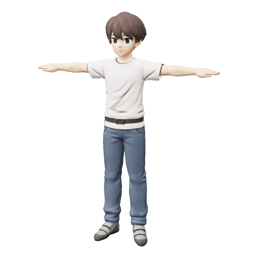

# Tripo 기본 클라이머

사용자가 제공한 정면·후면·좌우 T포즈 이미지 4장으로 생성한 기본 캐릭터다.

- GLB: `game/art/characters/climber_tripo_base.glb` (저장소 루트 기준)
- 참조 이미지: `references/front.jpg`, `left.jpg`, `back.jpg`, `right.jpg`
- 미리보기: `preview.png`
- 생성 기록: `task.json`
- 생성 모델: Tripo v3.1 (`v3.1-20260211`), 멀티뷰 생성 1회, 실제 비용 30크레딧

카툰풍 남성, 흰 반팔, 청바지, 회색 클라이밍화, 오른쪽 허리 뒤 회색 초크백이 사용자 요구다. 원본의 팔다리 비율과 과하게 뾰족하지 않은 머리를 기준으로 생성했다.

검증 범위: 생성 성공, GLB v2 헤더·선언 파일 길이 검사, 복사본 SHA-256 일치, 정면 미리보기에서 T포즈와 의상·머리 형태 확인. 뒤쪽 초크백의 위치와 게임 엔진 임포트·기기 성능은 미검증이다.

이 GLB에는 텍스처가 포함되며 스킨·리그·애니메이션은 없다. 기존 `climber.glb`의 뼈 기반 표현에 연결하려면 리깅과 뼈 대응 작업이 필요하다. 이번 업로드는 기본 모델과 제작 자료의 보관 범위다.

