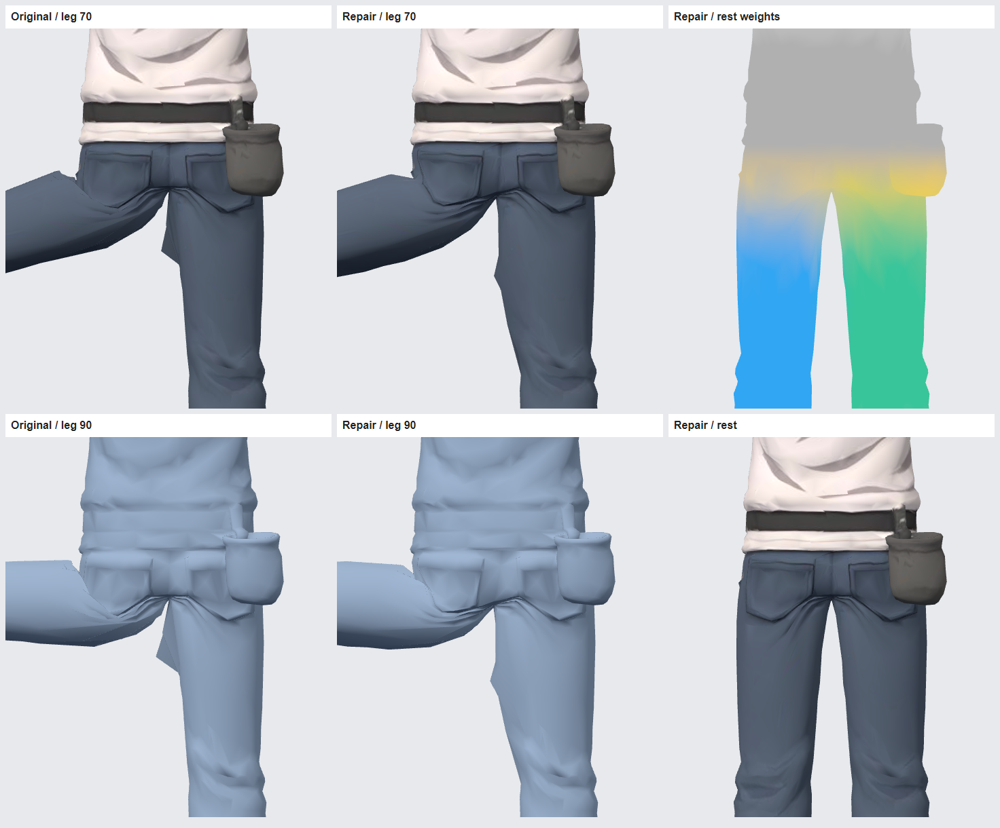
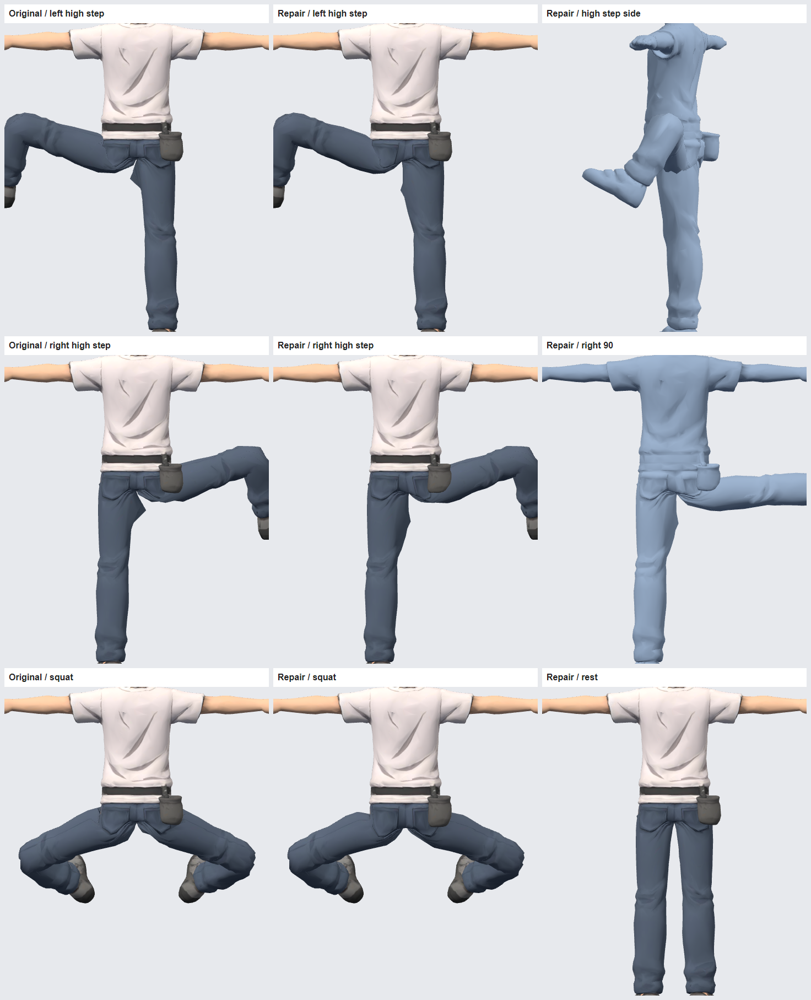

# 클라이머 골반 웨이트 수정본

사용자가 제공한 `climber_tripo_rig_wip.glb`의 엉덩이·허벅지 경계에서 생기는 급격한 접힘과 반대 다리의 삼각형 돌출을 줄였다. 완성 파일은 저장소 루트 기준 `game/art/characters/climber_tripo_rig_hipfix.glb`다.

## 적용

- 현재 WIP GLB를 읽는 모델 경로를 이 수정본으로 바꾼다. 원본과 뼈 이름·계층·바인드가 같아서 기존 WIP의 리그 대응을 그대로 사용할 수 있다.
- 수정본의 `hiphelp_L/R`는 호환성을 위해 남아 있지만 메시 웨이트는 0이다. 이 두 뼈에 대한 별도 추종·변형 코드는 필요하지 않다.
- 이 저장소 main의 실행 장면은 여전히 이전 CH01 모델을 사용한다. 사용자가 작업한 최신 Tripo 게임 연결 코드가 없어 실행 장면을 교체하지 않았다. 기존 CH01용 `climber.glb` 자리에 무조건 덮어쓰면 휴지 자세·재질 처리 차이가 생길 수 있다.

## 수정 내용

- 좁은 수평 띠에 몰린 허벅지→보조 뼈→골반 배분을 골반과 좌우 허벅지의 연속적인 배분으로 변경.
- 골반 전환 구간에서 표면 이웃을 따라 웨이트를 완화. UV 경계의 동일 위치 정점은 같은 결과를 사용하며, 가까운 정점의 영향은 거리 제곱의 역수로 가중해 미세한 모서리가 과도하게 늘어나는 것을 줄임.
- 좌우 중앙은 부드럽게 연결하고 오른쪽 뒤 초크백 위치에는 골반 영향력을 높임.
- 메시 위치·노멀·UV·삼각형·텍스처·뼈·바인드 행렬은 원본과 동일. 변경 대상은 스킨 웨이트와 해당 관절 인덱스다.
- Tripo 재생성 없음, 추가 크레딧 0.

## 검증

`source.glb`는 첨부 원본의 복사본이다. 같은 카메라·재질·관절 각도에서 원본과 수정본을 비교했다. 전체 메시: 12,000 삼각형, 내보낸 정점 8,492개, 뼈 21개.

| 테스트 자세 | 골반 구간 모서리가 휴지 길이의 2배 초과: 원본 → 수정본 |
| --- | --- |
| 왼쪽 다리 옆 벌림 70° | 7 → 0 |
| 왼쪽 다리 옆 벌림 90° | 20 → 0 |
| 왼쪽 높은 발 올리기 테스트 | 36 → 2 |
| 오른쪽 높은 발 올리기 테스트 | 33 → 0 |
| 양다리 굽힘 테스트 | 46 → 4 |

집계는 휴지 위치 `-0.15 < y < 0.20`, `abs(x) < 0.23`에 두 끝점이 들어오는 2,552개 인덱스 모서리를 기준으로 한다. UV 경계의 중복을 제거한 지표는 아니며, 모서리 길이는 시각적 품질이나 부피 보존을 직접 측정하지 않는다.

- Khronos glTF Validator: 오류 0. 원본에도 있는 `NODE_SKINNED_MESH_NON_ROOT` 경고 1건만 유지. 새 경고 없음.
- 웨이트 유한값·비음수·합 1 확인, 최대 합 오차 약 4.0e-8.
- 뼈 및 바인드, 정점·노멀·UV·인덱스·텍스처 원본 일치 확인.
- 별도 Three.js 렌더에서 좌우 벌림, 높은 발 올리기, 양다리 굽힘, 휴지 자세 비교.
- 미검증: 최신 Godot 실행 장면, 실제 모바일 기기, 모든 회전·비틀림 조합. 기준 이미지 3·4와 같은 포즈·카메라에서의 최종 아트 검수는 아직 하지 않았다. 큰 굽힘에서는 의상 접힘이 남으며 이를 전부 제거한 모델이라고 보장하지 않는다.





## 재현

이 폴더에서 Node.js로 실행한다.

```powershell
npm ci --no-audit --no-fund
node repair.mjs
node validate.mjs
node render.mjs
node render.mjs --extended
```

`repaired.glb`가 생성된다. 렌더 스크립트는 Windows의 `C:/Program Files (x86)/Google/Chrome/Application/chrome.exe`를 헤드리스로 사용한다. 다른 환경은 해당 경로를 변경해야 한다. `repair.mjs --helper`는 비교 실험용 분기이며 납품본은 인자 없이 생성한 파일이다.

수정본 SHA-256: `c46b952315271030c46e8cad33c01251c525a7100e2fe0222459e3231d74f184`.
