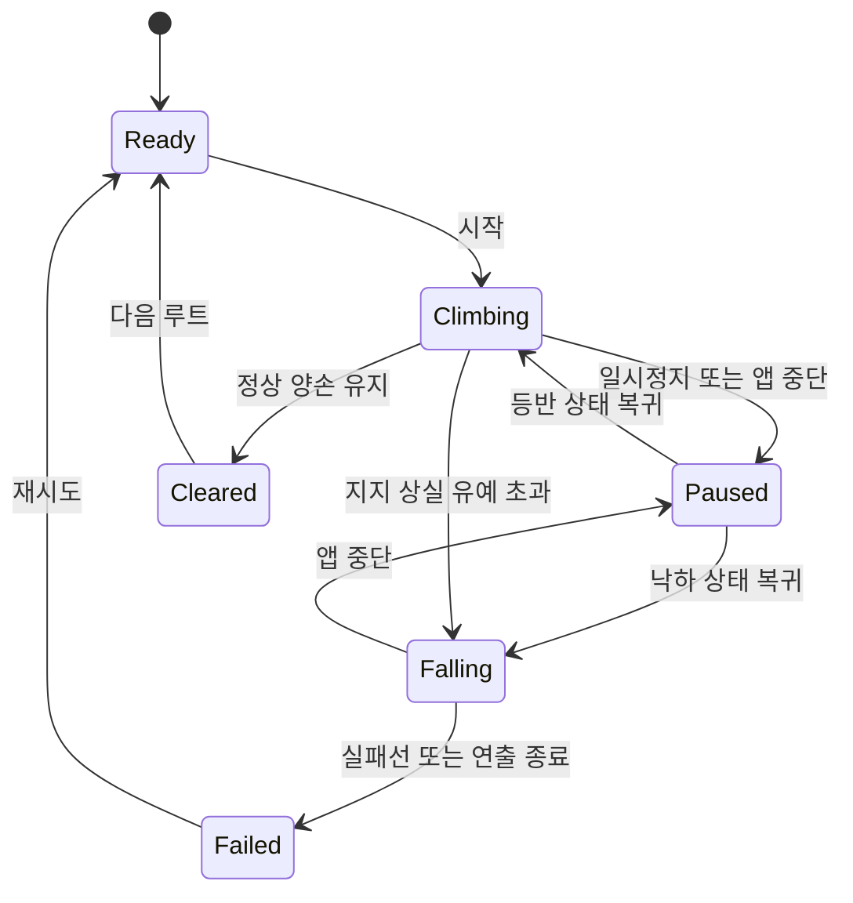

# 02. 게임 규칙

설계 제안. 판정 수치의 기준 문서는 [04. 자세·물리](04_pose_and_physics.md)다.

## 기본 순환

루트를 살핀다 → 움직일 손 또는 발의 패드를 누른다 → 드래그로 다음 홀드를 가리킨다 → 손가락을 떼어 잡는다 → 새 지점에 맞춰 몸통이 안정된다 → 반대쪽 손발을 옮긴다 → 정상 홀드를 양손으로 잡아 완등한다.

캐릭터를 위로 밀어주는 별도 이동 버튼은 없다. 플레이어가 정하는 것은 네 말단의 위치이며, 몸통과 관절은 그 접점에서 가능한 자세를 계산해 따라온다. 다음 홀드를 자동으로 고르거나 손발을 대신 옮기지 않는다.

## 손발과 홀드

| 요소 | 규칙 |
| --- | --- |
| 손 | 손 허용 슬롯을 잡는다. 벽 위에서 몸을 유지하려면 최소 한 손이 필요하다 |
| 발 | 발 허용 슬롯을 디딘다. 위에서 누르는 방향의 지지만 제공한다 |
| 일반 손홀드 | 한 손 슬롯 1개. 다른 손과 공유 불가 |
| 발판 | 한 발 슬롯 1개. 손 사용 불가 |
| 공용 홀드 | 명시된 손 슬롯과 발 슬롯을 독립 제공. MVP는 콘텐츠에서 최소 사용 |
| 정상 홀드 | 서로 다른 두 손 슬롯. 양손이 모두 잡고 목표 시간 유지 시 성공 |
| 시작·휴식 플랫폼 | 별도 바닥 지지 구역. 발만으로 서는 상태 허용 |

단순히 화면에서 겹쳐 보인다고 잡히지 않는다. 실제 도달 거리, 허용 손발 종류, 슬롯 여유, 캐릭터 전체 자세가 모두 유효해야 한다. 홀드의 메시는 외형이고 판정은 별도 슬롯·접촉 영역이 기준이다.

## 잡기와 놓기

1. 붙어 있는 팔다리의 패드를 누르기만 하면 기존 홀드가 유지된다.
2. 드래그가 의도 판정 거리를 넘을 때 해당 팔다리만 홀드에서 분리된다.
3. 드래그 중에는 도달 가능 영역과 가장 가까운 유효 후보를 표시한다. 아직 잡힌 상태가 아니다.
4. 손가락을 정상적으로 떼는 순간 후보를 다시 검사하고 유효하면 고정한다.
5. 유효하지 않으면 자유 상태로 남는다. 멀리 있는 홀드나 이전 홀드로 순간 이동시키지 않는다.
6. 잡기가 끝난 뒤 터치를 유지할 필요는 없다. 다시 누르고 움직여야 해당 팔다리가 떨어진다.

네 팔다리 동시 이동은 가능하다. 네 개를 모두 분리하면 지지가 없어지므로 추락할 수 있다. 튜토리얼에서 안전한 연습 구간으로 이 규칙을 먼저 보여준다. 시스템이 임의로 마지막 손을 잠그지는 않는다.

## 몸통 이동과 발의 역할

높은 손홀드를 잡으면 몸통이 가능한 범위에서 위로 당겨지고, 발을 높여 놓으면 다리를 펴기 좋은 위치로 골반이 올라간다. 모든 기존 접점을 유지할 수 있는 범위에서만 이동한다. 한 손을 멀리 뻗는 것만으로 무한 상승할 수 없고, 발을 바꾸지 않으면 높은 지점에서 이동이 막히거나 팔 피로가 커진다.

정지한 같은 접점에 계속 재접촉해도 목표 자세는 변하지 않는다. 팔·다리 길이를 늘려 도달시키거나 몸통을 홀드 너머로 순간 이동시키지 않는다. 물리적 정확성보다는 읽기 쉬운 조작과 일관된 결과를 우선하는 게임용 자세 모델이다.

## 피로

- 왼손·오른손에 피로 여유 0~100을 각각 둔다. 발에는 별도 체력 게이지가 없다.
- 발을 충분히 지지하고 안정된 자세이면 회복한다. 발 없이 팔로 버티거나 한 손만 남으면 더 빨리 줄어든다.
- 자유 상태의 손은 회복한다. 같은 홀드를 빠르게 놓았다 잡는 것으로 수치를 초기화하지 않는다.
- 경고 임계치 아래에서는 손 아이콘, 짧은 사운드, 선택적 진동을 제공한다.
- 붙어 있는 손의 수치가 0이면 그 손이 미끄러진다. 반대 손이 남으면 바로 실패하지 않고 다시 잡을 수 있다.
- 튜토리얼/연습 보조에서는 피로 소모를 끌 수 있다. 일반 기록과 보조 기록은 구분한다.

## 상태와 판정

| 사건 | 판정 |
| --- | --- |
| 손 없음·플랫폼 밖 | 골반을 멈춘 Grace에서 9개 연속 무지지 틱(0.15초)이 확정되면 Falling |
| 손 하나 또는 유효한 플랫폼 지지가 남음 | 남은 접점에서 가능한 자세 유지. 접점 수만으로 일괄 실패시키지 않음 |
| 도달 불가능한 새 접점 | 잡기 거부. 기존 접점은 유지 |
| 지속적인 자세 제약 오류 | 정상 게임 규칙과 구별해 진단. [04](04_pose_and_physics.md)의 복구 규칙 사용 |
| Falling 진입 | 이번 시도는 되돌릴 수 없음. 공중 재잡기·점프는 MVP 제외 |
| 실패 | 실패선을 지나거나 추락 연출 최대 1초 후 결과. 긴 낙하 대기 없음 |
| 정상 성공 | 두 손이 지정 정상 슬롯을 잡고 0.6초 연속 유지, Falling 아님 |
| 앱 중단·알림·전화 | 자동 일시정지. 기술적 입력 취소를 손을 놓은 행동으로 해석하지 않음 |

정상 유지 카운트는 같은 물리 틱에서 피로·지지 판정을 마친 후 증가시킨다. 추락 판정과 성공이 겹치면 추락이 우선한다. 일시정지 중에는 시간·피로·성공 유지 시간이 흐르지 않는다. Grace 중에는 말단 입력과 잡기를 허용하고, Falling 진입 후에는 모든 접점을 해제하고 잡기를 금지한다. 자세·사건·카운트의 정확한 확정 순서는 [15. 실행 규칙](15_runtime_contract.md)을 따른다.

## 목표, 보상, 진행

일반 루트의 메달 3개는 각각 완등, 해당 시도 무추락, 목표 시간 이내 완등이다. 완등은 다음 루트를 연다. 첫 두 메달의 조건이 짧은 루트에서 겹칠 수 있지만, 체크포인트가 있는 루트에서는 구분된다. 시간 메달은 숙련자에게만 선택 목표이며 진행을 막지 않는다.

재시도는 새로운 시도다. 체크포인트에서 이어가면 같은 시도의 추락 횟수는 유지한다. 무추락 메달을 원하면 루트 처음부터 재시도한다. 기록 시간에는 정상 플레이 시간과 체크포인트 복귀 전 추락 연출을 포함하며 일시정지·메뉴 시간은 제외한다.

보조 모드로 완등해도 다음 루트는 열린다. 보조 여부·설정 버전과 함께 최고기록을 분리한다. 보조 모드를 중간에 켜면 해당 시도 전체를 보조 기록으로 분류하며 중간에 꺼도 일반 기록으로 돌아오지 않는다. 기본 색상은 처음부터 제공하며 두 번째 색상은 R03, 세 번째 색상은 R09 완등으로 해금한다. 능력치는 바뀌지 않는다.

앱 프로세스 종료 또는 내부 오류로 과거 안전 자세를 복원한 시도는 recovered로 분류한다. 완등·다음 루트·외형 해금은 인정하지만 무추락·시간 메달과 최고 시간은 갱신하지 않는다. 정확한 현재 상태를 보존한 일반 일시정지는 이 제한을 받지 않는다. 체크포인트에서 정상적인 게임 실패 후 다시 진행하는 것은 복구 기록이 아니라 같은 시도의 계속이며 추락 수와 시간을 유지한다.

## 체크포인트

T01~T03은 단계별 재시작 지점을 두고, 일반 루트는 R06과 R09에만 중간 플랫폼을 둔다. 지정된 두 발의 플랫폼 지지와 정지 자세가 0.6초 유지되면 한 번 활성화한다. 저장 대상은 체크포인트 ID와 시도 메타데이터이며 복귀 자세는 검증된 콘텐츠 정의를 사용한다. 임의의 공중 자세는 저장하지 않는다. 체크포인트 복귀는 네 접점·몸통·속도 0·손 피로 100을 복원하지만 추락 횟수와 누적 시도 시간은 되돌리지 않는다.

## 난이도 조절

첫 단계는 큰 홀드, 짧은 거리, 회복 플랫폼으로 구성한다. 이후 거리, 좌우 이동, 발 교체 순서, 한 손 버티기, 피로 관리 중 한 요소씩 늘린다. 숨겨진 홀드, 불명확한 충돌, 갑작스러운 카메라 회전으로 난이도를 높이지 않는다.

연습 보조는 도달 범위 항상 표시, 피로 소모 끄기, 후보 반경 확대 중 선택할 수 있다. 실제 팔·다리 길이와 홀드 위치는 바꾸지 않는다.
