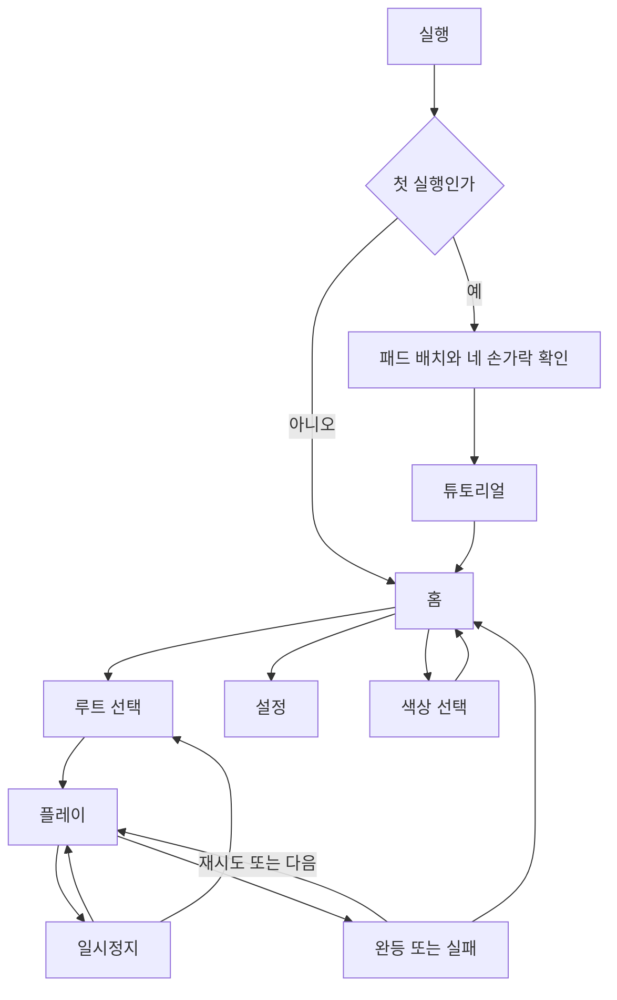
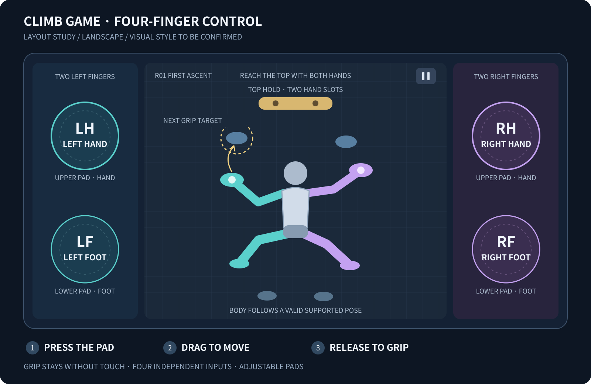

# 05. 화면·UX 설계

배치·카메라·튜토리얼 UX의 기준 문서다. 상태별 버튼, 설정 기본값·적용/취소, 실제 안내 문구는 [18. 화면 명세](18_screen_spec.md)에 구체화했다.

## 화면 흐름

## 플레이 화면

위 이미지는 정보 배치용 벡터 와이어프레임이다. 캐릭터·재질·조명·색감이 실제 목표 아트를 뜻하지 않는다.

가로 안전영역을 기준으로 왼쪽 패드 구역 22%, 중앙 벽 56%, 오른쪽 패드 구역 22%를 시작점으로 한다. 캐릭터와 다음 홀드는 중앙 구역에 배치한다. 위쪽 패드는 손, 아래쪽 패드는 발이다. 실제 화면에서 손목 자세를 확인한 뒤 위치를 조정할 수 있다.

| 요소 | 위치/내용 | 입력 규칙 |
| --- | --- | --- |
| 루트·도달 높이 | 중앙 상단 왼쪽 | 터치 대상 아님. 18의 정보용 높이 표시 |
| 일시정지 | 중앙 상단 오른쪽 | 패드와 겹치지 않는 단일 버튼 |
| 손 피로 | 좌우 손 패드 테두리 + 숫자 선택 표시 | 색·패턴·짧은 경고를 함께 사용 |
| 패드 4개 | 좌우 손/발 두 쌍 | 반투명 표시, 접점 유지/이동 상태 구분 |
| 도달 영역 | 활성 말단 주변 | 기본은 조작 중, 설정으로 항상 표시 가능. 기록 자격 영향 없음 |
| 홀드 후보 | 말단 가까운 슬롯 | 실선 테두리 + 손/발 표식 |
| 실패 위험 | 캐릭터 주변 작은 표식 | 1개 핵심 원인만 먼저 표시 |
| 목표 시간 | 기본 화면에서 숨김, 설정으로 표시 | 첫 플레이 압박 줄이기 |

UI 설계 좌표는 1600×900을 작업 기준으로 하되 실제 렌더 해상도를 고정하지 않는다. 패드 지름은 논리 160단위에서 시작한다. 6.2인치급 휴대폰(가로 안전영역 약 147×68mm)에서는 약 12mm로 계산되므로, 14~20mm 목표를 유지하려면 기본 지름 상향이 필요하다. 기본값은 G1 실측으로 확정한다([23](23_dev_readiness_review.md)). 장치 DPI를 정확하다고 가정하지 않고 사용자 크기 조절과 실물 기기 평가를 병행한다. UI 버튼은 논리 48단위 이상 히트영역을 내부 목표로 사용한다. 이는 OS의 dp/pt와 자동으로 같은 값이라는 뜻이 아니다.

노치·홈 제스처 안전영역을 제외한 뒤 레이아웃을 계산한다. 16:9, 19.5:9, 20:9, 태블릿 4:3에서 중앙 벽의 도달 판정은 같아야 한다. 넓은 화면에서 난이도가 낮아지지 않도록 월드 가시 폭과 루트 논리 폭을 분리한다. 작은 화면에서 네 패드가 겹치면 지원 한계와 패드 크기를 재검토한다.

### 패드 배치의 숫자 기준

안전영역 좌상단을 (0,0), 우하단을 (1,1)로 한 정규화 좌표를 사용한다. 기본 패드 중심은 LH=(0.11,0.30), LF=(0.11,0.72), RH=(0.89,0.30), RF=(0.89,0.72)다. 저장하는 위치는 이 비율 좌표이고 지름은 UI 논리 단위다. 03의 균일 배율로 실제 픽셀 지름을 계산한다.

패드 크기는 120~220 논리 단위, 패드 사이 빈 간격과 안전영역 바깥쪽 여유는 각각 최소 24단위를 유지한다. 손 패드와 발 패드의 위아래 순서는 바꾸지 않는다. 좌우 패드 원 전체가 각 22%의 측면 구역 안에 들어오도록 제한한다. 동일 측면에서 손·발 원이 가까워지면 먼저 이동을 제한하고, 레이아웃 변경으로 둘 다 들어갈 수 없으면 지름을 허용 최솟값까지 줄인다. 그래도 불가능하면 기존 설정을 억지로 적용하지 않고 배치 재설정 화면을 연다.

위치 미리보기의 패드는 실제와 같은 히트영역을 사용한다. 화면의 픽셀 수나 임의 DPI만으로 물리적 편안함을 보증하지 않는다. G1에서 기본 위치와 대각선 배치를 한 번에 한 요소씩 비교한다.

### 가시영역과 카메라

중앙 구역 안에 월드 폭 3.4m·높이 3.8m의 고정 비율 플레이 창을 맞춘다. 창의 픽셀 배율은 중앙 폭/3.4와 가용 높이/3.8 중 작은 값이다. 남는 공간은 비상호작용 배경으로 채우고 추가 홀드나 더 넓은 경로를 보여주지 않는다. 기기 종횡비 때문에 캐릭터의 도달 범위나 다음 홀드가 더 많이 보이는 차이를 줄인다.

몸통의 화면 Y가 위에서 50~68% 안에 있으면 카메라를 유지한다. 벗어나면 골반이 화면 62% 높이에 오도록 상하 추적한다. 목표 카메라 중심 Y는 골반 Y+0.12×3.8m이며, 보정 이득 8s⁻¹과 최대 2m/s를 적용한다. 벽 하단/상단 경계에서는 이 범위를 제한한다. 벽이 3.8m보다 낮으면 빈 배경을 허용하고 확대하지 않는다. 카메라 회전·좌우 추적·자동 줌은 없다.

일시정지·준비 카운트·결과에서는 카메라를 고정한다. 체크포인트 복귀 시 새 자세에 맞춰 카메라와 보간을 즉시 재설정하되 화면 전환으로 감싼다. 이전 낙하 위치에서 체크포인트까지 긴 스크롤을 재생하지 않는다.

## 화면별 명세

| 화면 | 주요 정보 | 행동 | 예외 |
| --- | --- | --- | --- |
| 첫 실행 | 기기를 놓는 자세, 좌우 손발 대응 | 패드 배치 → 4개 터치 확인 | 4개가 안 잡히면 설정/장치 확인 및 재시도 |
| 홈 | 유효 중단 세션의 이어하기, 최근 루트, 연습, 설정 | 재개와 새 시작을 구분 | 복구 기록 적용 시 안내 |
| 루트 선택 | 난이도, 학습 요소, 메달, 보조 기록 | 잠금 해제 루트 시작 | 미해금은 조건 표시 |
| 플레이 | 말단 상태, 후보, 피로, 목표 | 네 팔다리 조작 | 중단 시 자동 일시정지 |
| 일시정지 | 재개, 처음부터, 루트 선택, 설정 | 등반 재개는 준비 카운트 후 | 처음부터/홈/목록 이동은 현재 시도 포기 알림 |
| 실패 | 원인, 도달 높이, 재시도 | 체크포인트/처음부터 선택 | 광고나 네트워크 대기 없음 |
| 완등 | 메달, 시간, 추락 수, 기록 구분 | 다음 루트, 재시도 | 마지막 루트는 완료 화면 |
| 설정 | 패드·감도·사운드·진동·그래픽·보조 | 미리보기와 기본값 복원 | 진행 초기화는 별도 확인 |
| 색상 선택 | 기본색·R03/R09 해금색 | 미리보기 후 적용 | 잠금 조건 표시, 판정·능력치 변화 없음 |

## 튜토리얼 동작

튜토리얼 단계 ID·안내·완료 조건·실패 복귀의 단일 기준은 [16. 스테이지 제작 명세](16_stage_specs.md)의 T01-A~T03-E다. 첫 실행의 "네 패드 동시 터치 확인"만 이 문서의 첫 실행 화면에서 처리한다.

한 번에 한 문장과 한 행동만 안내한다. 팝업이 손가락 이동 경로를 가리지 않는다. 튜토리얼은 언제든 재실행 가능하다. 네 손가락 동시 사용은 준비에서 검증하지만 모든 퍼즐이 네 팔다리 동시 분리를 요구하지 않는다.

## 피드백과 오류 문구

| 상태 | 표시 | 짧은 문구 |
| --- | --- | --- |
| 유효 후보 | 실선 링 + 작은 슬롯 아이콘 | “놓으면 잡기” |
| 거리 부족 | 점선 도달 경계 | “몸을 더 가까이 옮겨보세요” |
| 다른 팔다리가 점유 | 슬롯 점유 아이콘 | “이미 사용 중이에요” |
| 발 지지 불가 | 발 아이콘 윤곽선 | “이 자세에서는 발로 받칠 수 없어요” |
| 손 피로 낮음 | 패턴 펄스 + 선택적 짧은 진동 | “발로 받치거나 손을 쉬게 해주세요” |
| 시스템 중단 | 일시정지 화면 | “준비되면 이어서 시작해요” |
| 수치 오류 | 복구 화면 | “자세를 복원하지 못했어요. 다시 시작할 수 있어요.” |
| 앱 재실행 후 CP 복귀 | 이어하기 안내 | “안전한 지점에서 이어갑니다. 완등 진행도만 반영돼요.” |
| 복구 후 완등 | 결과 기록 종류 | “복구 후 완등 · 진행도 반영” |

플레이 중 같은 경고를 매 프레임 출력하지 않는다. 상태 변경 시 한 번 표시하고 반복 경고 쿨다운을 둔다. 중요한 판정은 진동이나 소리만으로 전달하지 않는다.

완등 결과는 일반·보조·복구를 구분하고 [15의 기록 자격표](15_runtime_contract.md)를 따른다. 복구 시도에서 비활성인 무추락/시간 메달에 실패 표시를 넣지 않고 “이 시도에서는 기록하지 않음”을 표시한다. 세이브 오류는 게임 실패와 구분한다. 상세 튜토리얼 전이·힌트 조건은 [16](16_stage_specs.md)에 있다.

## 접근성과 설정

- 좌우 구분은 색, 손/발 아이콘, LH/LF/RH/RF 문자 중 필요한 조합을 쓴다.
- 패드 위치·크기·불투명도·감도를 조절하고 프로필을 저장한다. 패드가 겹치거나 안전영역을 벗어나는 설정은 막는다.
- 색각 보조 팔레트, UI 확대, 카메라 흔들림 끄기, 진동 끄기, 배경음/효과음 분리 볼륨을 제공한다.
- 네 손가락 조작이 불편한 사용자는 같은 네 패드를 순차 사용해도 된다. 팔다리 자동 조작은 없다.
- 제한된 손가락 수를 위한 전용 모드, 외부 컨트롤러, 스크린리더로 가능한 전체 플레이는 후속 범위다. 지원하지 않는 접근성을 이미 제공한다고 표시하지 않는다.
- 폰을 놓는 자세의 적합성을 G1에서 먼저 확인한다. 휴대 상태의 편의성이 필수라는 피드백이 나오면 조작 배치를 재설계한다.

## v0.5 자세 제한 표시

[25](25_movement_constraints_and_moves.md)의 표시 규칙을 따른다. 도달 원을 전체 허용 영역처럼 그리지 않고, 실제 가능 영역·체중 이동 후 접근 영역·관절/충돌 경계를 구분한다. Attached 발과 Loaded 발, Free/Flag를 서로 다른 아이콘으로 표시한다. 신체 좌우 ID는 교차 자세에서도 유지한다.

T02에서는 “발을 댔어요”와 “발에 체중을 실었어요”를 구분한다. 제약 안내는 거리·관절·몸통 방향·충돌·하중 중 하나를 우선 설명하며 25의 사유 ID와 연결한다. 게임 내부의 솔버·Quaternion·힘 계수는 플레이 UI 문구에 노출하지 않는다.
