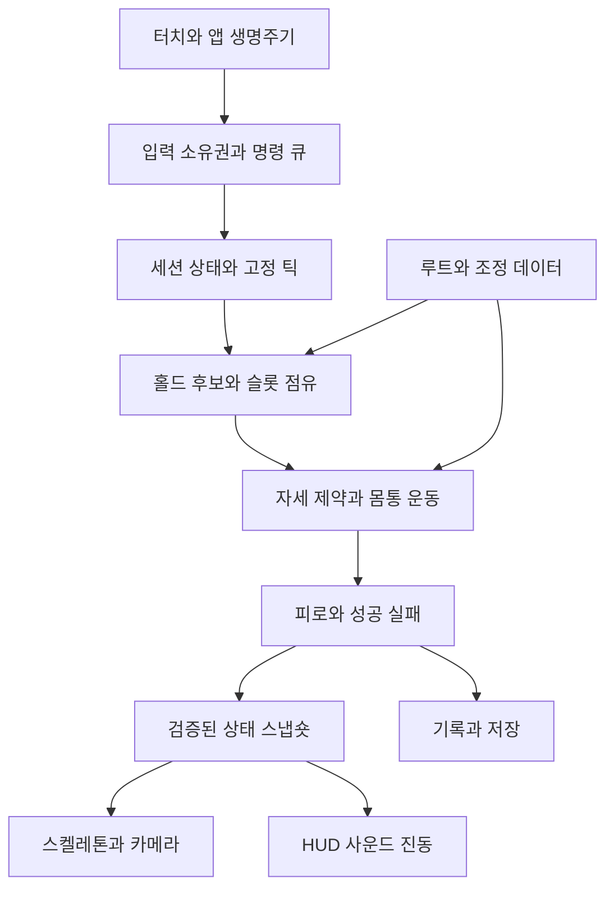

# 08. 기술 설계

모든 모듈·경로·흐름은 구현 예정 설계다. 현재 저장소에는 실행 프로젝트가 없다.

## 기술 선택

| 항목 | 제안 | 이유/유의점 |
| --- | --- | --- |
| 엔진 | Godot 4.7.2 stable | 공식 안정 릴리스 확인. 착수 시 패치·내보내기 버전 재확인 후 고정 |
| 언어 | GDScript | 작은 프로젝트에서 엔진 통합·반복 수정 단순화 |
| 화면 | 3D 캐릭터·벽 + 고정 후면 정사영 카메라 | 깊이감과 자유로운 팔다리 자세 표현 |
| 게임 판정 | 벽면 2D 자세/접점 | 3D 자유 이동·자유 카메라의 입력 부담 축소 |
| 렌더러 | Mobile을 우선 검증 | 고정 시점 모바일 3D를 위한 시작점 |
| 저사양 대안 | Compatibility 별도 평가 | 동일한 화면이 자동 보장되지 않으므로 별도 시각·기능 검증 |
| 플랫폼 | Android 첫 내부 빌드 | 실제 네 손가락 검증을 가장 먼저 수행 |
| 저장 | 버전 있는 로컬 저장 | 계정·백엔드 없이 완결 |
| 콘텐츠 | Godot Resource 계열의 타입 데이터 제안 | 편집기에서 루트와 조정값 관리 |
| 모델 납품 | glTF/GLB | 리그·애니메이션·단위가 검증된 엔진용 자산 |

Godot 선택은 이 프로젝트의 추천안이다. 고품질 아트를 엔진만으로 보장하지 않는다. 대형 자유 카메라 3D, 고급 렌더 파이프라인, 팀 내 기존 엔진 자산이 필수로 확인되면 엔진 선택을 재검토한다. Unity로 변경할 때도 입력·게임 규칙·데이터 계약은 유지할 수 있게 분리한다. 두 엔진의 최신 라이선스나 비용 비교는 이번 조사 범위가 아니다.

공식 지원 사실과 자체 설계를 구분한다. 터치 API, 렌더러, 내보내기, 스켈레톤은 [13. 공식 근거](13_references.md)를 따른다. 자세 해법·숫자·모듈 구조는 이 게임을 위한 제안이며 엔진의 기본 기능처럼 서술하지 않는다.

## 구성과 책임

| 모듈 | 소유 데이터/책임 | 하면 안 되는 일 |
| --- | --- | --- |
| InputRouter | 포인터 소유권, 입력 세대, UI/게임 분기 | 신체를 직접 이동하거나 피로 변경 |
| LimbIntent | 누적 드래그 목표, 선택/해제 요청 | 슬롯 강제 점유 |
| GripSystem | 후보, 슬롯 점유, 다중 잡기 거래 | IK가 보인다는 이유로 성공 판정 |
| PoseSolver | 골반·말단의 유효 자세, 지지 발 | 다음 홀드 자동 선택 |
| RuleSystem | 피로, 지지 유예, 성공/실패/메달 | UI 프레임에 따른 시간 계산 |
| SessionController | Ready/Climbing/Paused/Falling/결과 전환 | 저장 내용 무검증 적용 |
| CharacterPresenter | IK, 보조 애니메이션, 시각 효과 | 접점·판정 상태 덮어쓰기 |
| CameraController | 가시영역과 상하 추적 | 입력 월드 목표 변경 |
| FeedbackPresenter | 상태 차이에 따른 UI·소리·진동 | 후보만 보고 실제 잡기 사운드 발생 |
| SaveService | 버전·백업·원자적 저장 | 매 프레임 동기 쓰기 |
| ContentValidator | ID·범위·참조·초기 자세 확인 | 정적 검증만으로 완등 보증 |

게임 상태의 최종 권한은 고정 틱의 Session/Grip/Pose/Rule 계층에 둔다. UI·애니메이션·오디오가 같은 값을 별도로 갖고 판정하지 않는다. 복제된 표시값은 스냅숏에서 읽기 전용으로 받는다.

## 처리와 성능

- 물리·게임 규칙은 60Hz 고정 틱. 30FPS 품질 모드에서도 규칙 틱은 유지한다.
- 입력은 이벤트 단위로 수집하고 순서를 보존한다. 한 틱 안의 이동량은 터치별로 합산하되 press/release/cancel 경계를 합치지 않는다.
- 여러 잡기는 같은 틱의 제스처 배치에서 원자적으로 평가하고, 피로·상태 전환을 포함한 틱이 유효할 때 외부 이벤트를 확정한다. 슬롯 점유와 상태 변경 이벤트가 서로 어긋나지 않게 한다. 동일 팔다리의 새 제스처 경계는 [15](15_runtime_contract.md)를 따른다.
- 렌더링은 검증된 이전/현재 스냅숏을 보간한다. 직접 조작하는 목표 표시는 지연을 줄일 수 있지만 실제 손발 판정과 다르게 성공을 예고하지 않는다.
- 순간적으로 밀린 틱을 무제한 따라잡지 않는다. 프레임당 catch-up 상한은 4틱으로 평가하고, 시간 부채 0.10초 초과 또는 전경 업데이트 간격 0.25초 초과는 자동 일시정지로 처리한다. 누적 시간을 조용히 버려 타이머와 게임 속도를 다르게 만들지 않는다.
- 렌더 FPS를 낮춰도 이동 거리, 피로, 성공 유지 시간이 변하면 안 된다. 기기 간 비트 단위 결정론은 목표가 아니며 동일 시나리오의 허용 오차를 검증한다.
- 화면 가까운 홀드만 검색하되 MVP에서는 수십 개 후보를 단순 검색한 비용을 먼저 측정한다. 필요할 때 공간 격자 등으로 확장한다.
- 한 화면 캐릭터 1개를 전제로 한다. 멀티플레이 구조를 선행 구축하지 않는다.

## 카메라

카메라는 벽을 보는 후면 고정 정사영으로 시작한다. 상하 추적의 dead zone을 두어 손발을 옮길 때마다 흔들리지 않도록 한다. 캐릭터 몸통은 중앙 높이보다 약간 아래에 두고 위쪽에 다음 홀드가 보일 공간을 둔다. 화면 좌우 회전, 줌 제스처, 손가락으로 카메라 이동은 제외한다.

플레이 창은 월드 3.4×3.8m로 고정하고 중앙 구역에 균일 배율로 맞춘다. 추적 문턱·목표·속도는 [04](04_pose_and_physics.md), 패드·창의 화면 배치는 [05](05_screens_and_ux.md)에 정의한다. 종횡비에 따라 카메라의 시야나 입력 감도를 임의로 확장하지 않는다.

REF01에서는 원근감 있는 벽이 보이지만 이번 반영은 아트 표현에 한정한다. 기존 정사영·월드 창·입력 축은 유지하고 주변 구조물·면의 명암으로 공간감을 표현한다. [22](22_reference_art_direction.md)의 선·톤·재질 요구는 기술 구현 전의 목표다. 향후 원근 카메라로 변경하려면 터치 이동과 월드 거리의 관계·홀드 가시성을 별도 재검토한다.

## 구현 시 예상 파일 영역

| 미래 경로 | 목적 |
| --- | --- |
| game/scenes/ | 부트스트랩, 홈, 플레이, 결과 화면 |
| game/scripts/input/ | 터치 라우팅과 입력 명령 |
| game/scripts/climbing/ | 접점·자세·규칙 |
| game/scripts/presentation/ | IK·카메라·HUD·오디오 |
| game/scripts/persistence/ | 설정·진행 저장 |
| game/data/ | 루트·홀드·조정 프로필 |
| game/assets/ | 엔진에서 사용하는 모델·텍스처·음원 |
| art_source/ | 편집 원본과 제작 메모, 필요 시 대용량 관리 |
| tests/ | 입력·상태·저장·콘텐츠의 의미 있는 검증 |

위 경로는 이번 작업에서 생성하지 않는다. 외부 라이브러리·에디터 플러그인은 기본 엔진 기능으로 부족한 필요가 확인된 경우만 도입한다. IK 구현은 고정된 엔진 버전의 지원 API를 검토하고, 필요하면 작은 두 관절 해법을 구현하는 계획이다.

## 플랫폼·배포 계획

Android 내부 검증은 debug APK, 배포 검증은 서명된 릴리스 산출물을 사용한다. 에디터·내보내기 템플릿 버전을 맞추고 Android SDK·JDK·타깃 API는 고정 버전 공식 문서와 실제 배포일 정책을 함께 확인한다. 현재 문서에서 특정 스토어 제출 API 요건을 확정하지 않는다.

iOS는 후속 단계다. macOS의 전체 Xcode, 내보내기 템플릿, 서명·프로비저닝 준비가 필요하며 명령줄 도구만으로 완료된 것으로 보지 않는다(S05). 네 손가락 입력과 성능은 실제 iPhone/iPad에서 검증한다. 시뮬레이터 결과로 기기 품질을 보증하지 않는다.

서명키·비밀번호·스토어 인증서는 저장소에 커밋하지 않는다. 빌드 자동화는 구현이 시작되고 수동 내보내기가 재현된 뒤 계획한다. 버전별 엔진, 콘텐츠, 조정 프로필, 빌드 ID를 결과 화면의 정보 메뉴에서 확인할 수 있도록 한다.

## 목표 기기 범위의 결정

최소 OS·GPU·RAM을 아직 확정하지 않는다. Vulkan 지원 중급 Android 1대, 제조사/GPU가 다른 Android 1대, 상대적으로 낮은 성능 기기 1대를 테스트한 후 지원 하한과 렌더러를 확정한다. 선택적 저사양 Compatibility 빌드를 제공하려면 렌더러별 아트와 입력 검증까지 통과해야 한다. 옵션 이름만 추가해서 호환성을 보장하지 않는다.

백엔드, 클라우드 DB, 인증, 원격 설정은 MVP에 필요하지 않다. 추후 온라인 기록이 필요하면 부정행위 방지와 저장 계약을 별도 설계하며 로컬 기록을 신뢰할 수 있는 서버 점수로 바로 취급하지 않는다.
