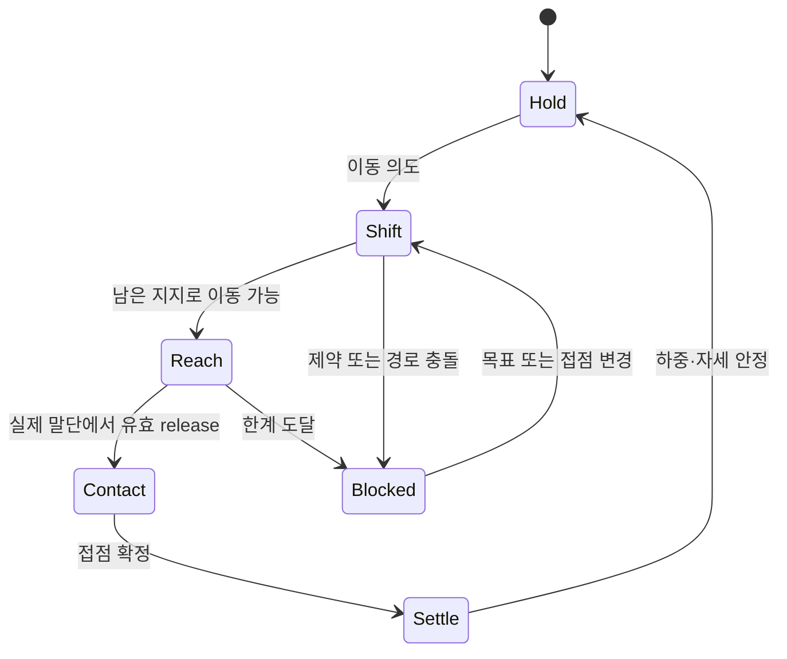

# 25. 자세에 따른 동작 제한·무브·검수 명세

설계 v0.5 · 2026-10-31(KST) · 구현 전 제안

## 목표

현재 손발 위치에 따라 **어디까지 움직일 수 있는지, 먼저 무엇을 옮겨야 하는지, 어떤 동작은 불가능한지**가 달라져야 한다. 플레이어는 네 패드로 손발을 조작하며, 시스템은 가능한 몸통 이동과 관절 자세를 계산한다. 정해진 애니메이션으로 홀드를 자동 완주하지 않는다.

현재 코드의 점검과 타 게임·실제 동작 근거는 [24](24_climbing_motion_research.md), 모든 판정 수치·회전·힘의 정의는 [04](04_pose_and_physics.md)가 기준이다. 아래의 허용/금지는 v0.5 목표 동작이며 현재 게임에서 확인한 결과가 아니다.

## 접점 조합별 기본 행동

접점 수는 첫 분류일 뿐이다. 각 행에서도 04의 하드 제약·하중 방향·균형·경로 검사를 통과해야 한다.

| 현재 접점 | 가능한 다음 행동 | 제한·위험 |
| --- | --- | --- |
| 손 2 + Loaded 발 2 | 한 손 뻗기, 발 높이기, 체중 이동, 조건부 손발 동시 이동 | 네 점이 모두 붙어 있으면 그 범위 안에서만 골반 이동. 자유 회전 없음 |
| 손 2 + Loaded 발 1 | 빈 발 이동·플래깅, 짧은 손 이동 | 손을 떼고 남는 손·발의 균형을 먼저 확인. 몸통이 지지 쪽으로 이동할 공간이 없으면 먼 뻗기 제한 |
| 손 1 + Loaded 발 2 | 자유 손 이동, 회복 가능한 자세 찾기, 조건부 발 교체 | 마지막 손을 놓으면 일반 벽에서는 Grace. 손의 피로와 허용 하중을 유지 |
| 손 1 + Loaded 발 1 | 균형을 만족하는 짧은 뻗기·플래깅·발 재배치 | 대각선 조합이 자동 안전한 것은 아님. 같은 쪽 조합도 일괄 금지하지 않음 |
| 손 2 + 발 지지 없음 | 짧은 양손 매달림, 발 복귀, 조건부 한 손 이동 | 팔 피로 증가, 발 없는 무한 상승 불가 |
| 손 1 + 발 지지 없음 | 몸이 손 아래의 허용 자세로 정렬되는 짧은 버티기·재잡기 | 긴 횡이동·회전으로 도달 거리 연장 금지. 불균형이면 Rebalancing |
| 손 0 + 일반 발만 있음 | 유예 안에서 손 재잡기 | 발에 매달리는 해 금지, Grace 9틱 |
| 지정 플랫폼의 양발 | 서기, 휴식, 손 재배치 | 플랫폼·발 방향·골반 위치·정지 조건 모두 필요 |

Loaded가 아닌 높은 발도 Attached 위치 제약은 유지한다. 이 발 때문에 골반이 움직일 수 없다면 “발을 올렸으니 무조건 일어선다”로 처리하지 않는다.

## 동작 단계

이 단계는 전신의 입력을 잠그는 순차 애니메이션 상태가 아니다. 말단별 이동 단계와 공유 몸통의 준비 상태를 구분한다. 한쪽 손이 Reach인 동안 다른 발의 요청도 함께 평가할 수 있다. 지원이 사라지면 위 단계보다 Grace/Rebalancing/Falling이 우선한다.

- Shift: 기존/남은 접점을 보존하며 골반을 이동한다. 분리된 접점을 유지한 척하지 않는다.
- Reach: 움직이는 말단은 허용 경로 안에서만 목표를 따른다.
- Contact: 화면상의 요청 목표가 아니라 실제 말단에서 잡기를 검사한다.
- Settle: 새 접점의 하중을 계산하며 몸통이 안정된다. 아직 Loaded가 아닌 발을 지지로 계산하지 않는다.
- Blocked: 정상 제약 결과다. 움직임을 경계에서 멈추고 다음 행동을 설명한다. 내부 오류로 간주하지 않는다.

## 기본 무브 목록

모든 무브에 H01~H07을 적용한다. “최소 세 접점 유지”를 전역 규칙으로 사용하지 않는다. 아래 필수 접점 수는 해당 무브의 제작 범위이며 다른 무브의 합법성을 결정하지 않는다.

| ID / 무브 | 진입 조건 | 진행·완료 | 제한·중단 |
| --- | --- | --- | --- |
| MV01 Reach — 기본 뻗기 | 움직일 손을 뺀 접점으로 균형을 유지하거나 정해진 Rebalancing 안에 회복 가능 | 골반을 허용 위치로 옮긴 뒤 손 이동, release에서 새 접점 | 반대 어깨 뒤로 돌리기·무한 원 궤도·길이 증가 금지 |
| MV02 HighStep — 높게 딛기 | 최소 한 손의 지지와 해당 발을 올릴 연속 경로 | 발을 높은 슬롯에 놓음. 아직 고관절보다 높으면 Unloaded | 발 접촉만으로 골반을 순간 상승시키지 않음 |
| MV03 Rockover / StandUp — 체중 이동·일어서기 | 목표 발이 Attached이고 골반을 그 발 위쪽으로 옮길 하드 제약 경로가 있음 | 몸의 중심을 옮기고 발 하중 증가 → 무릎이 펴지며 상승 | 손·다리 한계를 먼저 만나면 정지. 새 손/반대 발 재배치가 필요 |
| MV04 Traverse — 옆 이동 | 한 손 이상 유지, 이동 방향의 발 또는 손 지점에 실제 도달 가능 | 접점 교체와 골반 이동을 번갈아 수행 | 여러 접점을 그대로 둔 채 몸을 통과시켜 반대편으로 이동 금지 |
| MV05 LockOff — 짧게 당기기 | 한 손 이상 고정, 해당 손의 굽힘·하중 용량과 반대편 이동 경로 유효 | 잠시 팔을 접어 다른 손의 이동을 돕고 이후 발 지지·펴진 팔로 전환 | 무제한 당김이나 별도 상승 힘 없음. 정지해도 고하중이면 회복하지 않음 |
| MV06 Flag — 균형용 자유 발 | 한 손과 다른 Loaded 발 이상, 해당 발은 Free/Dragging, 요청 위치가 04의 Flag 방향·충돌 조건 안 | 자유 발 위치로 중심을 이동. UI 예고 후 release 시 Free/Flag 목표 유지 가능 | 홀드 접점·가상의 지지력 생성 금지. 균형을 개선하지 않는 자동 다리 뻗기 금지 |
| MV07 SideOn / DropKnee — 옆몸·드롭니 | 최소 한 손과 Loaded 발 2개, 회전할 발의 pivot_allowed=true, 옆몸 경로가 유효 | 골반·가슴을 제한 각도로 돌리고 같은 쪽 무릎을 연속적으로 아래로 정리 | 붙은 발목·무릎 twist 한계를 넘으면 진입 거부. 제한 각도 안에서만 가능 |
| MV08 CrossReach — 손 교차 | 반대 손이 붙어 있고 교차 경로의 깊이·관절·몸통 공간이 있음 | 움직이는 손이 반대쪽 슬롯으로 이동. L/R ID 유지 | 팔을 몸통이나 다른 팔 안으로 통과시키지 않음. 교차 후 되돌아올 경로도 필요 |
| MV09 HandMatch — 양손 모으기 | 한 홀드에 서로 다른 손 슬롯이 두 개 존재하고 둘 다 도달 가능 | 각각의 슬롯에 양손 고정 | 슬롯 1개를 양손 공유하지 않음. 일반 홀드에 숨은 두 번째 슬롯 추가 금지 |
| MV10 FootSwap — 발 바꾸기 | 교체 중 남은 손·발이 지지 가능, 들어올 발의 접근 경로 유효 | 기존 발 해제 → 빈 슬롯에 다른 발 접촉 → 하중 이전 | 같은 슬롯 동시 점유 금지. 외발/무발 순간의 위험·피로를 생략하지 않음 |
| MV11 Rest — 휴식 | 04의 안정·정지·손 하중 조건, 또는 유효 플랫폼 | 팔을 편한 길이로 유지하거나 자유 손 회복 | 붙은 발 2개라는 이유만으로 회복하지 않음. 높은 Unloaded 발은 제외 |
| MV12 DownClimb — 내려오기 | 아래쪽 목표로 이어지는 유효 지지·관절 경로 | 한 말단씩 낮은 접점으로 이동, 높이 기록은 기존 최댓값 유지 | 낙하 중 재잡기로 바꾸지 않음. 낮은 일반 손을 mantle처럼 사용하지 않음 |

### 무브 판별의 경계

무브 이름은 플레이어에게 강요하는 버튼이 아니다. 각 말단 의도와 자세의 특징으로 후보를 만든다.

- 손 목표가 반대 손의 X를 넘으면 CrossReach 후보, 같은 홀드의 별도 슬롯이면 HandMatch 후보가 된다. 두 경우 모두 실제 연속 경로를 검사한다.
- 발 목표가 현재 고관절 Y에서 0.20m 아래보다 높으면 HighStep 후보, 그 발의 하중이 늘면서 골반이 올라가면 Rockover/StandUp으로 이어진다.
- 이전과 같은 발 슬롯을 다른 발이 요청하면 FootSwap 후보다. 사용자 해제 없이 기존 발을 자동으로 떼지 않는다.
- 자유 발의 옆 이동이 중심 균형 비용을 줄이거나 Rebalancing 잔차를 낮추면 Flag 후보다. Attached 발을 자동으로 떼지 않는다.
- 옆몸은 입력 방향과 후보들의 하중·목표 비용으로 선택하며, 좌우 전환은 중립 자세를 거치는 연속 경로만 허용한다.
- 여러 후보가 겹치면 접점 교체 목적(Match/Swap), 교차, 높은 발, 일반 Reach/Traverse 순으로 설명 라벨을 정한다. 지지·회전 제약은 라벨과 무관하게 동일하다.

HighStep 문턱 0.20m, Flag 개선 최소 비용 0.02, 무브 전환 6틱은 04의 조정값으로 관리한다. 이 문구는 인체 동작 분류의 표준이 아니다.

> **구현 메모(2026-10-31):** 지지 계산이 벽면 내 근사라 Flag의 효과는 "무게중심을 지지선 쪽으로 옮겨 손 하중을 줄이는 것"으로만 나타난다. 벽 밖 회전(barn door)을 막는 효과는 모델에 없다. 측정상 같은 쪽 손·발 지지에서 몸이 지지선 바깥으로 약 0.2m 이상 벗어났을 때 안쪽 자유 발이 균형 비용을 0.02 이상 줄여 Flag 후보가 된다([23](23_dev_readiness_review.md)). MV07 SideOn/DropKnee는 yaw 미구현으로 아직 판별하지 않는다.

### Flag의 release와 복귀

일반적인 잡기 실패는 기존처럼 Free/Rest로 돌아간다. 단, 드래그 중 “균형 발” 예고가 있었고 release 시에도 Flag 조건을 통과하면 Free/Flag로 남는다. 별도 지지 접점·잡기 소리·슬롯 점유를 만들지 않는다. 터치를 계속 누르지 않아도 발 목표는 유지된다.

새 발 조작·정상 잡기는 Flag를 종료한다. 몸통 변화 때문에 원래 Flag가 불가능해지면 가까운 연속 유효 위치로 제한하고 균형을 재평가한다. 앱 중단 시 목표와 상태를 보존한다. 프로세스 재실행에서는 CP 복구 정책을 따르며 공중 Flag 자세를 영구 저장하지 않는다.

### 이번 버전에 포함하지 않는 동작

| 동작 | 제외 이유와 후속 조건 |
| --- | --- |
| Dyno·점프·공중 재잡기 | 두 손이 모두 떨어지는 비행은 계속 제외. **한 손 데드포인트는 v0.6에서 범위로 옮김**([27](27_technique_actions_design.md), [04 §10.5](04_pose_and_physics.md)) |
| Heel hook·Toe hook | 발의 당김·걸기·해제 하중을 지원하는 별도 접촉 유형 필요. v0.6 2차 범위(27) |
| Mantle·팔로 아래를 눌러 올라서기 | 일반 pull 손 슬롯과 힘 방향이 다름. 압축 손·플랫폼 전환 설계 필요 |
| Smear·벽을 밟는 마찰 지지 | 홀드 밖 접촉과 마찰 판정이 아직 없음. Flag를 smear로 가장하지 않음. v0.6 2차 범위(27) |
| 깊은 백스텝·완전 회전·캠퍼스 다이노 | 현재 관절·깊이·무지지 정책 밖. 캐릭터의 허용 범위만 늘려 추가하지 않음 |

## 상황별로 기대하는 결과

| 상황 | 원하는 반응 | 플레이어가 할 수 있는 해결 |
| --- | --- | --- |
| 손을 원형으로 계속 드래그 | 허용 방향 끝에서 멈춤. 골반·가슴·뼈 twist가 따라 누적 회전하지 않음 | 반대로 드래그하거나 다른 접점으로 자세 변경 |
| 손 두 개는 고정, 양발이 너무 낮음 | 먼 위쪽 손홀드는 경계 밖. 팔/골반만 비정상적으로 늘어나지 않음 | 한 발을 높인 후 체중을 싣고 다시 뻗기 |
| 발을 고관절보다 높이 올림 | 붙어 있지만 지지하지 않는 발 표시, 즉시 회복 없음 | 손·반대 발을 이용해 골반을 올릴 공간 확보 |
| 왼손·왼발에 체중이 몰림 | 중심과 하중에 따라 옆 이동 제한 또는 불안정 경고 | 자유 발을 균형 위치에 두거나 반대 접점 확보 |
| 양손 위치가 교차함 | 팔의 깊이 경로와 관절이 가능한 경우만 이동, 패드 ID 유지 | 먼저 골반·발을 옮기거나 낮은 경로로 손 이동 |
| 발끝은 고정인데 몸통을 크게 돌림 | 발목·무릎·골반 중 먼저 닿은 제한에서 정지 | 발을 해제·재배치하거나 pivot 허용 홀드 이용 |
| 힘이 없는 자세에서 마지막 손을 뗌 | 해제는 반영, 유효 지지가 없으면 Grace, 만료 후 낙하 | 유예 안에 실제로 닿는 손 슬롯을 재잡기 |
| 먼 홀드에 목표 링만 닿고 release | 실제 말단이 아직 멀면 거부 | 말단이 유효 위치에 도착한 뒤 놓기 |
| 같은 접점으로 손을 반복 재잡음 | 높이·피로·균형 유예의 무상 초기화 없음 | 실제 접점 또는 자세를 바꾸기 |

## 도달 영역과 거부 피드백

전체 원 대신 현재 선택한 말단의 가능 영역 일부를 표시한다. 다른 손발을 움직이면 이 영역도 갱신된다. 색만으로 의미를 전달하지 않는다.

| 표시 | 의미 |
| --- | --- |
| 실선 영역 + 손/발 아이콘 | 현재 몸통 자세에서 접근 가능한 위치 |
| 점선 영역 + 몸통 화살표 | 체중 이동을 거치면 접근 가능한 후보 영역. 아직 잡기 성공 아님 |
| 작은 채운 후보 링 | 실제 말단의 후보 반경·자세·경로 검사 통과 |
| 빗금 경계 + 잠금 아이콘 | 거리·관절·충돌 등으로 불가능 |
| 발 아래 채운 삼각형 | Loaded 발 |
| 발 아래 빈 삼각형 | Attached이지만 Unloaded |
| 자유 발의 균형 아이콘 | Free/Flag, 접점이 아님 |
| 몸통 경고 아이콘 | 높은 하중 또는 Rebalancing. 실제 상태에만 노출 |

| 추가 사유 ID | 대표 문구 | 판정 책임 |
| --- | --- | --- |
| JOINT_LIMIT | “팔·다리 각도 한계예요” | 관절 거리·swing·twist |
| BODY_ORIENTATION_LIMIT | “몸을 더 돌릴 수 없어요” | 골반·가슴 절대 방향 |
| NEED_WEIGHT_SHIFT | “먼저 체중을 옮겨야 해요” | 준비 경로가 존재하지만 현재 도달 불가 |
| SUPPORT_OVERLOAD | “남은 손발로 버티기 어려워요” | 힘 방향·용량·균형 |
| CONTACT_DIRECTION | “이 방향으로는 디딜 수 없어요” | 발 지지 방향·pivot·접촉 프레임 |
| SELF_COLLISION | “몸에 가로막혀요” | 사지/몸통 충돌 |
| NO_CONTINUOUS_PATH | “다른 경로로 움직여 보세요” | 시작·끝은 가능하지만 이동 경로 불가 |
| MOVE_NOT_SUPPORTED | “지금은 사용할 수 없는 동작이에요” | 훅·점프 등 미지원 접촉/무브 |

03의 기존 사유 ID도 유지한다. 우선순위는 잘못된 상태/소유권 → 종류·점유 → 거리 → 관절/몸통 → 충돌/경로 → 접촉 방향 → 하중/체중 이동 순이다. 여러 사유가 있으면 UI에는 첫 원인 하나, 진단에는 전체 목록을 남긴다. 제한에 닿을 때 선택적 짧은 진동을 한 번 제공하고 계속 누르고 있다고 반복 진동하지 않는다.

## 레벨에 적용하는 방법

| 대상 | 반영 과제 | 재검수 포인트 |
| --- | --- | --- |
| T01 | 접점 유지와 조작, 기본 Reach만 | 입력을 배우는 중 교차·높은 발을 강요하지 않음 |
| T02 | HighStep → Rockover → StandUp → Rest | 높은 발의 접촉과 실제 하중을 구분해 가르침 |
| T03 | 가능한 대각선 동시 이동과 지지 상실 | 동시 입력 지원을 유지하며, 불가능한 조합을 잠재 성공으로 표시하지 않음 |
| R01/R02 | 기본 교대·체중 이동·옆 이동 | v0.4에서 통과한 R01 v2를 새 3D 도달·하중 규칙으로 다시 확인 |
| R03 | 높은 발 선행 | 발을 올리기 전/후 손 도달의 차이, 급상승 금지 |
| R04/R07 | Traverse·CrossReach·선택 Flag | 역방향 경로·좌우 ID·깊이 충돌 |
| R05 | LockOff·한 손 버티기 | 피로 소모와 회복 지점, 순간 무지지 꼼수 금지 |
| R06/R09 | 안정 플랫폼·재개 | CP 자세도 새 깊이·관절·힘 해를 통과 |
| R08/R09의 추가 선택 구간 | SideOn/DropKnee·Match/Swap | 필요한 슬롯·pivot 속성을 먼저 저작. 기존 루트에 필수 동작을 자동 추가하지 않음 |

의도 경로는 limb/slot 순서만 기록하지 않는다. 각 이동의 출발 접점, 사용할 무브, 준비 자세, 하중 받을 발, 예상 몸통 방향, 실패 이유, 반대 방향으로 되돌아오는 경로를 함께 작성한다. 경로에 없는 해법을 일괄 금지하지 않으며 모든 플레이어 경로에 같은 물리 규칙을 적용한다.

## 후속 검수 시나리오

모두 **계획 상태**다. 이번 작업에서 실행하거나 통과 처리하지 않았다.

| ID | 조건 | 합격 기준 |
| --- | --- | --- |
| MC01 | 세 접점 유지, 자유 손 목표를 시계/반시계로 10바퀴 요청 | 확정 roll/yaw/pitch가 04 한계 안, 표시 리그에도 누적 회전 없음 |
| MC02 | 한 손만 지지한 채 반대 손을 관절 중심 가까이 이동 | 최소 거리·굽힘 유지, pole 뒤집힘·손 원점 통과 없음 |
| MC03 | 몸통 방향의 양쪽 경계를 반복 왕복 | 경계 밖 각속도 축적 없음, 좌우 전환이 중립을 거침 |
| MC04 | 같은 실제 회전의 q/-q 및 거의 반대 방향 입력 | 부호 차이로 회전하지 않음, 180° 대체 점프 없음 |
| MC05 | 팔꿈치·무릎이 거의 펴지는 경계 | 이전 branch 유지, 역관절·뼈 길이 변화 없음 |
| MC06 | 낮은 양발에서 먼 손 목표 → 발 높이기 → 체중 이동 | 발을 높이기 전 금지, 준비 후에만 도달. 골반 순간 이동 없음 |
| MC07 | 고관절 위 발에 접촉 | Attached/Unloaded, 피로 회복용 발 개수 증가 없음 |
| MC08 | 같은 쪽 손·발 지지에서 자유 발 Flag 비교 | 접점 추가 없이 중심·하중 변화, 유효 Flag만 예고·유지 |
| MC09 | pivot 금지/허용 발판에서 같은 드롭니 요청 | 금지에서는 거부, 허용에서도 twist·발 접촉·길이 한계 유지 |
| MC10 | 손 교차와 교차 해제 | L/R ID 유지, 몸통/사지 관통 없음, 되돌아오는 경로 유효 |
| MC11 | FootSwap과 HandMatch, 같은 슬롯 동시 요청 | 슬롯당 한 점유자. 두 손 슬롯이 있는 경우만 Match |
| MC12 | 개별로 가능하지만 함께 불가능한 네 말단 요청 | 공통 몸통 해로 평가, 기존 접점 보존, 부분 이벤트 선발행 없음 |
| MC13 | Rebalancing 중 down/up 반복·무브 변경·일시정지 | 18틱 예산 보존, 6틱 안정 전에는 예산 재획득 없음 |
| MC14 | 불균형 18번째/무지지 9번째 틱에 재잡기 | 같은 틱의 지지 회복을 먼저 판단. 만료 후에는 재잡기 금지 |
| MC15 | 동일 접점·피로 감소 끔, 30초 유지 | 수렴 후 지속 상승·회전 없음, 접점 오차≤0.02m |
| MC16 | 몸통과 말단의 3D 깊이 극한 | 고정 길이·벽 간격·관절 제한 모두 유지. 2D만 가능한 잡기 거부 |
| MC17 | 빠른 드래그/스냅으로 얇은 장애물 통과 시도 | 끝점이 유효해도 경로 차단, 손발 관통 없음 |
| MC18 | 같은 접점·다른 하중의 자세와 Rest 비교 | 하중 큰 손이 더 소모, 불안정 자세 회복 금지, 보조도 관절 한계 유지 |
| MC19 | 30/60/120FPS 표시와 중단·복귀 | 같은 규칙 틱 결과, 보간 중 관통·회전 폭주 없음 |
| MC20 | R01 양쪽 순서·R07 교차·R06/R09 CP | 새 조정 버전으로 각각 기록. 이전 버전의 성공 기록을 재사용하지 않음 |

접점 오차 허용치는 관절 길이를 늘려도 된다는 뜻이 아니다. 틱 단위의 body_angle뿐 아니라 골반/가슴 방향, 뼈별 swing/twist, pole branch, 스킨이 붙은 실제 메시의 뒤집힘도 함께 검사한다.

## 향후 구현 순서와 인계

1. **회전과 리그의 연속성:** 판정/표현 각도 로그를 분리하고 부모·휴지 축, pole, twist를 먼저 수정한다. 초기 안전 프로필은 yaw/pitch=0에서 시작할 수 있으나 그것만으로 v0.5 완성으로 보지 않는다.
2. **모든 말단의 기하학적 제약:** Free/Dragging에도 최소 거리·방향·몸 충돌을 적용하고 후보/스냅/보간에서 재사용한다.
3. **지지와 이동 준비:** 접점의 방향·하중·균형, Rebalancing, 몸통 준비와 안정화 단계를 연결한다.
4. **무브와 피드백:** 기본 Reach/HighStep/Rockover부터 검수하고 Flag/Cross/DropKnee를 추가한다.
5. **콘텐츠 재검수:** 새 조정·콘텐츠 버전으로 R01과 튜토리얼부터 확인하고 다음 루트로 확장한다.

이번 산출물은 위 작업을 시작할 수 있는 문서 설계다. 게임 코드·테스트 코드·리그·루트 JSON을 변경하지 않았고, 에디터·시뮬레이터·기기 실행도 하지 않았다.

## v0.6 기술 버튼과의 관계

이 문서의 무브 라벨은 **패드 조작을 해석한 설명**으로 유지한다. [27](27_technique_actions_design.md)의 기술 버튼은 같은 판정 위에서 플레이어가 기술을 **명시적으로 고르는** 입력이다. 버튼이 하드 제약·힘 균형을 완화하지 않으며, 같은 자세는 버튼이든 패드든 같은 판정을 받는다.

| 무브(25) | 기술(27) | 비고 |
| --- | --- | --- |
| MV01 Reach / MV04 Traverse | (패드) | 기술 버튼 없음 |
| MV02 HighStep / MV03 StandUp | T_HIGH_STEP | 버튼은 발 홀드 탭 후 일어서기까지 실행 |
| MV05 LockOff | T_LOCK_OFF | 버튼은 붙은 손을 지정해 0.42m 선호 |
| MV06 Flag | T_FLAG, T_FLAG_INSIDE, T_FLAG_OUTSIDE | 버튼은 종류·위치를 명시, barn door 근사로 효과(04 §10.4) |
| MV07 SideOn / DropKnee | T_OUTSIDE_EDGE, T_DROP_KNEE | **v0.6에서 구현 범위.** 골반 yaw(04 §10.1)는 기술만 목표를 정한다 |
| MV08 CrossReach | T_CROSS | |
| MV09 HandMatch | T_MATCH | 슬롯 2개 대신 잡기 영역 폭(0.16m 이상)으로 판단 |
| MV10 FootSwap | T_FOOT_SWAP | |
| MV11 Rest | T_REST | |
| MV12 DownClimb | (패드) | |
| — | T_INSIDE_EDGE, T_SIDEPULL, T_GASTON, T_UNDERCLING, T_DEADPOINT | v0.6 신규 |

추가 거부 사유(27 §7.3): SUPPORT_NEEDED, NO_HOLD, PIVOT_NOT_ALLOWED, GRIP_TOO_POOR, TOO_TIRED, BARN_DOOR. 기존 우선순위(상태 → 종류·점유 → 거리 → 관절 → 경로 → 접촉 방향 → 하중)에서 SUPPORT_NEEDED는 상태 다음, GRIP_TOO_POOR는 접촉 방향 다음, TOO_TIRED는 마지막이다.
