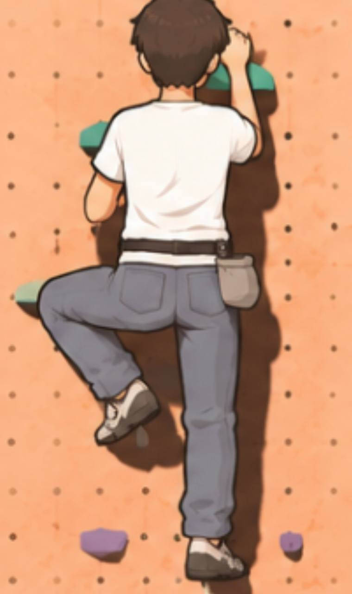
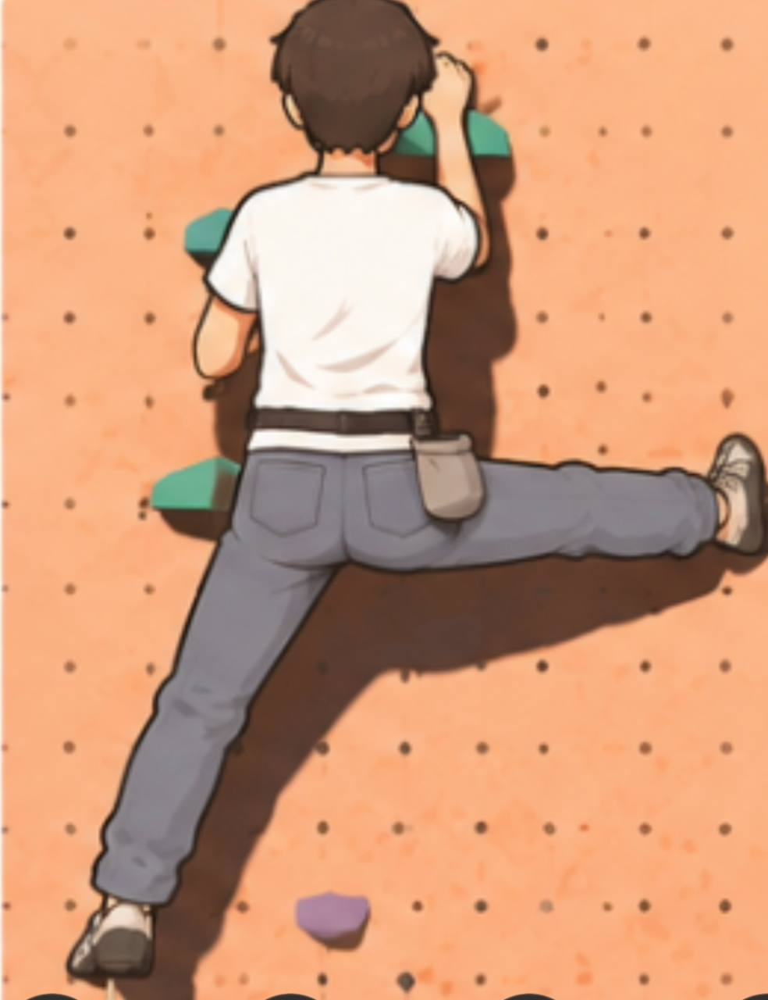

# 28. 등반 자세를 기준으로 한 캐릭터 재설계

2026-11-13 진행: 사용자가 최종적으로 승인한 작은 머리 시안으로 Tripo 기본 생성 및 Mixamo 자동 리깅을 완료했다. [제작 결과·비용·미해결 항목](../art_source/character/rebuild/approved_small_head/README.md)을 참조한다. 초크백 중복 형태와 큰 자세의 허리선 변형이 남아 있어 B~F 검수 통과로 간주하지 않는다. 아래 이전 입력과 등신 수치는 이 승인 시안보다 우선하지 않는다.

## 최신 외형 입력: 주름 없는 청바지 v1

사용자의 후속 요청에 따라 길고 가는 팔다리와 주름을 최소화한 청바지로 외형을 구체화했다. [제작 입력 및 상세 설계](../art_source/character/rebuild/smooth_denim_v1/README.md)에 정면·좌·후면·우 T포즈 PNG와 생성 프롬프트가 있다. 기본 바지는 주름 없이 만들고 색·평평한 주머니·얕은 봉제선으로 청바지 인상을 유지한다. 아래의 무릎·바짓단 주름은 기본 변형 검수 뒤에만 선택적으로 추가한다. 이 산출물은 2D 외형 참고이며 A~F 단계의 3D 검수 통과를 의미하지 않는다.

2026-11-12 · 상태: **설계 / Brief**. 새 모델·하체 시제품의 시각 검수, 엔진 통합, 기기 검증은 아직 통과하지 않았다.

사용자는 기존 수정본도 엉덩이 사이가 찢어진 것처럼 보인다고 지적했고, 참고 이미지처럼 보이도록 완전히 새로 만들어도 된다고 승인했다. 이번 설계는 기존 메시를 보존하는 것을 우선하지 않는다. 등반 자세에서의 의상 실루엣을 먼저 검증하고 그 위에 외형을 완성한다.

## 1. 최우선 목표

**한쪽 무릎을 높이 들거나 한쪽 다리를 옆으로 뻗었을 때, 바지가 하나의 옷으로 이어지고 엉덩이 아래가 둥근 곡선으로 허벅지와 연결되어야 한다.**

얼굴·머리는 카툰풍 남성, 흰 반팔, 청바지, 회색 클라이밍화, 오른쪽 허리 뒤 회색 초크백으로 제작한다. 머리는 과하게 삐죽하지 않게 한다. 원본 참고의 길고 가는 팔다리 인상을 유지하며, 게임의 관절 길이와 접점 계약은 별도로 맞춘다.

| 기준 이미지 | 반드시 재현할 시각적 특징 |
| --- | --- |
| [높은 발 올리기](../art_source/character/rebuild/references/high_step.jpg) | 들린 허벅지가 엉덩이 아래 곡선에 자연스럽게 연결됨. 중앙에 깊고 날카로운 V자 홈이 생기지 않음. 주머니는 천 표면을 따라 변형됨 |
| [옆으로 다리 뻗기](../art_source/character/rebuild/references/side_extension.jpg) | 골반과 뻗은 허벅지가 넓고 연속된 실루엣을 이룸. 밑위가 갈라진 입구·찢어진 틈처럼 보이지 않음. 반대쪽 다리가 끌려 나오지 않음 |

참고에서 읽히는 그림체와 윤곽이 목표다. 같은 3D 관절 위치·카메라·광원이 제공된 것은 아니므로, 먼저 시점·자세를 근사해 맞추고 차이를 표시한다. 한 장의 후면만 맞추기 위해 옆면을 납작하게 만드는 방식은 채택하지 않는다.

## 2. 기존 접근에서 바꿀 것

| 기존 접근과 확인된 한계 | 새 제작 기준 |
| --- | --- |
| T포즈 외형을 만든 뒤 등반 리그를 붙임 | 하체 기본형과 리그를 먼저 만들어 두 기준 자세를 통과시킴 |
| 웨이트 재분배로 모서리 늘어남은 줄었지만 사용자가 시각적으로 거부함 | 수치 개선을 시각적 합격으로 간주하지 않음. 참고와 같은 자세의 렌더가 핵심 판정 자료 |
| 원본의 깊은 뒤쪽 중앙 홈과 좁은 연결부가 변형에도 남음 | 골반·사타구니·허벅지 뿌리의 표면 흐름을 새로 제작 |
| 단순한 위치 기반 변형으로 주머니·밑위까지 늘어남 | 의상 부위별 표면 흐름을 따르는 모델링과 포즈별 보정 사용 |
| 보조 뼈와 엔진 구동의 대응이 확인되지 않은 상태에서 GLB만 납품 | 모든 보조 뼈·보정 셰이프에 엔진 드라이버와 실제 작동 검증을 함께 납품 |

`climber_tripo_rig_hipfix.glb`는 참고 목표에 미달한 이전 시도다. 새 제작의 합격 기준이나 최종 채택 자산으로 사용하지 않는다. 후속 로컬 성형 실험도 최종 모델로 확정하거나 업로드하지 않았다.

## 3. 형태와 메시 설계

### 바지와 골반

- 허리에서 좌우 허벅지로 이어지는 **하나의 연속된 바지 표면**을 만든다. 중앙 솔기는 얕은 의상 디테일이며 실제 열린 경계가 아니다.
- 골반에는 충분한 앞뒤 두께를 주고, 뒤쪽은 둥근 두 볼륨이 얕은 중앙 골과 연결되는 형태로 잡는다. 깊게 파인 중앙 홈을 기본형에 굳혀 넣지 않는다.
- 허벅지의 회전축은 골반 내부에 두되, 화면상의 바지 밑선과 뼈 시작점을 같은 위치로 맞추지 않는다. 관절을 감싸는 천의 여유가 있어야 한다.
- 사타구니 중앙과 엉덩이 하부에는 변형을 분산할 면을 배치한다. 좌우 다리 고리와 골반 고리가 연결되며, 큰 삼각형이 중앙 한 점으로 몰리지 않게 한다.
- 엉덩이와 허벅지 뿌리는 맞닿은 별도 덩어리로 만들지 않는다. 숨겨진 틈을 덮는 판을 추가하는 방식도 최종 구조로 쓰지 않는다.
- 주머니는 먼저 평평한 색·솔기로 검증한다. 두꺼운 테두리·깊은 주머니 홈이 골반을 딱딱한 판처럼 보이게 하지 않도록 한다.
- 주름은 무릎·바짓단 중심으로 절제한다. 엉덩이 밑에 고정된 짙은 삼각형 주름이나 깊은 AO를 굽혀 넣지 않는다.

### 부위별 구성

| 부위 | 구성·변형 원칙 |
| --- | --- |
| 머리·몸통 | 별도 제작 가능. 목·어깨 연결과 얇은 흰 반팔 형태를 검수 |
| 바지 | 골반부터 양쪽 바짓단까지 연결된 스킨 메시. 의상 밑위와 둔부 볼륨 우선 |
| 신발 | 발 뼈에 안정적으로 대응. 발 앞쪽 접점을 별도 표식으로 정의 |
| 벨트·초크백 | 골반에 부착. 허벅지 웨이트가 초크백으로 번지지 않도록 부위 분리. 필요하면 보조 흔들림은 후속 단계 |

초기 원본은 편집 가능한 사각형 위주 표면을 사용하고 최종 GLB는 삼각형으로 내보낸다. 폴리곤 총량보다 굽힘 영역의 배치와 변형을 우선 검수한다.

## 4. 리그와 비율 계약

- 골반/몸통, 좌우 고관절, 무릎, 발목, 발 접점을 명확히 분리한다. `pelvis`, `thigh_L/R`, `shin_L/R`, `foot_L/R` 등 엔진 대응 이름을 문서화한다.
- 제작용 휴지 자세는 T포즈 상체와 약간 벌어진 다리를 시작안으로 사용한다. 고관절·무릎 축을 확인할 수 있도록 중립 자세를 명시하고, 04의 게임 휴지 관절과 변환표를 만든다.
- 골반·허벅지 웨이트는 해부학적·의상 곡면을 따라 칠한다. 일정 높이만으로 구역을 잘라 최종 웨이트를 결정하지 않는다.
- 몸통의 기울기와 골반 방향은 실제 자세 상태에서 가져온다. 엉덩이 보정이 논리 관절·홀드 접점을 이동시키지 않는다.
- 양쪽 동시 동작과 좌우 거울 자세를 같은 중요도로 검수한다. 한쪽만 예쁘게 만들어 반대편 변형이 손상되는 결과는 탈락이다.

**중요한 스케일 차이:** 현재 main의 `Tuning`과 04에는 팔 0.40/0.38m, 다리 0.52/0.48m가 정의되어 있다. 첨부 WIP GLB의 뼈 원점 간 거리는 팔 약 0.20/0.35, 다리 약 0.51/0.375로 달랐다. 이 값은 GLB의 뼈 거리이며 사용자 최신 실행 코드의 설정을 확인한 결과는 아니다. 새 제작 시작 시 실제 사용할 게임 리그 계약을 먼저 고정하고, 메시의 팔다리 비율과 함께 맞춘다. 내보내기 뒤 뼈 길이만 억지로 늘려 맞추지 않는다.

## 5. 큰 자세를 위한 보정

기본 웨이트가 자연스러운 범위까지 작동한 뒤 아래 보정을 추가한다. 보정으로 기본 메시의 구멍이나 잘못된 관절 위치를 감추지 않는다.

| 보정 채널 | 목적 |
| --- | --- |
| `hip_abduct_L/R` | 옆으로 다리를 벌릴 때 엉덩이 하부의 볼륨과 중앙 연결 유지 |
| `hip_flex_L/R` | 무릎을 높이 들 때 바지 앞쪽 압축과 뒤쪽 늘어남을 분산 |
| 복합 자세 보정 | 벌림+굽힘+골반 회전이 겹칠 때 기본 채널의 과보정·관통 완화 |

이 명칭과 채널 수는 제작 시작안이며, 실제 테스트로 필요 여부를 결정한다. 가동률은 골반 기준 허벅지 회전에서 계산하고 부드러운 곡선으로 연결한다. 절대 월드 각도나 프레임마다 누적한 회전값으로 구동하지 않는다.

GLB에 모프 타깃을 저장해도 관절에 자동 연결되는 것은 아니다. Godot에서 해당 뼈 상태를 읽어 셰이프 값을 설정하는 드라이버를 함께 제공한다. 양쪽 채널을 더할 때 중앙 변형이 두 배가 되지 않게 조합 규칙을 검증한다. IK 적용 뒤 최종 뼈 자세를 기준으로 작동 순서를 맞춘다.

Godot 공식 API 근거: [SkeletonModifier3D](https://docs.godotengine.org/en/stable/classes/class_skeletonmodifier3d.html), [MeshInstance3D의 blend shape 값 설정](https://docs.godotengine.org/en/stable/classes/class_meshinstance3d.html). 엔진 버전은 프로젝트에 맞춰 고정하며 API 문서만 읽은 것을 실제 엔진 통과로 기록하지 않는다.

## 6. Tripo의 역할

Tripo를 사용할 경우 얼굴·헤어·흰 반팔·신발과 전체 인상의 출발점으로 사용한다. 결과의 골반 토폴로지·리깅이 이 게임의 극단 자세를 만족한다고 가정하지 않는다. 필요하면 하체를 별도 재제작하고 외형을 통합한다.

- 입력 멀티뷰는 **같은 중립 자세**의 앞·뒤·좌·우 이미지로 준비한다.
- 이번 두 이미지는 서로 다른 동작이다. 같은 물체의 일치된 멀티뷰 입력으로 묶지 않고 포즈 검수 기준으로 쓴다.
- 생성 직후의 미리보기만으로 최종 모델을 채택하지 않는다. 기본형의 구멍·홈·두께와 단색 포즈를 검사한다.
- 하체 구조 시제품을 통과시킨 후 필요한 외형만 생성한다. 생성·재생성 비용은 실제 작업별로 기록한다.
- 이번 재설계 단계에서 새 Tripo 작업은 제출하지 않았으며 추가 크레딧 사용은 0이다.

## 7. 제작 순서와 통과 기준

| 단계 | 제출물 | 통과 기준 |
| --- | --- | --- |
| A. 구조 고정 | 기준 관절·비율표, 단색 하체 시제품, 모델 원점/축 | 게임 계약과 외형 비율의 차이를 해소하고 다음 단계 입력이 명확함 |
| B. 핵심 두 자세 | 참고와 근사한 카메라의 높은 발 올리기·옆 뻗기, 좌우 거울 자세 | 중앙이 찢어진 듯 보이지 않고 엉덩이 밑선이 둥글게 이어짐. 단색·후면·사선·측면에서 검수 |
| C. 변형 범위 | 중립↔각 자세의 연속 동작, 양다리 동시 동작, 골반 회전 | 메시 열린 경계·뒤집힘·큰 관통·갑작스러운 셰이프 전환 없음. 손발 접점 유지 |
| D. 외형 완성 | 얼굴·옷·주머니·초크백·재질·얇은 윤곽선 | B의 실루엣을 유지하며 원본 캐릭터 인상과 참고 명암에 접근 |
| E. 엔진 검수 | GLB+Godot 장면+보정 드라이버, 실행 캡처·동영상 | 실제 임포트와 포즈 드라이버 작동. 최신 게임의 IK와 충돌하지 않음 |
| F. 성능·최종 검수 | 기기·해상도·프레임·메모리 기록, 같은 포즈 비교판 | 실제 게임 화면으로 사용자 참고와 비교 가능. 미검증 항목 명시 |

현재 단계는 A 이전의 설계 상태다. B를 통과하지 않은 시안을 "완성 GLB"로 납품하거나 기본 캐릭터로 교체하지 않는다. 자동 검사에서 오류가 없거나 모서리 늘어남이 감소한 것만으로 B를 통과시키지 않는다.

각 비교판에는 **참고 이미지 / 이전 모델 / 새 시안**을 나란히 놓고 카메라와 포즈 차이를 표시한다. 이전의 다리 70°·90° 시험은 기술 점검으로 남기되 참고 두 자세의 대체 합격 자료로 사용하지 않는다.

## 8. 예산과 납품

06의 초기 예산을 유지한다: 캐릭터 15k~25k 삼각형, 변형 뼈 40개 이하, 재질 슬롯 3개 이하, 주요 텍스처 1K~2K. 이는 성능 측정값이 아니라 제작 목표다. 보정 셰이프·윤곽선까지 포함해 최종 메모리와 렌더 비용을 측정한다.

납품 묶음은 편집 가능한 원본, 최종 GLB, 텍스처, 리그 대응표, 보정 채널/구동 규칙, Godot 연결 장면, 테스트 포즈·비교 캡처, 재현 절차다. 폴더는 `art_source/character/rebuild/`와 `game/art/characters/`를 사용한다. CH01~03 자산 ID를 유지하며 기존 시도는 이력으로 남긴다.

최종 목표는 참고처럼 자연스러운 등반 캐릭터다. 이번 문서는 그 제작 기준을 재정의한 것이며 그 품질의 새 모델이 완성되었다는 보고가 아니다.
