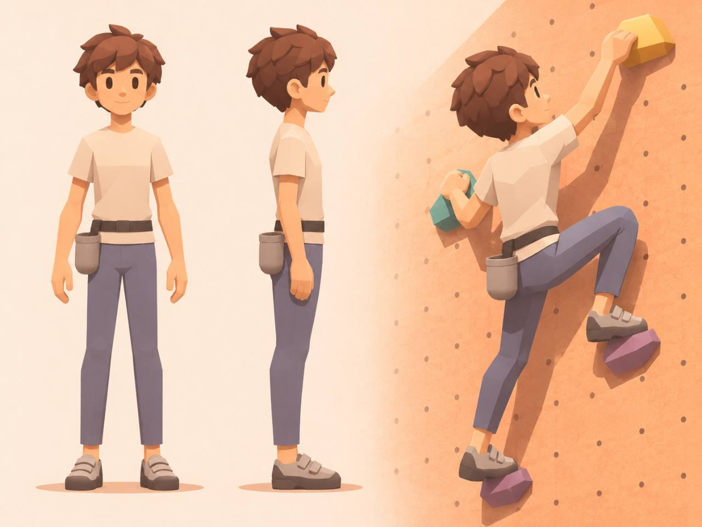

# 29. 넓은 색 면으로 표현하는 클라이머 상세 설계

2026-11-12. 사용자 제공 45204.jpg 기준. **설계 제안이며 모델 제작·변형·엔진 검증 완료가 아니다.** 최신 외형 목표는 이 문서, 변형 구조와 제작 통과 기준은 28, 판정 관절 계약은 04를 따른다. 이전 smooth_denim_v1 이미지는 비교 이력으로 보존한다.

## 1. 관찰과 해석

| 관찰되는 특징 | 제작에 반영할 결정 | 확인할 수 없는 부분 |
| --- | --- | --- |
| 큰 머리, 작은 턱, 검은 타원 눈, 단순한 코·입 | 친근한 카툰 얼굴, 흰자·홍채·광택 최소화 | 실제 얼굴 메시 및 표정 리그 |
| 머리카락은 큰 겹친 덩어리와 소수의 끝부분으로 구성 | 모발 가닥보다 덩어리 실루엣을 제작 | 원본 폴리곤 수·제작 방식 |
| 피부·옷에 넓고 완만하게 나뉜 명암 면 | 매끈한 큰 형태 위에 제한된 면 표현 | 실제 로우폴리인지 그림인지 |
| 상의는 따뜻한 흰색, 바지는 회보라·청회색 | 중립 베이스와 따뜻한 장면 조명을 분리 | 정확한 원본 알베도 |
| 바지에 깊은 주름·선명한 데님 결이 거의 없음 | 기본형은 무주름, 청바지 느낌은 색과 최소 봉제선만 | 보이지 않는 뒤 주머니 형태 |
| 다리를 들어도 허벅지가 하나의 긴 덩어리로 읽힘 | 사타구니·둔부의 연속된 곡면 우선 | 후면 중심부의 실제 연결·가중치 |
| 짙은 외곽선 없이 색과 그림자로 분리 | 기본 외곽선 없음, 실루엣 대비로 가독성 확보 | 원본 셰이더·조명 구성 |

정면과 측면은 팔을 내린 모습이며 오른쪽은 다른 등반 자세다. 이 한 장을 동일 자세의 멀티뷰 입력으로 제출하지 않는다. 그림의 인상은 분석할 수 있지만 모델의 폐곡면·변형 품질·물리적 자세의 가능성을 입증하지는 않는다.

## 2. 비율과 실루엣

이전 약 7등신 프롬프트를 그대로 유지하지 않는다. 정면에서 머리카락 최상단~턱을 한 머리 길이로 볼 때 대략 5~5.5등신 인상이다. 이는 눈대중 추정이며 정확한 계측값은 아니다.

| 항목 | 새 제작 시작안 | 검수 방법 |
| --- | --- | --- |
| 전체 비례 | 약 5.2~5.8등신, 첫 시안 5.5등신 | 정면 중립 자세의 머리 포함 전신 비교 |
| 머리 | 넓은 두개부, 작은 둥근 턱, 볼은 절제 | 머리가 큰 인상 유지, 유아형 과장 방지 |
| 어깨 | 머리 최대 폭의 약 1.35~1.5배를 시작안으로 사용 | 좁고 편안한 체형, 근육질 방지 |
| 팔 | 가늘고 긴 인상, 상완에서 손목으로 점진적으로 좁아짐 | 내린 손끝이 허벅지 중간 근처에 위치 |
| 다리 | 전체 키의 약 45~49%를 바지 밑위~바닥 구간의 시작안으로 사용 | 정면·측면, 발 포함 길이 비교 |
| 손·발 | 몸에 비해 조금 크게 읽히게 유지 | 게임 거리에서 홀드 접촉이 구분되는지 확인 |
| 발목 | 바짓단과 신발 사이에 짧게 노출 | 긴 양말·롤업·주름 추가 금지 |

위 수치는 이미지 제작과 기본형 비교를 위한 가설이다. 실제 관절 길이, 도달 거리, IK 목표를 바꾸는 승인이나 측정값이 아니다. 머리 크기·몸통 길이·팔다리의 시각적 굵기를 먼저 조정하고 04와 길이 대응을 확인한다. 팔다리를 이전 시안에서 다시 일괄 연장하지 않는다.

## 3. 얼굴과 헤어

- 눈은 짙은 갈색 또는 거의 검은 세로 타원. 이전 큰 홍채·흰자·반짝이는 눈보다 단순화한다. 작은 화면에서 표정이 남을 크기를 유지한다.
- 코는 짧은 돌출과 작은 명암 면으로 표현한다. 콧구멍·입술·치아 디테일을 기본형에 넣지 않는다.
- 입은 짧고 얕은 미소 선, 눈썹은 단순한 두 선. 볼의 붉은 기는 약하게 한다.
- 머리는 둥근 기본 덩어리 위에 앞머리·옆머리·뒷머리의 큰 묶음을 배치한다. 전체에 수십 개의 뾰족한 가시를 만들지 않는다.
- 정수리에 2~3개의 짧은 방향성 포인트를 허용하되 뒤통수와 옆 실루엣은 둥글게 유지한다. 이는 제작 시작안이며 원본 가닥 수를 센 결과가 아니다.
- 각 머리 덩어리의 내부 면은 절제한다. 잘게 쪼갠 삼각형 무늬나 검은 경계가 머리 전체에 반복되지 않게 한다.

## 4. 상의·바지·장비

### 상의

따뜻한 흰색으로 보이는 짧은 소매의 크루넥 티셔츠. 중립 조명에서의 기본 색은 미색에 가까운 흰색으로 잡고 장면의 주황색을 텍스처에 강하게 굽지 않는다. 소매는 팔을 약간 여유 있게 감싸고 몸통은 단순한 통형에 약한 허리 변화만 준다. 겨드랑이에서 가슴으로 깊은 주름을 새기지 않는다. 벨트 아래 짧은 흰 밑단을 유지한다.

### 바지

목표는 **청바지 느낌을 가진 매끈한 슬림 스트레이트 클라이밍 팬츠**다. 실사 데님 직조·바랜 무늬·두꺼운 스티치·주름을 제거한다. 골반에는 약간의 여유가 있고 허벅지에서 발목까지 점진적으로 좁아지며 레깅스처럼 근육을 드러내지 않는다.

- 앞주머니는 얕은 선으로만 표시하거나 기본형에서 생략한다. 뒤 주머니는 기존 정체성을 위해 얕은 두 개를 시작안으로 제안하되 후면 검수 전에는 확정하지 않는다.
- 좌우 둔부가 따로 붙은 두 공처럼 보이지 않도록 허리에서 허벅지까지 넓고 연속된 천 표면을 만든다.
- 중앙 솔기는 가느다란 색 차이 또는 얕은 선이며 열린 틈이 아니다. 엉덩이 하부를 검은 곡선으로 둘러싸지 않는다.
- 참고 정면의 사타구니 아래 작은 어두운 삼각형은 깊은 조각으로 복제하지 않는다. 재발 위험이 있는 시각 요소이므로 약화하거나 생략한다.
- 기본형의 무릎·발목도 무주름으로 시작한다. 포즈를 취했을 때 생기는 넓은 면 방향 변화와 조명만으로 입체감을 만든다.
- 옆으로 다리를 벌릴 때 정상적인 다리 사이 공간은 남긴다. 그 공간과 바지 중심이 찢어져 보이는 결함을 구별한다. 틈을 막는 판을 덧붙이지 않는다.

### 벨트·초크백·신발

벨트는 좁은 짙은 회갈색 띠와 작은 직사각 버클. 초크백은 회갈색의 단순한 원통형, 둥근 바닥과 얇은 입구 테두리로 구성한다. 캐릭터 본인의 오른쪽 뒤에 한 개만 둔다. 정면에서는 화면 왼쪽, 후면에서는 화면 오른쪽이다. 참고의 등반 뷰만 보고 좌우 위치를 재해석하지 않는다.

초크백은 골반에 붙이고 허벅지에 스킨하지 않는다. 높은 발 올리기에서 허벅지와 겹치면 부착 위치·몸에서의 간격을 먼저 조정하고 필요한 경우만 제한된 보조 회전을 검토한다. 신발은 회색 상부, 두 개의 넓은 벨크로, 짙은 고무 앞코·뒤꿈치와 얇은 밑창. 일상 운동화처럼 두꺼운 쿠션을 추가하지 않는다.

## 5. 면 표현과 색·조명

**각져 보이는 외형과 굽힐 수 있는 메시 밀도를 구분한다.** 팔꿈치·무릎·골반까지 무조건 적은 삼각형으로 만들면 참고 같은 부드러운 움직임을 얻기 어렵다. 관절은 충분한 연결 면으로 만들고 머리·소매·신발 같은 비교적 안정된 부분에 큰 면의 명암을 집중한다.

| 부위 | 표면 표현 |
| --- | --- |
| 얼굴·관절 | 부드러운 명암, 경계 최소화 |
| 머리·소매·신발 | 절제된 넓은 면과 약한 각 |
| 바지 | 큰 형태를 따라 넓은 명암, 고정된 삼각형 패치 없음 |
| 벽·홀드 | 캐릭터보다 명확한 각, 손발 실루엣을 가리지 않는 밀도 |

베이스 컬러는 다음을 초기 제안으로 사용한다. 이미지에서 정확히 추출한 색이나 확정 팔레트가 아니다: 피부 #E9A36F, 머리 #79452F, 상의 #F1E5D1, 바지 #666274, 벨트 #4B403A, 초크백 #8C7D70, 신발 상부 #B4A394, 고무 #514740. 중립 광원에서 확인한 뒤 따뜻한 벽 앞에서 조정한다.

모든 부위는 무광·비금속을 기본으로 한다. 제작 입력 이미지에는 흰 배경과 균일한 중립 조명을 사용한다. 게임 장면에는 따뜻한 주광과 부드러운 환경광을 시작안으로 사용하고 긴 그림자는 실시간 장면 요소로 만든다. 벽의 그림자나 주황 반사색을 캐릭터 기본 텍스처에 그리지 않는다. 외곽선은 기본적으로 끄고 실제 게임 거리에서 대비가 부족한 경우에만 재검토한다. 기존 REF01의 검은 윤곽선 요구보다 이번 캐릭터 방향이 우선한다.

## 6. 리깅·변형 설계

28의 연속된 골반 메시와 자세 보정 원칙을 유지한다. 좌우 고관절 회전축은 골반 내부에 둔다. 바지 밑선이나 주머니 밑을 회전축으로 사용하지 않는다. 골반 중심은 양쪽 허벅지에 과도하게 끌려가지 않게 하고, 고관절 둘레에서는 영향이 넓고 부드럽게 바뀌도록 한다. 일정 높이로 가중치를 잘라 최종화하지 않는다.

먼저 단색 재질로 하체를 검수한다. 무릎 들기에서는 뒤쪽 천이 자연스럽게 늘어나고 앞쪽이 압축되도록 하며, 옆 벌림에서는 골반 하부의 볼륨이 유지되도록 한다. 필요하면 hip_flex_L/R, hip_abduct_L/R 및 복합 자세 보정을 제작한다. 모프 타깃만 GLB에 넣고 끝내지 않고 Godot에서 관절 상태에 따라 구동되는지 확인한다. 양다리가 동시에 움직일 때 중앙이 이중으로 부풀지 않아야 한다.

주름 없는 외형은 변형 오류를 줄이는 데 유리한 출발점이지, 자동 리깅 품질을 보장하는 해결책은 아니다. 물리 판정·뼈 길이는 표현 보정을 위해 임의로 바꾸지 않는다.

## 7. Tripo 제작 입력 명세

다음 입력은 아직 생성하지 않았다. 기존 smooth_denim_v1을 최신 스타일의 최종 입력으로 오인하지 않는다.

1. 정면 중립 T포즈를 먼저 제작한다. 5.5등신 시작안, 단순 타원 눈, 큰 헤어 덩어리, 무주름 바지, 흰 배경, 한 명만 배치한다.
2. 정면을 기준으로 후면·왼쪽·오른쪽을 제작한다. 머리·어깨·허리·밑위·무릎·밑창 높이를 비교하고 동일 의상과 초크백 위치를 맞춘다.
3. 네 방향 모두 같은 T포즈로 한다. 측면에서 팔은 카메라 방향으로 뻗어 짧게 보인다. 팔 내린 측면과 T포즈 정면을 섞지 않는다.
4. 각 뷰를 개별 PNG로 저장한다. 앞·좌·뒤·우의 이름을 명시한다. 포즈 장면·라벨·색상표·치수선·벽·바닥 그림자는 입력 PNG에 넣지 않는다.
5. 등반 장면은 별도 품질 목표 이미지로만 사용한다. 같은 물체의 멀티뷰 입력에 서로 다른 자세를 합치지 않는다.

공통 영문 제작 프롬프트 초안:

> A friendly stylized male climber, approximately five and a half heads tall, slim elongated-looking limbs, simple dark oval eyes without detailed irises, a small nose and subtle smile, rounded chestnut hair built from broad soft clumps with a few short tips. Off-white short-sleeve T-shirt, narrow charcoal belt, smooth muted blue-gray climbing trousers with a straight slim fit and slight ease, no denim grain and no sculpted or painted wrinkles. Continuous natural pelvis flowing into the thighs, shallow center seam, no deep crotch or buttock groove. Gray two-strap climbing shoes with dark thin rubber soles. One small gray chalk bag attached behind the character's anatomical right hip. Broad restrained faceted shading on stable shapes, smooth natural joints, matte materials, no black outlines. A single full-body character in a neutral symmetrical T-pose, orthographic view, pure white background, diffuse neutral illumination, no cast shadows, no text, no additional poses.

시점별 문구는 제작 때 추가한다. 제외할 요소는 deep wrinkles, torn-looking crotch, detached buttocks, sharp V cleft, skinny leggings, realistic denim grain, glossy anime eyes, excessive hair spikes, baked orange lighting, multiple characters 등이다.

## 8. 제작 순서와 검수

| 단계 | 제출물 | 통과 조건 |
| --- | --- | --- |
| 1. 비율 | 정면·측면 단색 기본형 | 큰 머리와 가는 팔다리, 옷과 장비 위치가 참고 인상과 일치 |
| 2. 하체 | 중립·높은 발·옆 벌림의 후면/사선/측면 | 깊은 V홈, 부피 붕괴, 분리된 둔부, 뾰족한 면 없음 |
| 3. 연속 변형 | 각 자세의 좌우 반전·전환 영상 | 갑자기 튀는 면·관통·중앙 이중 보정 없음 |
| 4. 외형 | 단순한 얼굴·헤어·의상, 중립광 및 따뜻한 장면 비교 | 색과 넓은 면만으로 스타일 구현, 접힌 주름 패턴 재발 없음 |
| 5. 엔진 | GLB 및 보정 구동, 목표 화면 크기 캡처 | 접점 유지, 장비 관통 억제, 손발과 홀드 식별 가능 |

최신 참고의 높은 발 올리기뿐 아니라 이전 사용자의 후면 옆 벌림 이미지도 필수 검수 대상으로 유지한다. 새 참고에서 가려진 후면을 검수에서 제외하지 않는다. 좁은 정면 실루엣 하나만 예쁘다고 채택하지 않는다. 테스트 각도는 04의 실제 허용 범위를 사용하며 참고 그림을 근거로 강제 확대하지 않는다.

기존 15k~25k 삼각형·변형 뼈 40개 이하·재질 3개 이하를 예산 가설로 유지한다. 로우폴리처럼 보인다는 이유로 관절의 면 수를 무조건 줄이지 않는다. 실제 성능은 엔진·기기에서 따로 확인한다.

이번 작업 산출물은 참고 이미지 보존과 상세 설계다. 새 이미지, Tripo 모델, 리그, 런타임 수정은 이 문서 작성 단계에서 수행하지 않았다.
