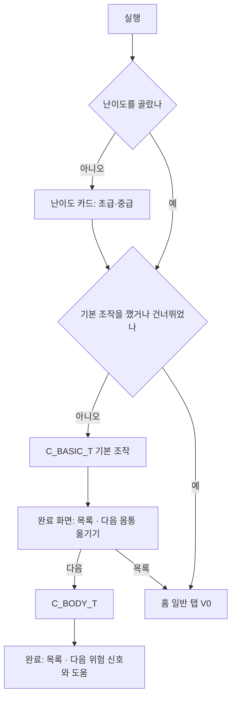

# 33. 튜토리얼 개편 기획·설계

설계 v0.2 · 2026-11-09(KST) · **사용자 승인, 구현됨**(0.9.16) · 브랜치 `design/modes-grades`

> **사용자 결정(2026-11-09):**
> - "일부러 떨어지기 과정은 없애." C_FALL을 합치지 않고 없앴다. C_DANGER의 일부러 떨어지기 단계(D5·D6)도 뺐다.
> - 새 과정 이름·설명 초안은 "진행해".
> - 강제 튜토리얼은 기본 조작 하나만 두는 안에 "그렇게 해".
>
> **구현하며 바꾼 것:**
> - C_BODY의 BD3(몸 낮추기)를 뺐다. 봇으로 재 보니 몸을 낮춰도 손 하중이 줄지 않았다.
> - C_ARM_LOAD의 A5(문 열림)를 뺐다. 사다리 배치에서는 자동 자세가 몸을 같은 쪽 손발 아래로 바로 정렬해 문 열림 부담이 생기지 않았다(봇: 일곱 자세 모두 부담 배율 1.0). 문 열림은 이후 플래그·아웃사이드 엣지 과정에서 가르친다.
> - C_DANGER D3 목표를 "위험 진입"에서 "위험이 끝남(회복 또는 떨어짐)"으로 바꿨다. 진입하자마자 다음 단계로 넘어가면, 손을 놓는 순간 자세가 되돌아가 신호를 겪을 틈이 없기 때문이다.

사용자 요청(2026-11-09): "그동안 수정 및 추가된 내용들을 토대로 튜토리얼 항목과 내용들을 수정하고 기획 설계 진행해. 문서로만 진행해 우선."

이 문서는 2026-11-04에 만든 튜토리얼([28 §6](28_modes_grades_courses_design.md), [16 v0.7](16_stage_specs.md#v07-기술-탭-튜토리얼재구성)) 이후 바뀐 게임에 맞춰 튜토리얼을 다시 짠다. 구현은 사용자 승인 뒤에 한다. [초안] 표시는 배치나 수치를 봇으로 맞춰야 하는 값이다.

---

## 1. 그동안 바뀐 것과 튜토리얼에 주는 영향

| 날짜 | 바뀐 것 | 지금 튜토리얼 상태 | 해야 할 일 |
| --- | --- | --- | --- |
| 11-04 | 문 열림 부담(barn door): 같은 쪽 손발로만 버티면 몸이 돌아가며 팔 힘이 빨리 빠짐 | 가르치지 않음 | 몸 모양과 팔 힘에 한 단계 추가(§4.5) |
| 11-05 | 데드포인트 제거 | 16에 C_DEADPOINT_T 절이 남아 있음 | 16의 그 절을 "삭제됨"으로 표시 |
| 11-05 | 잡을 수 있으면 홀드가 **하얗게** 깜빡임. 튜토리얼 목표는 **노랗게** 깜빡임 | 도움말이 모두 "반짝이는 홀드"라서 둘이 헷갈림 | 문구 규칙: 목표는 "노란 홀드", 놓는 때는 "하얗게 빛나면"(§3.2) |
| 11-05 | 홀드 크기 = 잡는 크기, 작은 홀드 위주. 잡은 위치에 따라 품질(잘 잡음/보통/끝을 잡음)이 정해지고 최대 하중이 달라짐 | 과정 설명(how)에만 "홀드 끝을 잡으면 빨리 빠져요"가 있고 단계는 없음 | 몸 모양과 팔 힘에 "가운데 잡기" 단계 추가(§4.5) |
| 11-07 | 패드 사이 가운데를 끌어 **몸통 옮기기** | 가르치지 않음. 다리 내리기 튜토리얼은 "몸이 옮겨 갈 때까지 기다려야" 닿는데 이 사실도 안 알려 줌 | 새 과정 "몸통 옮기기"(§4.2). 다리 내리기 도움말 보강 |
| 11-07 | 두 손 모으기는 **파란 홀드**에서만 | 핸드매치 M1에 반영됨 | 일반 플레이에서 처음 막히면 안내(§5) |
| 11-07 | 캐릭터 CH02, 표정 4종, 해부학 관절 | 영향 없음(표현만) | – |
| 11-08 | 위쪽 정보 패널 새 디자인(진행 점·목표 높이·현재 높이·"왼손 팔 힘 n/100"·지지/손 하중/무브 줄) | 문구가 옛 이름("위쪽 게이지", "위 줄의 손 하중 숫자") | 화면 이름으로 문구 통일(§3.2) |
| 11-08 | 일시정지 카드, 탭하면 3초 카운트다운 | 영향 없음 | 튜토리얼 시간(도움말 12초)은 일시정지 동안 멈춤 — 확인만 |
| 11-08 | 시작할 때 **난이도(초급·중급)** 고르기 | 첫 실행은 난이도 → 기본 조작으로 이미 바뀜 | 난이도별로 다른 단계(§3.4) |
| 11-09 | 경고 3단계: ① 주의(노란 패드 "떼면 떨어져요") ② 위험(붉은 화면·두근거림·"잡아!/균형!/버텨!"·고리) ③ 회복("휴!") | 가르치지 않음. 처음 보면 무슨 뜻인지 모름 | 새 과정 "위험 신호와 도움"(§4.3) + 처음 한 번 안내(§5) |
| 11-09 | 떨어진 뒤 원인 한 줄 | 튜토리얼에서 떨어지면 단계 재시작만 보임 | 튜토리얼에서도 원인 한 줄을 보인 뒤 재시작(§3.3) |
| 11-09 | 초급: 버틸 시간 10배, 다시 잡을 홀드·몸 방향 안내 | 튜토리얼에도 그대로 적용됨 | 그대로 둔다(배우기 좋음) |
| 11-09 | 초급: 위험 고리를 누르면 **자동 도움**(손 하나·발 하나, 정상 제외, 3번) | 튜토리얼에서도 켜져 있음. **목표 홀드를 대신 잡아 단계를 건너뛸 수 있고**, 일부러 떨어지기 단계에서는 떨어지지 못하게 막음 | 튜토리얼에서는 끈다. 가르치는 한 단계에서만 켠다(§3.1) |

정리하면 지금 튜토리얼에는 세 가지 문제가 있다.

1. **새 조작을 안 가르친다:** 몸통 옮기기, 위험 신호, 자동 도움, 홀드 가운데 잡기, 문 열림.
2. **새 기능과 부딪힌다:** 자동 도움이 튜토리얼을 대신 풀거나 막는다. 경고 큰 글자가 안내 줄과 겹친다.
3. **문구가 낡았다:** "반짝이는", "위쪽 게이지" 같은 옛 이름을 쓴다.

---

## 2. 목표와 원칙

**목표:** 처음 하는 사람이 첫 5분 안에 "움직이기 → 위험을 알아보기 → 떨어져도 괜찮음"을 몸으로 익히고, 나머지는 필요할 때 배운다.

**원칙**
- **꼭 해야 하는 것은 짧게.** 첫 실행에 강제로 하는 것은 기본 조작 하나뿐이다(지금과 같음). 나머지 과정은 기술 탭에서 고른다. 대신 기본 조작이 끝나면 다음 과정을 추천한다(§4.1).
- **글보다 몸으로.** 한 단계에 한 문장과 목표 하나를 둔다(16 공통 규칙 유지). 설명은 시작 카드와 도움말로 미룬다.
- **배울 때는 도와주지 않는다.** 튜토리얼에서 자동 도움은 꺼 둔다. 28 §3의 "튜토리얼도 대신 움직이지 않는다"를 지킨다.
- **필요한 순간에 한 번.** 튜토리얼 밖에서 처음 겪는 새 신호는 그 순간 한 번만 짧게 알려 준다(§5).
- **화면 이름 그대로.** 안내 문구는 화면에 실제로 보이는 이름(왼손 팔 힘, 손 하중, 지지, 노란 홀드)만 쓴다.

---

## 3. 튜토리얼 공통 규칙(개정)

16 공통 규칙과 28 §6.1을 유지하고 아래를 더하거나 바꾼다.

### 3.1 튜토리얼에서 새 기능

| 기능 | 튜토리얼에서 | 이유 |
| --- | --- | --- |
| 경고 3단계(주의·위험·회복), 소리·진동 | 켬 | 정보일 뿐이고 배우는 대상이다 |
| 초급 버틸 시간 10배, 해결 안내 표시 | 플레이어 난이도대로 | 초급 플레이어가 튜토리얼에서 덜 떨어진다 |
| 자동 도움(고리 누르기) | **끔**. 단계 규칙 `rules.rescue: true`인 단계만 켬(§4.3의 D4 하나) | 목표를 대신 잡아 단계를 건너뛰거나, 일부러 떨어지기를 막는다 |
| 떨어진 뒤 원인 한 줄 | 켬 | 아래 3.3 |

### 3.2 문구 규칙

| 쓰지 않음 | 씀 | 뜻 |
| --- | --- | --- |
| 반짝이는 홀드, 표시된 홀드 | **노란 홀드** | 튜토리얼 목표(노랗게 깜빡임) |
| 반짝이는 홀드에서 떼요 | **하얗게 빛나면 손가락을 떼요** | 지금 놓으면 잡힘 |
| 위쪽 게이지, 위쪽 팔 힘 게이지 | **위쪽 '왼손 팔 힘'** | 정보 패널 2줄 |
| 위 줄의 손 하중 숫자 | **위쪽 '손 하중'** | 정보 패널 3줄 |
| (없음) | **노란 패드** | 주의(떼면 위험) |
| (없음) | **붉은 화면, 두근거림** | 위험 |
| (없음) | **고리** | 캐릭터 둘레 남은 시간(초급은 눌러서 자동 도움) |
| 넓은 홀드 | **파란 홀드** | 두 손을 모을 수 있는 홀드 |

### 3.3 떨어졌을 때

- 지금은 단계를 바로 다시 시작한다. 이제는 떨어진 이유 한 줄(DangerFeedback.fall_cause)을 안내 줄 자리에 2초 보인 뒤 그 단계 시작 자세로 돌아간다.
- 목표가 `fall`인 단계는 이유 대신 "잘했어요. 떨어져도 처음 자세로 돌아와요"를 보인다.

### 3.4 난이도별 단계

- 단계에 `only_level: "beginner" | "intermediate"`를 둘 수 있다. 다른 난이도에서는 그 단계를 건너뛴다.
- 쓰는 곳: §4.3 D4(자동 도움, 초급만).

### 3.5 화면 겹침

- **위험 동안:** 머리 위 큰 글자("잡아!")와 고리가 안내 줄보다 우선한다. 위험이 시작되면 안내 줄을 흐리게(불투명도 0.35) 하고, 위험이 끝나면 되돌린다. 도움말 버튼은 그대로 둔다.
- **위쪽 정보 패널:** 화면 높이 222(배율 전)까지 차지한다. 안내 줄의 위쪽 위치는 지금 값(290)을 유지한다.
- **주의(노란 패드) 글자:** 패드 옆 글자가 안내 줄과 겹치면 패드 글자를 패드 안쪽으로 붙인다.

---

## 4. 과정 목록과 단계(개정)

### 4.0 순서

| 순서 | 과정 | 상태 | 강제 | 설명 카드(purpose) |
| --- | --- | --- | --- | --- |
| 0 | C_BASIC 기본 조작 | 문구 개정 | 첫 실행 | 손과 발을 하나씩 이동하여 홀드 잡기.(사용자 문구 유지) |
| 1 | **C_BODY 몸통 옮기기** | 새로 | – | 패드 사이 가운데를 끌어 몸을 원하는 곳으로 옮기기. |
| 2 | **C_DANGER 위험 신호와 도움** | 새로 | – | 떨어지기 전 신호를 읽고 버티는 법 알기. |
| 3 | C_REST 쉬는 법 | 문구 개정 | – | 두 발로 버티고 팔을 펴면 팔 힘이 돌아와요.(유지) |
| 4 | C_ARM_LOAD 몸 모양과 팔 힘 | 단계 추가 | – | 어떻게 매달려 있느냐에 따라 팔 힘이 빠지는 속도가 달라요.(유지) |
| 5 | C_DROP_FOOT 다리 내리기 + 먼 손 뻗기 | 도움말 개정 | – | 유지 |
| 6 | C_MATCH 핸드매치 | 문구 개정 | – | 유지 |
| 7 | C_CROSS 크로스 | 문구 개정 | – | 유지 |

**C_FALL(일부러 떨어지기)은 없앴다(사용자 결정 2026-11-09).** courses.json에서 지우고 C_FALL_T 파일도 지웠다. 이미 C_FALL_T를 깬 저장 기록은 그대로 두며, 해금에는 영향이 없다.

**기술 과정 순서를 바꾸는 이유**
- 몸통 옮기기는 다리 내리기·핸드매치 원리("몸이 옮겨 가야 닿는다")의 바탕이라 기술 과정보다 앞에 둔다.
- 위험 신호는 모든 플레이에서 나오므로 일찍 둔다.

### 4.1 C_BASIC_T 기본 조작 (문구 개정, 배치 그대로)

- **배치:** G_V0_01 사다리, 피로 끔(지금과 같음).
- **시작 카드 how(개정):** "손·발 패드를 누른 채 끌어 노란 홀드 위로 옮기세요. 홀드가 하얗게 빛날 때 손가락을 떼면 잡혀요. 한 번에 하나씩 옮겨요."

| 단계 | 안내 | 목표 | 도움말 1 / 2 |
| --- | --- | --- | --- |
| B1 | 왼손을 노란 홀드로 옮겨 잡아요. | grab LH H03 | 왼쪽 위 손 패드를 누른 채 끌어요 / 홀드가 하얗게 빛나면 손가락을 떼요 |
| B2 | 오른손도 노란 홀드로 옮겨요. | grab RH H04 | 오른쪽 위 손 패드를 끌어요 / 같음 |
| B3 | 왼발을 노란 발판에 올려요. | grab LF F03 | 왼쪽 아래 발 패드를 끌어요 / 발판이 하얗게 빛나면 떼요 |
| B4 | 오른발도 올려요. 몸이 따라 올라가요. | grab RF F04 | 오른쪽 아래 발 패드를 끌어요 / 같음 |
| B5 | 손을 하나씩 다음 노란 홀드로 옮겨요. | grab LH H05 | 손을 하나씩 옮겨요 / 하얗게 빛나면 떼요 |
| B6 | 다른 손도 옮겨요. | grab RH H06 | 같음 |
| B7 | 발도 하나씩 올려요. | grab LF F05 | 발을 하나씩 올려요 / 하얗게 빛나면 떼요 |
| B8 | 다른 발도 올려요. 위쪽 '현재 높이'가 늘어요. | grab RF F06 | 같음 |
| B9 | 두 손으로 맨 위 크림색 홀드를 잡으면 끝나요. | clear | 한 손씩 정상 홀드로 / 두 손이 다 잡으면 완등 |

**완료 화면:** 지금의 [목록] 옆에 **[다음: 몸통 옮기기]**를 더한다. 첫 실행이면 이 버튼을 강조한다. 누르지 않아도 된다.

### 4.2 C_BODY_T 몸통 옮기기 (새로)

- **원리(03 v0.9):**
  - 패드 사이 네모 영역을 누른 순간의 골반이 기준점이다. 끄는 만큼(최대 0.45m) 골반 목표가 옮겨 간다.
  - 균형이 깨지는 쪽으로는 가지 않는다.
  - 다른 팔다리를 움직이기 시작하면 목표가 지워진다. 단, 가운데를 계속 누르고 있으면 지워지지 않는다.
  - 그래서 "몸을 옮긴 채로 뻗기"는 **두 손가락**(한 손가락은 가운데, 다른 손가락은 손 패드)으로 한다.
- **배치 [검증됨]:**
  - G_V0_01 사다리에 오른쪽 먼 손홀드 H07 (1.30, 1.70)을 더했다.
  - (0.95~1.2)는 자동 자세(뻗는 쪽으로 몸이 저절로 따라감)만으로도 닿아서 뺐다.
  - 1.30은 몸통을 끌지 않으면 닿지 않는다(금지 재생 테스트). 가운데를 오른쪽으로 끌어 골반을 0.39 옮기고 누른 채 뻗으면 닿는다.
- **피로:** 끔.
- **시작 카드(초안)**
  - purpose: "패드 사이 가운데를 끌어 몸을 원하는 곳으로 옮기기."
  - when: "손이 조금 모자랄 때, 발 위로 몸을 올리고 싶을 때."
  - how: "네 패드 사이 빈 곳을 누른 채 끌면 몸이 따라가요. 균형이 깨지는 쪽으로는 가지 않아요. 가운데를 누른 채 다른 손가락으로 손 패드를 끌면 옮긴 자세 그대로 뻗어요."

| 단계 | 안내 | 목표 | 도움말 1 / 2 |
| --- | --- | --- | --- |
| BD1 | 패드 사이 가운데를 누른 채 오른쪽으로 끌어 몸을 옮겨요. | body: 골반 x ≥ 시작 + 0.20, 0.5초 유지 | 네 패드 사이 빈 곳을 눌러요 / 끄는 쪽으로 화살표가 나오고 몸이 따라가요 |
| BD2 | 가운데를 누른 채로, 다른 손가락으로 오른손을 노란 홀드까지 뻗어요. | grab RH H_far | 한 손가락은 가운데에 그대로 / 다른 손가락으로 오른손 패드를 오른쪽 멀리 끌어요 |

BD3(몸 낮추기)는 뺐다. 봇으로 재 보니 골반을 0.2 낮춰도 손 하중이 0.12 → 0.10~0.14로 줄지 않았다.

### 4.3 C_DANGER_T 위험 신호와 도움 (새로, C_FALL 합침)

- **배치:** G_V0_01 사다리(지운 C_FALL_T와 같은 배치)를 쓴다(검증됨).
  - 손 H01·H02 (±0.45, 1.80), H03·H04 (±0.50, 2.10), H05·H06 (±0.40, 2.55)
  - 바닥 발판 F01·F02 (±0.30, 0.10, 플랫폼), 벽 발판 F03·F04 (±0.35, 0.65), F05·F06 (±0.25, 1.15)
- **피로:** 끔.
- **자동 도움:** D4에서만 켬.
- **시작 카드(초안)**
  - purpose: "떨어지기 전 신호를 읽고, 떨어져도 괜찮다는 걸 알기."
  - when: "패드가 노래지거나 화면이 붉게 뛸 때."
  - how: "노란 패드는 '지금 떼면 위험해요'예요. 화면이 붉게 뛰고 '잡아!'가 나오면 떨어지기 직전이니 손발을 다시 잡아요. 초급은 캐릭터 둘레 고리를 누르면 자동으로 도와줘요(문제마다 3번). 떨어져도 괜찮아요. 시작 자세로 돌아와 다시 해요."

| 단계 | 난이도 | 시작 자세 | 안내 | 목표 | 도움말 1 / 2 |
| --- | --- | --- | --- | --- | --- |
| D1 주의 | 모두 | 오른손 H04, 왼손 놓음, 두 발 F03·F04 [검증됨: 골반 (−0.348, 1.401) 0.21°, 안정, 오른손을 떼면 GRACE] | 오른손 패드를 눌러만 보세요. 노란 패드는 '지금 떼면 떨어져요'라는 뜻이에요. | caution RH | 오른쪽 위 손 패드를 누른 채 끌지 말고 기다려요 / 패드가 노래지면 다음으로 넘어가요 |
| D2 먼저 잡기 | 모두 | 이어서 | 그럼 왼손을 먼저 노란 홀드에 잡아요. 손이 둘이면 안전해요. | grab LH H03 | 왼쪽 위 손 패드를 노란 홀드로 끌어요 / 홀드가 하얗게 빛나면 손가락을 떼요 |
| D3 위험 | 모두 | 두 손 H03·H04, 두 발 F03·F04(골반 (−0.353, 1.156)) | 이번엔 두 손을 모두 놓아 보세요. 붉은 화면과 두근거림이 떨어지기 직전 신호예요. | danger_end(회복했거나 떨어짐) | 손 패드 둘을 끌어 허공에서 떼요 / 떨어져도 괜찮아요. 다음 단계로 넘어가요 |
| D4 자동 도움 | 초급만, `rules.rescue: true` | D3과 같음 | 다시 두 손을 놓고, 붉게 뛰면 캐릭터 둘레 고리를 눌러 보세요. | safe_again(자동 도움 또는 스스로 다시 잡아 회복) | 두 손을 놓은 뒤 고리 안 아무 곳이나 눌러요 / 손발을 하나씩 옮겨 버티게 도와줘요(문제마다 3번) |

**난이도별 흐름**
- **중급:** D1 → D2 → D3. D3에서 0.15초 만에 떨어지면 목표가 채워지고 끝난다.
- **초급:** D1 → D2 → D3(손이 없으면 바로 떨어짐, 2026-11-10) → D4 → D5. D4·D5만 튜토리얼 규칙(danger_seconds)으로 고리를 누를 시간을 준다.
- D3에서 떨어져 다음으로 넘어가면 "잘했어요. 떨어져도 처음 자세로 돌아와요"가 뜬다.

**회복("휴!") 단계를 따로 두지 않는 이유:** 초급에서는 D4의 "스스로 다시 잡기"로 회복을 겪고, 중급은 0.3초 안에 회복하기 어렵다. 회복 신호는 처음 한 번 안내(§5)로 알려 준다.

**v2 개정(2026-11-10 사용자):** "패드를 잠깐 눌렀다 놓기만 해도 성공으로 넘어가 배움이 없다. 양손을 다 놓은 채로 시작해 가운데 고리를 누르도록 반복."

| 단계 | 시작 자세 | 안내 | 목표 | 규칙 |
| --- | --- | --- | --- | --- |
| D4 (초급) | 두 발(벽 발판 F03·F04)만, 손 없음 → 시작하자마자 위험 | 두 손이 모두 떨어진 위험한 상황이에요. 패드 말고 캐릭터 둘레 고리를 눌러 자동 도움을 받아요. | rescue(고리를 눌러야만) | rescue, danger_seconds 6 |
| D5 (초급) | 같음 | 한 번 더 해 봐요. 붉게 뛰면 바로 고리를 눌러요. | rescue | rescue, danger_seconds 4 |

- 패드로 다시 잡아 회복하면 성공이 아니다. "패드 말고 캐릭터 둘레 고리를 눌러요"를 보이고 그 단계를 다시 한다. 떨어져도 다시 한다.
- `danger_seconds`는 이 단계에서만 떨어지기까지 버틸 시간(초)이다. 읽고 누를 시간을 준다. 다음 단계에서 원래 값으로 돌아간다.
- 튜토리얼에서 쓴 자동 도움은 문제의 3번 횟수를 쓰지 않는다.
- D1~D3 안내에 상황 설명을 더했다. 예: "왼손이 떨어져 있어요…", "잡은 손이 둘이면 하나를 떼도 안전해요", "'잡아!'와 고리가 줄어들면 떨어지기 직전이에요".

### 4.4 C_REST_T 쉬는 법 (문구만)

| 단계 | 안내(개정) | 도움말 1 / 2(개정) |
| --- | --- | --- |
| R1 | 두 발로 서서 가만히 있어 보세요. 위쪽 '왼손 팔 힘'이 차요. | 아무것도 누르지 말고 기다려요 / 두 발로 서 있으면 쉬어져요 |
| R2 | 왼손을 홀드에서 놓고 기다려 보세요. 놓은 손은 더 빨리 회복돼요. | 왼손 패드를 끌어 허공에서 떼요 / '왼손 팔 힘'이 차면 다음으로 |
| R3 | 다시 잡고 노란 홀드로 올라가요. | 왼손 패드를 노란 홀드로 / 하얗게 빛나면 떼요 |

R2에서 왼손을 떼도 두 발이 바닥 발판(플랫폼)이라 주의 신호가 뜨지 않는다. 구현 때 확인한다.

### 4.5 C_ARM_LOAD_T 몸 모양과 팔 힘 (두 단계 추가)

| 단계 | 규칙 | 안내 | 목표 | 도움말 1 / 2 |
| --- | --- | --- | --- | --- |
| A1 | 피로 켬, 체력 100 | 왼발을 발판에서 떼고 버텨 보세요. 발 하나로 버티면 팔 힘이 빨리 줄어요. | stamina LH max 85 | 왼발 패드를 끌어 허공에서 떼요 / 위쪽 '왼손 팔 힘'이 줄어드는 걸 보세요 |
| A2 | 피로 켬 | 왼발을 다시 노란 발판에 올려요. 두 발로 서면 덜 빠져요. | grab LF F01 | 왼발 패드를 발판으로 / 하얗게 빛나면 떼요 |
| A3 | 피로 켬, 체력 60 | 두 발로 서서 팔을 편 채 가만히 있으면 손 하중이 줄고 힘이 돌아와요. | stamina LH min 75 | 위쪽 '손 하중' 숫자를 보세요 / 움직이지 말고 기다려요 |
| **A4 가운데 잡기** | 피로 켬 | 왼손을 노란 홀드의 **가운데**에 잡아요. 끝을 잡으면 팔 힘이 더 빨리 빠져요. | grab LH H_wide, quality ≥ 0.85 | 홀드 한가운데까지 끌어요 / '끝을 잡음'이 나오면 다시 잡아요 |

- **A4 배치 [검증됨]:**
  - 넓은 손홀드 W01 (−0.85, 1.75), 반폭 0.22. 사다리 시작 자세에서 시작한다(start_pose). A3 뒤 자세는 골반이 오른쪽으로 가 있어 닿지 않았다.
  - 가운데를 잡으면 품질 0.94, 끝을 잡으면 0에 가깝다. 목표는 grab + quality_min 0.85다.
- 패드로 손을 잡으면 그 순간 손 위에 품질 문구("잘 잡음/보통/끝을 잡음")를 1초 보여 준다(모든 플레이).
- **A5(문 열림)는 뺐다.** 맨 위 "구현하며 바꾼 것"을 본다.

### 4.6 기술 과정 튜토리얼 (문구·도움말만)

| 과정 | 바꿀 것 |
| --- | --- |
| C_DROP_FOOT_T | "반짝이는" → "노란". **DF2·DF4 도움말 2:** "발을 내린 뒤 몸이 옮겨 갈 때까지 잠깐 기다려요. 가운데를 끌어 몸을 옮겨도 돼요." (16에 "발을 내리자마자 손을 끌면 닿지 않는다, 기기에서 사람이 기다리는지 확인"이라고 적어 둔 문제의 해결책) |
| C_MATCH_T | 이미 파란 홀드 문구로 바뀜(M1). M2·M4 "반짝이는 홀드" → "노란 홀드". M3 "반대로: 왼손을 파란 홀드로 모아요."(이미 같음) |
| C_CROSS_T | "표시된" → "노란". 그 밖에는 그대로 |
| C_HIGH_STEP_T(숨김) | HS-B 도움말 2에 "가운데를 위로 끌어 몸을 발 위로 올려도 돼요"를 더함(다시 열 때) |

### 4.7 데이터에서 지울 것

- docs/16의 C_DEADPOINT_T 절: "2026-11-05 제거"로 표시한다.
- C_FALL은 courses.json과 파일 모두에서 지웠다(사용자 결정).

---

## 5. 처음 한 번 안내(튜토리얼 밖)

튜토리얼을 건너뛴 사람도 새 신호를 처음 만나면 뜻을 알 수 있게 한다. 게임을 멈추지 않는다. 같은 안내는 기기에 한 번만 나온다(`Progress.seen_tips`).

| ID | 언제 | 어디에 | 문구 |
| --- | --- | --- | --- |
| TIP_CAUTION | 처음으로 주의(노란 패드)가 뜰 때 | 그 패드 옆, 3초 | "노란 패드: 지금 떼면 떨어질 수 있어요" |
| TIP_DANGER | 처음으로 위험을 겪은 뒤(회복했거나 떨어진 다음, 안정할 때·다시 시작할 때) | 화면 가운데 작은 카드, 4초, 탭하면 닫힘 | "붉은 화면과 두근거림은 떨어지기 직전 신호예요. 손발을 다시 잡으면 돼요." 초급이면 "캐릭터 둘레 고리를 누르면 자동으로 도와줘요(3번)."를 더함 |
| TIP_RECOVER | 처음 회복했을 때 | "휴!" 아래, 2초 | "버텼어요! 초록빛은 다시 안전하다는 뜻이에요" |
| TIP_BODY | 같은 문제에서 "닿지 않아요"나 "몸을 옮겨야 해요" 거부가 2번 나왔을 때 | 화면 문구 자리, 3초 | "패드 사이 가운데를 끌면 몸을 옮길 수 있어요" |
| TIP_MATCH | 처음으로 다른 손이 잡은 청록 홀드에 손을 놓으려 했을 때(OCCUPIED) | 화면 문구 자리, 3초 | "두 손은 파란 홀드에만 모을 수 있어요" |
| TIP_RESCUE_OUT | 초급에서 자동 도움 3번을 처음 다 썼을 때 | 화면 문구 자리, 3초 | "이번 시도의 자동 도움을 다 썼어요. 떨어지면 다시 3번이 생겨요" |

**규칙**
- 튜토리얼 안에서는 나오지 않는다(튜토리얼이 같은 것을 가르친다).
- 한 번에 하나만 보인다. 경고 큰 글자와 겹치면 위험이 끝난 뒤로 미룬다.
- 설정의 "진행 초기화"에서 함께 지운다(18 확인 창 문구에 "안내" 추가).

---

## 6. 첫 실행 흐름(개정)

- 기본 조작 뒤의 추천은 선택이다. 강제하는 것은 지금처럼 기본 조작 하나뿐이다.
- 완료 화면의 [다음]은 과정 순서(§4.0)의 다음 기본 과정을 가리킨다. 마지막 기본 과정(C_ARM_LOAD)이면 [일반 V0 시작]이 된다.

---

## 7. 구현 요구 (2026-11-09 모두 구현)

§5의 처음 한 번 안내는 구현에서 단순하게 했다. 모든 안내가 화면 문구 자리(가운데 위)에 3.5초 나오고, 위험 중이거나 다른 문구가 떠 있으면 기다렸다가 나온다.

구현 위치:
- TutorialRunner: set_level · note · rescue_allowed · body · quality_min
- DangerFeedback: observe_session · tutorial_events
- play_test: _tip · TIPS · _grip_label · next_course
- PlayFlow: next_basic_tutorial · mark_tip
- Progress.seen_tips
- tests/tutorial_driver: 초급·경고·arm·body_drag·rescue
- 테스트: tests/test_tutorial_redesign.gd

| # | 요구 | 지금 | 바꿀 곳(제안) |
| --- | --- | --- | --- |
| 1 | 튜토리얼 목표에 화면 사건을 받는다: `caution {limb?}`, `danger {stage: "enter"}`, `safe_again`(회복 또는 자동 도움), `body {x_min?, x_max?, y_min?, y_max?(시작 골반 기준), seconds}` | 목표는 세션 기술 로그와 체력만 본다 | play_test가 DangerFeedback 사건과 자동 도움을 `TutorialRunner.note(ev)`로 넘긴다. `body`는 hold_still처럼 매 틱 골반으로 판정 |
| 2 | 단계 규칙 `rescue: bool`(기본 false), 단계 `only_level` | 없음. 자동 도움이 튜토리얼에서도 켜짐 | play_test `_rescue`가 `tutorial == null or tutorial.rescue_allowed()`일 때만. TutorialRunner가 단계를 고를 때 난이도로 건너뜀 |
| 3 | 목표가 `danger`인 단계에서 목표를 채운 뒤 떨어지면 실패로 세지 않고 다음 단계로 | 떨어지면 재시작 | 목표를 채운 틱에 바로 다음 단계로 넘어가므로 대부분 해결된다. 같은 틱 추락만 예외 처리 |
| 4 | 튜토리얼에서 떨어지면 원인 한 줄 2초 → 재시작 | 바로 재시작 | play_test `_tutorial_tick`의 재시작 앞에 문구 |
| 5 | 패드로 잡을 때 품질 문구(잘 잡음/보통/끝을 잡음) 1초. grab 목표에 `quality_min` | 기술 선택 홀드 탭에만. grab 이벤트에는 quality가 있음 | TutorialRunner.matches에 `quality_min` 비교 추가 |
| 6 | 위험 동안 안내 줄 흐리게(0.35) | 겹침 | play_overlay 안내 줄 그리기 |
| 7 | 완료 화면 [다음: 과정 이름] | [목록]만(기본 조작은 건너뛰기 흐름) | play_overlay 튜토리얼 완료 화면, PlayFlow에 다음 기본 과정 |
| 8 | 처음 한 번 안내(§5), `Progress.seen_tips` 저장 | 없음 | 새 노드 없는 클래스 TipCenter(어떤 안내를 언제), play_test에서 그림 |
| 9 | courses.json: C_BODY·C_DANGER 추가, C_FALL 숨김, 순서 변경 | – | 데이터 |
| 10 | 새 튜토리얼 파일 C_BODY_T·C_DANGER_T, C_ARM_LOAD_T 단계 추가, 문구 개정 파일들 | – | 데이터(content_version 올림) |

---

## 8. 검증 계획

- **완주 테스트:** 모든 튜토리얼을 패드 입력 봇으로 끝까지 재생한다(test_course_technique_tutorials·test_basic_courses 확장). 초급·중급 두 번씩 돈다. 중급에서는 D4가 건너뛰어지는지 본다.
- **금지 재생:**
  - C_BODY BD2: 몸통 끌기 없이는 실패해야 한다.
  - C_ARM_LOAD A4: 끝을 잡으면 목표가 안 채워져야 한다.
  - C_DANGER D1: 왼손이 붙어 있으면 주의가 안 떠야 한다.
- **자동 도움 차단:** 튜토리얼 모든 단계(D4 제외)에서 고리를 눌러도 아무 일이 없는지 본다.
- **문구 검사:** 튜토리얼 데이터에 "반짝이는", "위쪽 게이지", "넓은 홀드"가 남아 있지 않은지 테스트로 막는다.
- **시간:** 단계마다 목표까지 걸린 시간을 기록한다. 기본 조작 전체 3분 이내, 새 과정 각각 2분 이내를 목표로 한다.
- **기기에서 볼 것(사람):**
  - BD2의 두 손가락 조작이 폰에서 편한가. 불편하면 03 v0.9 규칙을 "손발을 끄는 동안 몸통 목표 유지"로 바꾸는 것을 검토한다.
  - D3·D4에서 진동·소리가 무섭지 않은가.
  - 처음 한 번 안내가 방해되지 않는가.

---

## 9. 설계자 판단과 사용자 결정

1. ~~C_FALL을 C_DANGER에 합친다.~~ → 사용자 결정: C_FALL을 없앤다.
2. 새 과정 두 개의 이름과 설명 카드 문구 → 사용자 결정: 그대로 진행.
3. **튜토리얼에서 자동 도움을 끈다**(D4만 켬). 28 §3 "튜토리얼은 대신 움직이지 않는다"를 지키기 위해서다.
4. **강제 튜토리얼은 기본 조작 하나만 유지**(사용자 결정: 그렇게)하고, 나머지는 완료 화면 추천 + 처음 한 번 안내로 대신한다.
5. **기본 조작 C_BASIC에는 위험 신호를 넣지 않았다.** "손과 발을 하나씩 이동하여 홀드 잡기"(사용자 문구)에 집중하게 하기 위해서다.

## 10. 다른 문서와의 관계

- **28 §6 과정 표:** 이 문서 §4.0 순서로 바뀐다(승인 뒤 반영). §3의 "튜토리얼도 대신 움직이지 않는다"는 유지한다. 일반 플레이의 자동 도움(초급, 3번, 정상 제외)은 사용자 결정(2026-11-09)이라 예외로 적는다.
- **16 v0.7:**
  - C_BASIC·C_REST·C_ARM_LOAD·C_DROP_FOOT·C_MATCH·C_CROSS 단계표의 문구는 이 문서 §4가 대신한다.
  - C_FALL은 C_DANGER로 옮긴다.
  - C_DEADPOINT는 삭제로 표시한다.
- **18:** 튜토리얼 안내 줄과 위험 표시의 우선순위(§3.5), 처음 한 번 안내(§5)를 더한다.
- **03 v0.9:** 몸통 끌기 규칙은 그대로이고, 기기 확인 결과에 따라 §8의 대안을 검토한다.
