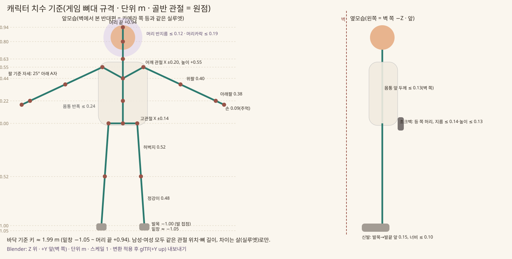

# 34. 캐릭터 외형 교체(남성·여성, 파츠 교체) 검토

검토 v0.1 · 2026-11-11 · 코드 변경 없음(검토만)

사용자 요청: 남성·여성 캐릭터를 고르고, 헤어스타일·상의·하의·초크백·클라이밍화를 각각 바꿀 수 있는 구조를 원한다. 이를 위해 다음을 검토한다.
- 지금 모델의 메시·재질·뼈대·스키닝 구조
- 지금 모델을 고쳐서 될지, 새 모델이 필요한지
- 조작·IK·홀드 잡기를 그대로 둔 채 외형만 바꿀 수 있는지
- 에셋 규격
- 게임 코드와 Blender 각각에서 할 일

---

## 1. 지금 모델 구조 (CH02, game/art/characters/climber.glb)

**만드는 방법:** 손으로 만든 모델이 아니다. 스크립트가 만든다(art_source/character/build_climber.py, Blender 배경 실행).
1. 관절 그래프에 Skin 모디파이어를 씌워 몸통·팔다리 튜브를 만든다.
2. 머리·머리카락·벨트·초크백·신발 끈 같은 작은 조각을 붙인다.
3. 모두 메시 하나로 합쳐 glb로 내보낸다.

| 항목 | 지금 상태 |
| --- | --- |
| 노드 | CH02_rig/Skeleton3D 아래에 메시 5개 |
| 메시 | **CH02_climber 하나**(정점 6,504, 삼각형 3,148, 표면 13개). 표정 FX_face_calm·effort·happy·scared 4개(각 124~340 삼각형)는 따로 있다 |
| 재질 | 표면마다 이름만 있는 M_* 재질(M_shirt, M_skin, M_pants, M_shoe, M_rubber, M_hair, M_belt, M_buckle, M_chalk, M_chalk_rim, M_strap, M_face_*). 텍스처는 없다. 게임이 이름으로 툰 셰이더 + 외곽선 재질로 바꾸고 색은 CHARACTER_COLORS에서 넣는다(play_3d._build_model) |
| 옷 | **옷이 따로 없다.** 셔츠·바지·신발은 같은 몸 튜브의 구역(머티리얼)일 뿐이다. 반팔·바지 길이는 튜브 위 위치로 칠한 것이다(zone()) |
| 뼈대 | 17개(아래 3.1). glTF Skin 하나 |
| 스키닝 | 몸 튜브는 자동 가중치(ARMATURE_AUTO)로 정점 1,364개가 여러 뼈에 걸친다. 머리·머리카락·눈은 head, 벨트·초크백은 pelvis, 신발 끈은 foot_L/R에 가중치 1.0으로 고정했다. 표정 메시도 head에 고정했다 |
| 움직이는 방식 | 애니메이션은 없다. 매 프레임 ClimberPose가 3D 관절 위치를 만들고, RigPose가 뼈마다 전역 회전을 계산해 Skeleton3D.set_bone_global_pose로 넣는다(play_3d._pose_model). 머리는 고개 돌리기를 따로 더한다 |
| 표정 | FX_face_* 메시 4개 중 하나만 보이게 한다(play_3d._set_face) |
| 모델이 없을 때 | 캡슐 인형(_build_character)으로 대신한다 |

---

## 2. 결론

### 2.1 지금 모델을 고쳐서 될까 → 뼈대와 코드는 그대로 쓰고, 메시는 새로 만든다

- **그대로 쓸 수 있는 것:** 뼈대 규격(이름·계층·길이·기준 자세), 자세를 만드는 코드 전부(판정 → ClimberPose → RigPose → 스켈레톤), 표정 방식, 툰 재질 방식.
- **새로 만들어야 하는 것:** 메시.
  - 지금 메시는 옷·머리카락·초크백이 몸과 한 덩어리라서 파츠로 떼어 낼 수 없다.
  - 사용자가 CH02·CH03 모양을 "원하는 캐릭터와 너무 다르다", "별로다"라고 했다. 그래서 외형 품질도 새로 만들어야 한다.
- **권장 순서:**
  1. build_climber.py를 "부위별 메시"를 내보내게 고쳐 **임시 파츠 세트**를 만들고, 교체 구조·코드를 먼저 검증한다.
  2. 최종 외형(남·여 몸, 머리카락, 옷, 신발)은 같은 규격으로 새로 모델링한다. 직접 만들거나, 이미지→3D 도구 결과를 리토폴로지·리깅한다.

### 2.2 조작·IK·홀드 잡기를 그대로 두고 외형만 바꿀 수 있나 → 가능하다

- 판정(잡기·지지·피로·자동 도움)은 2D 논리이고 메시를 전혀 보지 않는다.
- 표현은 관절 위치 18개 → 뼈 17개 회전으로만 움직인다. 같은 뼈대에 스키닝된 메시라면 무엇이든 그대로 따라온다.
- **꼭 지킬 조건**
  1. **뼈 이름·계층·순서·기준 위치가 같아야 한다.** RigPose는 기준 자세 회전과 길이축에서 계산한다. set_bone_global_pose는 뼈 원점을 관절 위치에 놓는다.
  2. **뼈 길이가 게임 몸 길이와 같아야 한다**(팔 0.40/0.38, 다리 0.52/0.48). 다르면 관절에서 메시가 벌어지거나 겹친다.
     - 그래서 **남성·여성도 뼈대 하나를 같이 쓴다.** 28 §2 "모든 플레이어의 신체 조건은 같다"와도 맞는다.
     - 남녀 차이는 뼈가 아니라 메시 실루엣(어깨·가슴·허리·골반 모양, 얼굴, 머리카락)으로 낸다.
  3. **두께 한계를 지킨다.** 지금 관통 검사(anatomy.gd)는 몸통 0.15, 머리 0.15(머리 반지름 0.12 + 팔 0.035)를 가정한다. 이보다 크게 부푼 옷·머리카락은 팔이 뚫고 지나가 보인다(판정은 그대로).

---

## 3. 에셋 규격 (모든 몸·파츠 공통)

### 3.1 뼈대 (이름·순서·부모를 정확히, 17개)

| # | 뼈 | 부모 | 머리 위치(m, Godot 좌표) | 꼬리(다음 관절) |
| --- | --- | --- | --- | --- |
| 0 | pelvis | – | (0, 0, 0) | spine |
| 1 | spine | pelvis | (0, 0.22, 0) | chest |
| 2 | chest | spine | (0, 0.44, −0.01) | neck |
| 3 | neck | chest | (0, 0.63, −0.01) | head |
| 4 | head | neck | (0, 0.80, −0.01) | head_top (0, 0.94, −0.01) |
| 5 / 8 | upperarm_L / R | chest | (∓0.20, 0.55, 0) | elbow (∓0.563, 0.381, 0) — 길이 0.40 |
| 6 / 9 | forearm_L / R | upperarm | elbow | wrist (∓0.907, 0.220, 0) — 길이 0.38 |
| 7 / 10 | hand_L / R | forearm | wrist | 손끝 = 손목 + 같은 방향 0.09 |
| 11 / 14 | thigh_L / R | pelvis | (∓0.14, 0, 0) | knee (∓0.176, −0.519, 0) — 길이 0.52 |
| 12 / 15 | shin_L / R | thigh | knee | ankle (∓0.210, −0.998, 0) — 길이 0.48 |
| 13 / 16 | foot_L / R | shin | ankle | 발끝 = 발목 + (0, −0.05, 앞 0.15) — 길이 0.158(Anatomy.FOOT_LENGTH) |

- **좌표**
  - Godot: Y 위, X 오른쪽, **−Z가 캐릭터 앞(벽 쪽)**, +Z가 등(카메라 쪽).
  - Blender: Z 위, **+Y가 앞**. glTF는 Y-up으로 내보낸다(export_yup).
- **기준 자세:** 팔은 몸 옆으로 25° 내린 A자, 다리는 4° 벌림, 발끝은 앞쪽 아래, 손바닥은 지금 손 뼈 roll(0)을 따른다. 메시는 이 자세로 모델링한다.
- **허용 오차:** 뼈 머리 위치 ±1mm, 길이 ±1mm. 뼈 roll은 기본(0)이다. 추가 뼈(머리카락 흔들림, 초크백 끈 등)는 만들지 않는다. 필요하면 이후 규격을 바꾼다.
- **크기:** 미터 단위, 골반 관절이 원점이다. 머리 끝 +0.94, 발바닥 약 −1.07, 전체 키는 약 2.0m다. 지금 게임 몸 비율(04 계약)이 키가 크게 잡혀 있다. 비율을 바꾸려면 판정 길이(Tuning)부터 바꿔야 하므로 이번 범위가 아니다.

### 3.2 몸을 부위로 나누기 (파츠 연결 방식)

**방식:** 옷을 몸 위에 덧입히지 않는다. **옷 파츠가 덮는 부위의 맨몸을 숨기는 "부위 교체"**로 한다. 로우폴리 툰에서 옷과 몸이 서로 뚫고 나오는 문제가 생기지 않는다.

| 부위 | 기본 몸(남·여 각각) | 바꿔 덮는 파츠 |
| --- | --- | --- |
| R_head | 얼굴·귀·눈 | 머리카락(덮지 않고 위에 붙음) |
| R_neck | 목 | (상의 목둘레가 일부 덮을 수 있음) |
| R_torso | 몸통(허리선 위) | 상의 |
| R_upperarm_L/R | 위팔 | 상의(반팔은 위팔 절반, 긴팔은 전체) |
| R_forearm_L/R | 아래팔 | 긴팔 상의 |
| R_hand_L/R | 손 | (장갑을 넣게 되면) |
| R_hips | 허리선 아래 골반 | 하의 |
| R_thigh_L/R | 허벅지 | 하의 |
| R_shin_L/R | 정강이 | 긴 하의(반바지는 무릎까지) |
| R_foot_L/R | 발 | 클라이밍화 |

- **자르는 고리(이음매):** 모든 몸·파츠가 같은 높이·같은 정점 수(12개)·같은 반지름 범위로 자른다. 그래야 서로 다른 파츠를 끼워도 이음매가 맞는다.
  - 허리선: 골반→척추 30% 지점
  - 목 밑: 가슴→목 30%
  - 위팔 중간: 50%
  - 팔꿈치, 손목, 무릎
  - 발목: 무릎→발목 86%
- 고리 반지름은 몸마다 다를 수 있으나 파츠 쪽 고리가 몸 쪽보다 1~3mm 크게 한다. 덮는 쪽이 바깥에 오게 하기 위해서다.
- **파츠 선언:** 파츠마다 `covers: [부위...]`를 선언한다. 게임은 선택한 파츠들이 덮는 부위의 맨몸 메시를 숨긴다.

### 3.3 파츠별 규칙

| 슬롯 | 스키닝 | 크기·위치 한계 |
| --- | --- | --- |
| 머리카락 | head에 1.0 고정 | 머리 중심(0, 0.84)에서 반지름 0.19 안. 얼굴 앞면(−Z 쪽 눈·입 구역)을 가리지 않는다. 목 아래로 0.10 넘게 내려가지 않는다(어깨·팔과 겹침) |
| 상의 | pelvis·spine·chest·upperarm(·forearm) 자동 가중치. 정점당 뼈 4개 이하 | 몸통 축에서 앞(벽 쪽)으로 0.13 이하(벽 관통), 옆·뒤 0.15 이하(팔 관통 검사 기준) |
| 하의 | pelvis·thigh·shin | 허벅지 반지름 0.09, 정강이 0.085 이하(무릎 굽힘 시 겹침) |
| 초크백 | pelvis에 1.0 고정 | 오른쪽 뒤(+X, +Z 등 쪽) 허리 높이. 지름 0.14, 높이 0.13 이하. 앞(−Z, 벽 쪽)으로 나오지 않는다. 왼쪽 메는 것도 허용(거울 위치) |
| 클라이밍화 | foot(발목 고리 위 2cm까지는 shin 섞음) | 발목 관절이 홀드 접점이다(ClimberPose: ankle = 발 말단 위치). 밑창이 발목에서 약 0.05 아래, 발끝이 발목에서 앞으로 0.15. 너비 0.10 이하 |
| 기본 몸(남·여) | 자동 가중치 | 위 부위로 나눈 메시. 손은 hand 뼈 0.09 안의 주먹 쥔 모양(손목 = 손 접점, 손은 홀드 쪽으로 0.09 더 나감) |
| 표정 | head에 1.0 고정 | 지금처럼 FX_face_calm·effort·happy·scared 4개. 몸(남·여)마다 따로 둘 수 있다 |

### 3.4 재질·폴리곤

- **재질 이름:** `M_<슬롯>_<구역>`(예: M_top_main, M_top_trim, M_shoe_rubber). 게임이 이름으로 툰 셰이더를 씌우고 색 팔레트(색 바꾸기)를 넣는다. 맨살은 M_skin 하나로 통일한다(피부색 선택에 대비).
- **텍스처:** 지금 툰 셰이더는 단색만 받는다. 로고·무늬가 필요하면 셰이더에 albedo 텍스처 입력을 더해야 한다(코드 작업).
- **폴리곤 예산(모바일):** 장착한 전체가 삼각형 8,000개 이하다(지금 3,148). 파츠별 기준은 몸 2,500, 머리카락 1,200, 상의 1,500, 하의 1,200, 신발 각 400, 초크백 300, 표정 각 400이다. 정점당 뼈 4개 이하, 재질 표면은 장착 합계 16개 이하로 한다.

### 3.5 캐릭터 크기 정하는 법 (2026-11-11 사용자 질문 "캐릭터 크기는 어떻게 설정해서 만들어야 해?")

(그림 생성: art_source/character/size_sheet.py)

**원칙: 게임 실제 크기(1 Blender 단위 = 1m)로, 관절 위치를 위 표에 정확히 맞춰 만든다.** 키를 먼저 정하고 비율을 맞추는 방식이 아니다. **관절이 먼저 고정**돼 있고 그 위에 살을 붙인다.
- 판정이 이 길이로 손이 닿는 범위를 계산한다(팔 0.40 + 0.38, 다리 0.52 + 0.48, 어깨 ±0.20, 고관절 ±0.14).
- 모든 문제의 홀드 배치도 이 길이로 검증했다.
- 모델 비율이 다르면 관절에서 메시가 벌어지거나, 손이 홀드에 닿아 보이지 않는다.

**치수 (골반 관절 = 0, 위가 +)**

| 기준 | 높이·크기 | 바닥 기준 |
| --- | --- | --- |
| 머리 끝 | +0.94 | 1.99 m |
| 머리 중심 / 머리 반지름 | +0.84 / ≤ 0.12(머리카락 포함 ≤ 0.19) | 1.89 m |
| 목 관절 | +0.63 | 1.68 m |
| 어깨 관절 | +0.55, 좌우 ±0.20(관절 사이 0.40). 어깨 바깥 살 폭은 남 약 0.50, 여 약 0.44 권장 | 1.60 m |
| 가슴 / 허리 관절 | +0.44 / +0.22 | – |
| 고관절 | 0, 좌우 ±0.14 | 1.05 m |
| 팔 | 위팔 0.40, 아래팔 0.38, 손(주먹) 0.09. 기준 자세는 25° 아래 A자 | 어깨→주먹 끝 0.87 |
| 다리 | 허벅지 0.52, 정강이 0.48. 4° 벌림 | – |
| 발목(발 접점) | −1.00 | 0.05 m |
| 밑창 | 약 −1.05 | 0 |
| 신발 | 발목에서 앞으로 0.15, 뒤꿈치 쪽 0.06~0.08, 너비 ≤ 0.10 | 길이 약 0.22~0.26 |
| 몸통 | 반폭 ≤ 0.24, 앞(벽 쪽) 두께 ≤ 0.13 | – |

- **바닥 기준 키는 약 1.99m다.** 비율은 사람과 비슷하다. 다리가 키의 약 53%, 머리가 약 7.6등신, 팔 길이가 키의 44%다. 다만 지금 게임 몸은 큰 사람이다.
  - 비율은 그대로 두고 키만 1.75m처럼 줄이려면, 판정 길이(Tuning)를 0.875배로 바꾸고 모든 문제를 다시 검증해야 한다. 큰 작업이라 이번 범위에 넣지 않는다.
  - 화면에서 작아 보이게 하려면 카메라 거리를 조정하는 편이 쉽다.
- **남성·여성:** 관절 위치와 뼈 길이가 완전히 같다. 차이는 살로만 낸다.
  - 여성: 어깨 바깥 폭을 줄이고, 가슴·허리·엉덩이 곡선을 넣고, 목·팔·다리 굵기를 가늘게 한다.
  - 손·발 메시는 조금 작게 해도 되지만 손목·발목 위치는 같다.
- **Blender 설정**
  - 단위계 Metric, Unit Scale 1.0.
  - armature와 메시 오브젝트는 위치 0·회전 0·스케일 1이다. 내보내기 전에 Apply All Transforms를 한다.
  - 골반 관절을 원점(0, 0, 0)에 둔다. 바닥은 Z = −1.05다.
  - 앞(벽 쪽)은 +Y다. glTF는 +Y up으로 내보낸다(Godot에서 앞 = −Z).
  - 바닥 Z = 0에 세워 작업해도 되지만, 그때는 armature와 메시를 함께 −1.05 내린 뒤 내보낸다.
- **확인 방법:** 최종 에셋은 4.2-6 규격 검사 테스트(뼈 위치 ±1mm)로 확인한다. 이미지→3D 도구로 만든 모델은 키·비율이 제각각이다. 리그를 먼저 이 치수로 놓고, 메시를 관절에 맞춰 늘리고 줄이는 순서로 작업한다.

---

## 4. 해야 할 일

### 4.1 Blender(에셋) 쪽

1. **기준 리그 파일(master.blend):**
   - 3.1 그대로의 armature "rig" 하나를 둔다. 지금 build_armature()와 같다.
   - 자르는 고리 표시용 참고 메시를 같이 둔다.
2. **임시 파츠(검증용):** build_climber.py를 부위별 메시로 내보내게 고친다.
   - 몸 튜브를 3.2 고리에서 자른다.
   - 상의(반팔·긴팔), 하의(긴바지·반바지), 신발 2종, 초크백 2종, 머리카락 2종을 만든다.
   - 여성 몸은 같은 관절에서 반지름만 바꾼 임시판으로 만든다.
3. **최종 에셋:** 남·여 몸과 파츠를 같은 리그에 스키닝한다. 이미지→3D 도구를 쓰면 리토폴로지 → 기준 자세 맞추기 → 리그에 가중치 순으로 작업한다.
4. **내보내기:**
   - 1차는 **glb 하나에 모든 파츠를 다른 메시로 넣고**, 같은 armature 하나에 스키닝한다. 게임은 고른 것만 보인다. 뼈 순서가 하나라서 스킨 재연결 문제가 없다.
   - 파츠가 많아지면(예: 30개 넘음) 슬롯별 glb로 나누고 4.2-3의 이름 기준 재연결을 쓴다.
   - 메시 이름은 `P_<슬롯>_<id>`(예: P_top_tee_short, P_body_female)로 한다.

### 4.2 게임 코드 쪽

| # | 할 일 | 위치 |
| --- | --- | --- |
| 1 | 캐릭터 설정 저장: {body: male/female, hair, top, bottom, chalk, shoes, 색} | Progress(저장), PlayFlow |
| 2 | 파츠 목록: id·슬롯·메시 이름·covers·남녀 호환·기본 색 | data/characters.json + 읽기 클래스 |
| 3 | 조립기 CharacterAssembler: glb를 열어 고른 메시만 보이고, 덮인 맨몸 부위를 숨기고, 재질을 툰 + 팔레트로 바꾸고, 표정 메시를 찾는다. 슬롯별 glb를 쓰게 되면 다른 파일의 메시를 기준 Skeleton3D로 옮기고 Skin bind를 뼈 이름으로 다시 잇는다 | scripts/presentation/ 새 파일 |
| 4 | play_3d._build_model: 지금 glb 직접 로드와 CHARACTER_COLORS를 조립기와 파츠 팔레트로 바꾼다. 자세·고개·표정 코드는 그대로 | play_3d.gd |
| 5 | 캐릭터 고르기 화면: 홈에 [캐릭터] 버튼 → 남·여, 슬롯별 고르기, 3D 미리보기(SubViewport, 돌리기) | home.gd + 새 장면 |
| 6 | 규격 검사 테스트 | tests/test_character_parts.gd |
| 7 | (선택) 툰 셰이더 텍스처 입력, 피부색 선택 | art/shaders |
| 8 | (선택) 손 접점 보정: 지금은 손목이 홀드 접점이라 손이 홀드 위로 0.09 튀어나간다. 손바닥 가운데를 접점에 두도록 ClimberPose의 손 끝 계산을 바꾸면 홀드를 쥔 모습이 좋아진다(판정 불변) | climber_pose.gd |

**6번 규격 검사 테스트가 볼 것**
- 모든 몸·파츠가 3.1 뼈 17개(이름·순서·부모·위치 ±1mm)를 갖는다.
- 정점당 뼈 4개 이하, 삼각형 예산, 재질 이름 규칙을 지킨다.
- 메시 이름 P_*가 data/characters.json과 맞는다.
- 고른 조합마다 맨몸 부위가 빠짐없이 덮이거나 보인다(구멍 없음).
- 무작위 자세 스윕에서 파츠 경계 상자가 3.3 한계 안에 든다.

**바꾸지 않는 것:** 판정 전부(ClimbSession·ClimbRules·GripCheck·AutoRescue), ClimberPose·LimbIK·Anatomy의 관절 계산, RigPose.

---

## 5. 다음 단계 제안

1. **결정 받기:** 부위 교체 방식(3.2), 1차 glb 하나 방식(4.1-4), 키 약 2.0m 비율 유지.
2. **임시 파츠로 구조 검증:** 4.1-2와 4.2의 1·2·3·4·6. 화면에서 남녀·파츠를 바꿔 IK·잡기가 그대로인지 확인한다.
3. **고르기 화면:** 4.2-5.
4. **최종 아트를 이 규격으로 제작:** 이미지→3D 도구를 쓸지, 외주나 직접 모델링을 할지 정한다.
