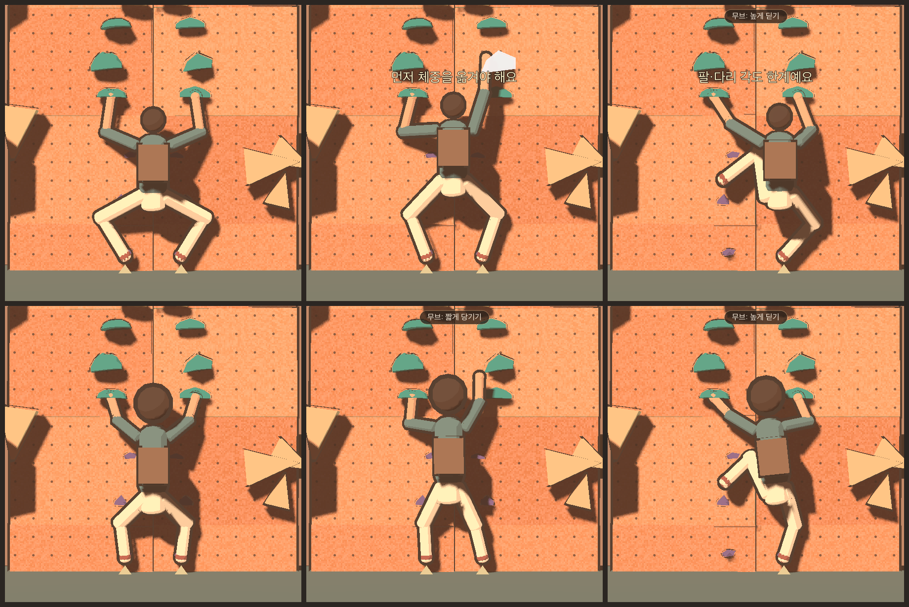

# 35. Tripo 기본 캐릭터(climber_tripo_base.glb) 적용 검토

검토 v0.1 · 2026-11-11 · 코드 변경 없음(검토만)

- **대상:** `origin/main`의 game/art/characters/climber_tripo_base.glb(44MB). 생성 기록은 art_source/character/tripo/(README, task.json, 정면·후면·좌우 참고 이미지)에 있다. Tripo v3.1 멀티뷰 생성 결과이며 리그 없음.
- **방법:** 작업 브랜치에 넣지 않고 임시로 꺼냈다.
  - glTF 구조를 직접 읽었다.
  - Godot으로 불러 정점을 높이 200칸으로 나눠 폭·두께를 쟀다.
  - 사타구니·겨드랑이·목·발끝·초크백 위치를 찾았다.
- 기준 규격은 [34 §3](34_character_customization_review.md)이다.

---

## 1. 파일 상태

| 항목 | 값 | 게임 규격 | 판단 |
| --- | --- | --- | --- |
| 메시 | 1개(통짜) | 몸·파츠 분리(34 §3.2) | 파츠 교체 불가. 분리 필요 |
| 정점 / 삼각형 | 752,378 / **1,464,454** | 장착 합계 8,000 이하 | **약 180배 초과.** 리토폴로지 필수 |
| 재질 | PBR 1개. 색·ORM·노멀 텍스처 3장(약 2.3MB), metallicFactor 1.0 | 툰 셰이더 + 외곽선, 단색 | 텍스처를 쓰는 툰 셰이더 필요. 금속값 1.0이라 그대로 쓰면 금속처럼 보임 |
| 뼈대·스킨·애니메이션 | 없음 | 뼈 17개(RigPose.BONES) | 리깅 필요 |
| 크기 | 키 **1.0**으로 정규화(y −0.5~+0.5) | 키 약 1.99m, 골반 = 원점 | 크기·원점 조정 필요 |
| 방향 | 앞 = **+X**, 팔이 ±Z로 뻗음. 캐릭터 오른쪽 = +Z | 앞 = −Z(벽), 오른쪽 = +X | Y축으로 +90° 돌려야 함 |
| 기준 자세 | T자(팔 수평) | 팔 25° 내린 A자 | RigPose는 기준 자세에서 출발하므로 원리상 가능. 시험 후 규격 고침 |
| 손 | 편 손바닥 | 주먹·말아 쥔 손 | 홀드를 쥐는 모양으로 수정 권장(손가락 뼈 없음) |
| 초크백 | 오른쪽 뒤 허리(+Z 0.11, 뒤 −X 0.09, 정규화 값) | 오른쪽 뒤 | 맞음 |
| 얼굴 | 텍스처에 그린 눈·입 | 표정 4종(FX_face_*) | 표정은 텍스처 교체나 따로 만든 얼굴 메시가 필요 |
| 파일 크기 | 44MB | APK 29MB | 저폴리 + 텍스처 압축 후 수 MB로 줄어야 함 |

---

## 2. 비율 — 가장 큰 문제

키를 1로 놓고 비교했다. 게임 수치는 키 1.99m로 나눈 값이다. Tripo 쪽은 메시 폭이 바뀌는 높이에서 관절 위치를 추정한 값이라 ±0.02 오차가 있다.

| 부위 | Tripo(키=1) | 게임(키=1) | Tripo/게임 |
| --- | --- | --- | --- |
| 바닥 → 고관절(다리 길이) | 약 0.41(사타구니 0.38) | 0.53 | **0.78** — 다리가 짧다 |
| 고관절 → 어깨(몸통) | 약 0.34(어깨 0.745) | 0.28 | **1.21** — 몸통이 길다 |
| 머리(턱 → 정수리) | 약 0.17~0.18(목 0.825) | 0.13 | **1.35** — 머리가 크다(약 5.8등신) |
| 어깨 관절 좌우 | 약 ±0.09 | ±0.10 | 0.9 — 비슷하다 |
| 어깨 → 손끝 | 약 0.31(손끝 ±0.40) | 0.44 | **0.71** — 팔이 짧다 |
| 팔 벌린 폭 / 키 | 0.80 | 1.08 | 팔이 짧은 애니 체형 |

**왜 문제인가:** 판정이 팔 0.40 + 0.38, 다리 0.52 + 0.48m로 손이 닿는 범위를 계산하고, 모든 문제의 홀드 배치를 이 길이로 검증했다. 화면의 손·발은 판정 접점에 붙어야 한다.

**크기만 바꾸면 어디에선가 어긋난다**

| 맞추는 기준 | 배율 | 결과 |
| --- | --- | --- |
| 키 1.99m | ×1.99 | 다리 0.82(게임 1.05), 팔 0.62(0.87), 몸통 0.67(0.55), 머리 0.35m |
| 다리 길이 | ×2.56 | 키 2.56m, 몸통 0.86, 머리 0.45m, 팔 0.79(0.87) |

**길은 셋이다**

| 안 | 내용 | 비용·결과 |
| --- | --- | --- |
| **A(권장)** | 게임 몸은 그대로 두고 Blender에서 모델 비율을 고친다. 키 1.99m에 맞춘 뒤 팔 ×1.4, 다리 ×1.28, 몸통 ×0.83로 늘이고 줄인다. 머리는 0.35m를 유지하거나 0.30m 정도로 조금 줄인다 | 판정·문제 그대로. 결과는 "팔다리가 긴 애니 캐릭터"가 되어 참고 이미지의 짧은 팔 체형과 달라진다 |
| B | 게임 몸을 모델에 맞춘다(팔 약 0.29 + 0.28 등) | 손이 닿는 범위가 크게 줄어 **모든 문제를 다시 만들고 검증**해야 한다. 권하지 않는다 |
| C | 모델 비율을 두고, 화면에서만 팔다리 뼈를 늘여 홀드에 닿게 한다(늘어나는 고무 팔) | 판정은 그대로지만 팔을 뻗을 때마다 팔이 늘어나 보인다. 어색할 가능성이 크다 |

참고 이미지의 짧은 팔 체형을 지키고 싶다면 B뿐이다. B는 게임 전체 재조정이라 사용자 결정이 필요하다.

---

## 3. 적용하려면 고칠 것 (A안 기준)

### 3.1 모델(Blender) 쪽

1. **방향·크기·원점:** Y축 +90° 회전(앞 +X → −Z), 키 1.99m, 골반 관절을 원점에 두고 변환을 적용한다.
2. **비율 맞추기(2장 A안):**
   - 34 §3.1의 뼈대를 먼저 놓는다.
   - 모델을 관절 위치에 맞춰 늘이고 줄인다. 임시 리그로 자세를 잡아 기준 자세로 적용하거나, 부위별로 스케일한다.
   - 팔 끝은 손목이 (∓0.907, 0.220, 0)에 오고, 다리는 발목이 (∓0.21, −0.998, 0)에 와야 한다.
3. **리토폴로지:**
   - 146만 → 약 6,000~8,000 삼각형으로 줄인다. Tripo의 저폴리·리메시 기능, Quad Remesher, 수작업 중 하나를 쓴다.
   - 관절(어깨·팔꿈치·무릎·고관절)에 고리를 충분히 둔다(굽힘 변형).
4. **텍스처 다시 굽기:** 고폴리 → 저폴리로 색(1024~2048)을 굽는다. 노멀은 툰 셰이더에서 쓸지 정한 뒤 굽는다. ORM은 빼거나 금속 0으로 한다.
5. **파츠 분리(교체가 필요하면):** 몸(머리·목·팔), 머리카락, 상의, 하의, 신발, 초크백을 따로 뗀다. 맨살 부위 규칙과 자르는 고리는 34 §3.2를 따른다. 통짜로 먼저 쓰고 나중에 나눠도 된다.
6. **손:** 편 손을 살짝 말아 쥔 모양으로 고친다.
7. **리깅:**
   - 뼈 17개, 이름·순서·부모·위치는 34 §3.1 그대로다.
   - 자동 가중치 후 정리한다. 정점당 뼈 4개 이하다.
   - 머리카락·초크백은 head·pelvis에 고정한다.
8. **얼굴 표정:** 다음 중 하나를 고른다.
   - (a) 얼굴 부분만 따로 메시로 떼어 표정 4종 메시(FX_face_*)를 만든다.
   - (b) 얼굴 텍스처 4장을 바꿔 끼운다(코드 작업 필요).
9. **내보내기:** glTF(+Y up). 메시 이름은 P_* 규칙(통짜면 P_body_male 하나), 재질 이름은 M_<슬롯>_<구역>이다.

### 3.2 게임 코드 쪽

| # | 할 일 | 위치 |
| --- | --- | --- |
| 1 | **텍스처 툰 셰이더:** 지금 toon.gdshader는 단색 albedo만 받는다. albedo 텍스처 입력을 더한다(노멀 텍스처는 선택). CharacterAssembler.style이 텍스처가 있는 재질을 넘기게 한다 | art/shaders/toon.gdshader, character_assembler.gd |
| 2 | **외곽선:** 뒤집은 껍질 방식이 저폴리 메시의 법선과 맞는지 확인한다(리토폴로지 결과에 따라 굵기 조정) | outline.gdshader |
| 3 | **머리·몸통 크기 반영:** 팔이 머리·몸통을 뚫지 않게 피하는 기준이 지금 머리 반지름 0.12·높이 0.84, 몸통 0.15다. 큰 머리(0.30~0.35m)에 맞춰 Anatomy.HEAD_CENTER_UP·HEAD_CLEARANCE·TORSO_CLEARANCE를 새 모델 치수로 바꾼다. 판정은 바뀌지 않는다. anatomy 스윕 기준도 다시 잰다 | anatomy.gd, test_anatomy |
| 4 | **모델 등록:** data/characters.json에 새 몸(또는 새 model 파일)을 등록한다. 통짜면 슬롯 파츠가 없는 몸을 허용하도록 CharacterAssembler를 고친다 | data/characters.json, character_assembler.gd |
| 5 | **표정:** 3.1-8 (b)를 고르면 얼굴 텍스처 교체 코드를 넣는다. (a)면 지금 코드 그대로 | play_3d.gd |
| 6 | **크기 검사 테스트:** 새 모델에도 뼈 위치 ±1mm, 삼각형·재질·가중치 규칙 테스트(test_character_assembler)를 적용한다 | tests |
| 7 | **용량:** 텍스처 압축(ETC2/ASTC)과 해상도를 Godot 가져오기 설정에서 정한다. 원본 44MB glb는 art_source 보관만 하고 게임 폴더에는 저폴리 결과만 둔다 | .import 설정, 폴더 정리 |

**바꾸지 않는 것:** 판정 전부, ClimberPose·LimbIK·RigPose의 관절 계산. 다만 3번 기준값은 화면용 상수라 바꾼다.

---

## 4. 결론

- **이 glb는 그대로 쓸 수 없다.** 쓰려면 다음이 모두 필요하다.
  - 비율 조정
  - 리토폴로지와 텍스처 굽기
  - 방향·크기 정리
  - 리깅
  - (교체용이면) 파츠 분리
  - 손·표정 처리
- **가장 먼저 정할 것은 비율(2장)이다.**
  - A안: 게임 몸에 맞춰 모델 팔다리를 늘린다. 참고 이미지보다 팔다리가 길어진다.
  - B안: 게임 몸을 모델에 맞춘다. 모든 문제를 다시 만들어야 한다.
- **코드 쪽 큰 일은 텍스처 툰 셰이더와 화면용 머리·몸통 기준값 조정 둘이다.** 나머지는 이미 만든 조립기(34 §7)를 그대로 쓴다.

---

## 5. B안 미리보기 (2026-11-11, 사용자 "B안으로 하고 싶어. 많이 차이날까? 예시 사진")

- **위 줄:** 지금 게임 몸.
- **아래 줄:** B안 몸.
- **열:** 시작 자세 / 오른손을 위로 끝까지 뻗기 / 왼발을 높은 발판으로 올리기.
- 벽은 G_V0_01이다.

**찍은 방법(임시, 저장소에는 반영 안 함)**
- 캡슐 인형으로 찍었다.
- 판정 몸 길이(Tuning)와 표현 몸통·머리 위치(ClimberPose)를 B안 값으로 바꿨다.
- B안 몸은 키를 1.99m로 두고 Tripo 비율을 따랐다.

| 항목 | 값 |
| --- | --- |
| 위팔 | 0.285 |
| 아래팔 | 0.27 |
| 허벅지 | 0.41 |
| 정강이 | 0.375 |
| 어깨 | ±0.18, 골반 위 0.67 |
| 고관절 | ±0.10 |
| 머리 | 정수리가 골반 위 1.17, 머리 크기 1.5배 |
| 손이 닿는 거리 | 0.14~0.55 |
| 발이 닿는 거리 | 0.20~0.78 |
| 선호 거리 | 팔 ×0.71, 다리 ×0.78 |

**잰 값(헤드리스 아님, 화면 실행 결과)**

| 동작 | 지금 | B안 |
| --- | --- | --- |
| 시작 골반 높이 | 0.742 | 0.723 |
| 오른손 최대 높이(목표 2.55를 향해 끌기) | 2.20 | **2.01**(약 0.19 낮음) |
| 왼발 올리기(목표 F05 1.15) | 0.92 | 0.91 |

**B안으로 갈 때 생기는 일**
- **손이 닿는 범위가 크게 줄어든다.** 팔 길이가 약 71%라, 위로 닿는 높이는 이 벽에서 약 0.19m 낮다.
  - 지금 사다리(손홀드 간격 0.30~0.45)도 한 칸씩은 닿지만 여유가 거의 없다.
  - 일반·과정 문제의 홀드 간격을 대략 70~80%로 줄여 다시 배치하고, 봇 검증·금지 재생·튜토리얼 완주 테스트를 모두 다시 통과시켜야 한다.
- **다리는 덜 바뀐다.** 다리가 짧아도 몸이 따라 올라가 발 올리기 높이는 거의 같다.
- **몸통이 길고 머리가 커서 팔이 머리 옆을 지나는 일이 많아진다.** 화면용 머리·몸통 기준값(3.2-3)을 함께 바꿔야 한다.
- 판정 수치(04 Tuning), 해부학 범위(Anatomy), 자동 도움·위험 예측은 길이를 Tuning에서 읽으므로 코드 구조는 그대로다. **바뀌는 것은 수치와 콘텐츠(홀드 배치) 전체다.**

---

## 6. B안 적용 (2026-11-11, 사용자 "일단 다 바꿔보자. 문제는 처음부터 다시 할 것이므로 V3 마지막 문제 하나만 변경해서 남기고 튜토리얼도 다 없애. 머리 크기만 1.5배에서 1.4배로")

### 6.1 판정 몸 (Tuning, TUNING_VERSION 8)

| 값 | 이전 | B안 |
| --- | --- | --- |
| 위팔 / 아래팔 | 0.40 / 0.38 | 0.285 / 0.27 |
| 허벅지 / 정강이 | 0.52 / 0.48 | 0.41 / 0.375 |
| 어깨(옆, 골반 위) | 0.20, 0.55 | 0.18, 0.67 |
| 고관절(옆) | 0.14 | 0.10 |
| 손 도달 명목 범위 | 0.20~0.78 | 0.14~0.55 |
| 발 도달 명목 범위 | 0.25~1.00 | 0.20~0.78 |
| 어깨·고관절 yaw 깊이 계수 | 0.18 / 0.14 | 0.16 / 0.10 |
| 선호 팔 거리(기본/쉼/뻗기/락오프) | 0.52/0.70/0.60/0.42 | 0.37/**0.46**/0.43/0.30 |
| 선호 다리 거리(기본/섬) | 0.78/0.86 | 0.61/0.67 |
| 하이스텝 기준(고관절 아래) | 0.20 | 0.16 |
| 손 하중 자격(어깨 아래 한계) | 0.10 | 0.07 |
| 언더클링 높은 발 / 일어서기 판정 / 개스턴 띠 | 0.55 / 0.72 / 0.30 | 0.43 / 0.56 / 0.21 |

쉼 팔 거리 0.46의 이유: 어깨가 벽에서 약 0.21 떨어져 있어 팔이 벽면을 따라 닿는 최대는 약 0.51이다(3D 길이 0.555). 0.50이면 쉬는 자세가 팔을 다 편 채가 되어 도달 여유가 0이 됐다. 이전 몸 비율(0.70 / 0.75)만큼 여유를 남겼다.

### 6.2 표현 몸
- **ClimberPose:** 척추 0.27, 가슴 0.54, 목 0.76, 머리 관절 0.84, 정수리 1.16. 이전 0.22 / 0.44 / 0.63 / 0.80 / 0.94.
- **머리 1.4배:** 캡슐 머리 반지름 0.115 × 1.4.
- **Anatomy:** 머리 중심 골반 위 1.00, 머리 회피 거리 0.20, 몸통 축 +0.06~+0.62, 발 길이 0.135.
- **옛 비율 3D 모델은 쓰지 않는다:** CH02 climber.glb와 시제품 climber_modular.glb는 뼈 길이가 지금 몸과 달라 관절에서 메시가 벌어진다. 그래서 CharacterAssembler.compatible로 걸러 캡슐 인형을 쓰고, 홈 [캐릭터] 버튼도 숨긴다. B안 비율로 리깅된 Tripo 모델이 들어오면 자동으로 쓴다.

### 6.3 콘텐츠
- 일반 문제는 **G_V3_02 "모아서 뻗기" 하나만 남겼다**(V3 두 문제 모두 order 2였고, 목록에서 마지막인 것).
  - 새 몸으로는 첫 동작인 크로스가 성립하지 않았다. 그래서 주제(파란 H07에 두 손을 모은 뒤 오른쪽 H08로 뻗기)를 유지하고, 발·손을 번갈아 올리는 배치로 다시 만들었다.
  - 봇 완등 35.1초, 매치를 금지하면 #10에서 막힌다. 필요 기술은 T_MATCH 하나다.
  - 경고: 도달 여유 0.000 < V3 기준 0.01.
- **튜토리얼·과정 문제는 모두 지웠다.** courses.json의 과정 목록은 비어 있다.
- **첫 실행 잠금:** 기본 조작 튜토리얼 파일이 없으면 첫 실행이어도 등급을 잠그지 않는다(Progress.first_run_locked).

### 6.4 테스트
- 지운 콘텐츠 전용 테스트를 지웠다: test_basic_courses, test_basic_tutorial, test_course_cross, test_course_high_step, test_course_technique_tutorials, test_general_hard.
- **물리 테스트용 판:** 지운 G_V0_01 사다리를 B안 몸에 맞게 줄인 tests/fixtures/G_V0_01.json으로 바꿨다(가로 ×0.9, 시작 손 높이 1.8 유지, 손 간격 ×0.6, 발 간격 ×0.9).
- **TX_GRIP 시험 루트**와 grip 테스트 좌표는 가로 ×0.8, 높이 ×0.85로 줄였다.
- 몸 치수를 직접 쓰던 테스트(pose·yaw·barn door·교차·하이스텝·균형 발 등)는 Tuning 값이나 새 좌표로 다시 썼다.
- 튜토리얼 엔진 테스트(test_tutorial_redesign)는 테스트용 판에 단계를 붙여 시험한다.
- 옛 정적 봇(RouteBot)은 B안 몸에서 첫 손 동작 전에 몸을 충분히 올리지 못해, 해당 테스트를 SessionBot으로 바꿨다.
- 결과: 259개 모두 통과.

### 6.5 알려진 문제
- **팔이 머리를 스친다.** 어깨가 머리 중심에서 0.38, 머리 위로 끝까지 뻗어도 손이 정수리보다 0.06 높을 뿐이다. 그래서 손을 머리 위로 뻗을 때 팔이 머리 옆을 지나는 자세가 많다.
  - 무작위 조작 스윕 측정값(이전 몸 상한 5%·30%)은 아래와 같다. 관절 뒤집힘은 0이다.

    | 항목 | 측정값 |
    | --- | --- |
    | IK가 놓친 위반 | 20.5% |
    | 강제된 위반 | 31.3% |

  - 회귀 감시 상한을 22%·34%로 두었다.
  - 대책 후보: 머리 크기 조정, 팔꿈치 방향 선호 조정, 머리 회피 거리를 실제 모델 머리에 맞추기. 리깅된 모델이 들어온 뒤 결정한다.
- 남은 G_V3_02와 테스트용 판 모두 도달 여유가 빠듯하다(0~0.03). 새 문제를 만들 때는 새 몸 기준으로 홀드 간격을 다시 정해야 한다.
