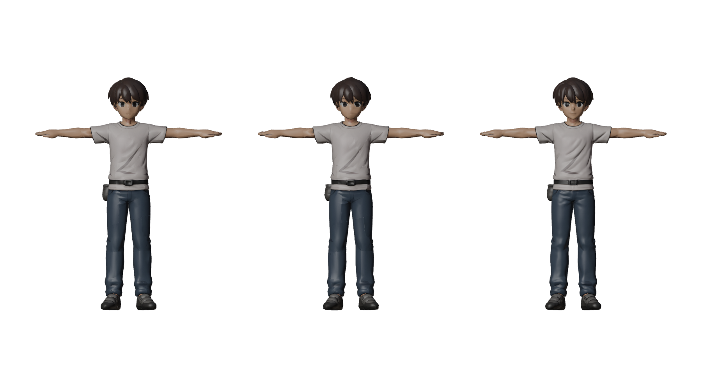
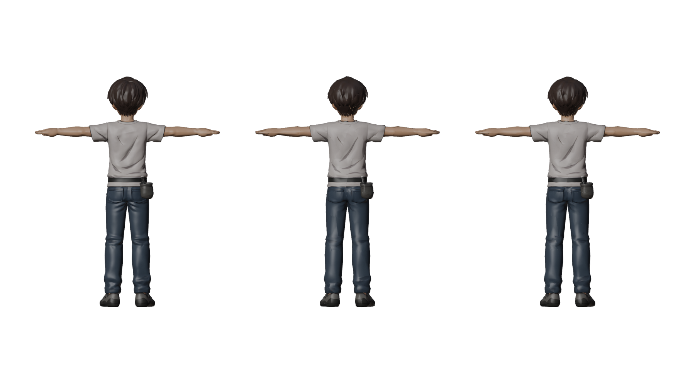
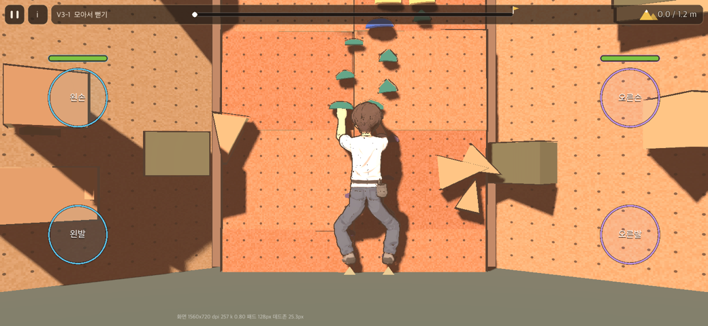
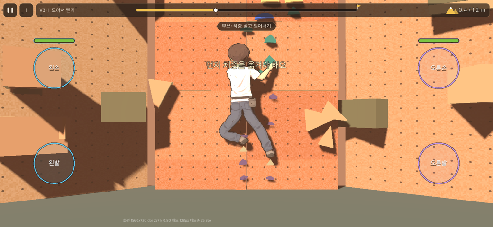
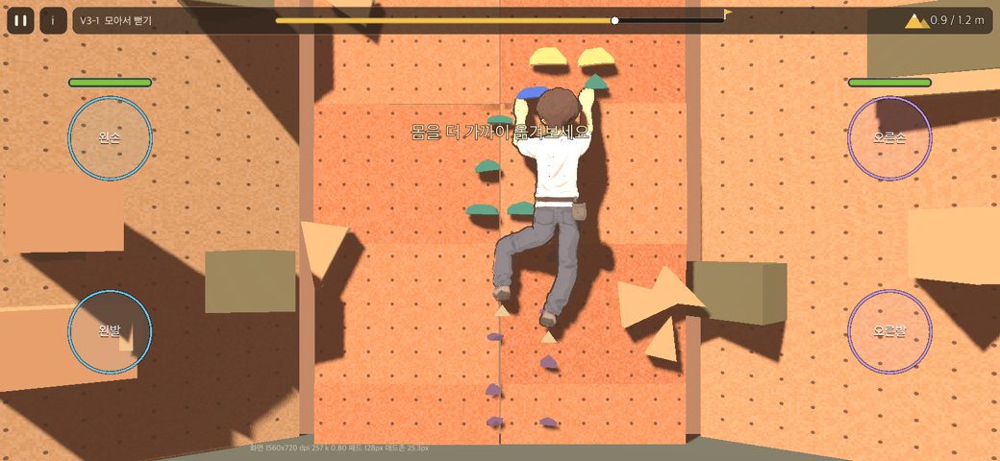
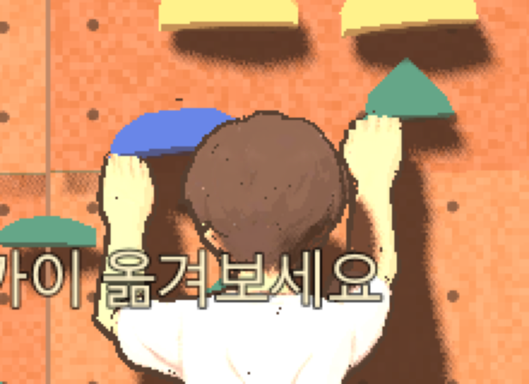

# 36. Tripo 캐릭터(climber_tripo_base.glb) 적용 계획

기획 v0.2 · 2026-11-11 · v0.1 검토·시험 → v0.2 사용자 결정 반영, 1~3단계 적용(0.9.23, 아래 5장)

사용자 요청: "climber_tripo_base.glb 확인해. 적용 가능하려면 어떻게 해야 하는지 검토하고 기획해."

- **대상:** `origin/main`의 game/art/characters/climber_tripo_base.glb(커밋 73f65e0). [35](35_tripo_model_review.md) 1장에서 본 파일과 같다(그 뒤 바뀌지 않음).
  - 정점 752,378 / 삼각형 1,464,454
  - 메시 1개, PBR 재질 1개(색·ORM·노멀 텍스처)
  - 리그·애니메이션 없음, T자, 키 1.0
- **달라진 점:** 그 사이 판정 몸을 이 모델 비율에 맞춰 바꿨다(B안, 35 §6). 그래서 이번에는 "적용하려면 무엇을 하나"를 실제로 시험해 보고 계획을 세운다.
- **시험(이 Mac, Blender 5.2.3 배경 실행)**
  - art_source/character/tripo/probe_fit.py: 방향·크기 맞추기와 신체 기준점 재기
  - probe_decimate.py: 줄이기와 렌더

---

## 1. 시험 결과

### 1.1 B안 몸과 맞는가 → 1~2cm 안에서 맞는다(비율 수정 불필요)

Blender로 불러 Z축 +90° 회전(앞 +X → +Y, 우리 Blender 규약)하고, 키 1.99m, 발바닥 z = −0.835(골반 관절 = 원점)로 놓은 뒤 쟀다.

| 기준점 | Tripo 모델 | B안 몸(Tuning) | 판단 |
| --- | --- | --- | --- |
| 어깨선 높이 | 0.670 | 0.67 | 맞음 |
| 정수리 | 1.155 | 1.16 | 맞음 |
| T자 손끝 | ±0.798 | 어깨 0.18 + 팔 0.555 + 손 약 0.07 = 약 0.80 | 맞음 |
| 사타구니 | −0.068(고관절 아래 7cm) | 고관절 0 | 자연스러운 위치 |
| 목(가장 가는 곳) | 0.827 | 목 관절 0.76 ~ 머리 관절 0.84 사이 | 맞음 |
| 다리 바깥 폭 | 약 ±0.195(무릎) | 고관절 ±0.10, 허벅지 반지름 약 0.09 | 맞음 |
| 몸통 반폭(가슴) | 약 0.16 | 몸통 회피 0.15 | 맞음 |
| 초크백 | 오른쪽(+X 0.144) 뒤(−Y 0.181) | 오른쪽 뒤 | 맞음 |
| 발끝 | +Y 0.209(앞) | 앞 | 맞음 |

→ **35 §3.1의 "비율 고치기(늘이고 줄이기)"는 필요 없다.** 뼈를 B안 관절 위치에 놓기만 하면 된다.

### 1.2 줄이기 → 8천 삼각형도 게임 거리에서는 거의 같다

- 왼쪽부터 원본(1,464,454), 8천(7,999), 1만 5천 삼각형이다.
- Blender Decimate(접기)로 각각 약 12초 걸렸다. UV가 남아 원래 색 텍스처를 그대로 쓴다.
- 게임 화면은 등 쪽에서 본다. 뒷면 8천에서 뒷머리에 작은 텍스처 이음이 보이고, 1만 5천은 거의 없다.
- 손을 가까이 보면, 손가락이 붙은 납작한 판(벙어리장갑) 모양이다. 원본도 같다.

---

## 2. 적용 계획

### 2.1 1단계 — 자동 변환 스크립트(Blender, 설계자가 만듦)

`art_source/character/tripo/build_tripo_rig.py`로 원본 → 게임용 glb를 한 번에 만든다. 원본이 바뀌면 다시 돌린다.

1. **놓기:** Z +90° 회전, ×1.99, 발바닥 z = −0.835, 변환 적용(1.1과 같음).
2. **줄이기:** 8천~1만 5천 삼각형(2.4 결정). UV 유지.
3. **재질:** 색 텍스처만 쓴다(2048 → 기기에서 1024 압축). ORM·금속값은 버리고, 노멀은 2단계에서 쓸지 정한다. 재질 이름은 `M_body_main`.
4. **뼈대:** 17개(RigPose.BONES)를 B안 관절 위치에 놓는다.

   | 뼈 | 위치 |
   | --- | --- |
   | 골반 | 0 |
   | 척추 / 가슴 / 목 / 머리 | 0.27 / 0.54 / 0.76 / 0.84 |
   | 어깨 | (±0.18, 0.67) |
   | 팔꿈치 | 어깨 + 0.20(T자라 수평) — v0.2에서 바꿈(5.1) |
   | 손목(게임 접촉점) | + 0.35 = 모델의 손가락 뿌리 마디 |
   | 손 꼬리 | 손목 + 0.07(손끝 방향) |
   | 고관절 | (±0.10, 0) |
   | 무릎 / 발목 | 아래로 0.41 / 0.375(모델 다리 축에 맞춰 약간 벌림) |
   | 발 꼬리 | 발목 + 앞 0.135 |

   **기준 자세가 T자다.** RigPose는 기준 자세에서 회전을 구하므로 원리상 된다(34 §3.1의 "A자 25°"는 이 모델에서 T자로 바꾼다). 3단계에서 확인한다.
5. **가중치**
   - 자동(bone heat)으로 주고 다음을 정리한다.
     - 머리카락·머리는 head 고정.
     - 초크백(허리 뒤 오른쪽 영역)은 pelvis 고정.
     - 신발은 foot 위주.
   - 정점당 뼈 4개 이하로 한다.
6. **내보내기:** `game/art/characters/climber_tripo.glb`(메시 이름 P_body_male, 리그 이름 ClimberCommonRig). 원본 44MB는 게임 폴더에서 art_source/character/tripo/로 옮긴다(APK 크기).

### 2.2 2단계 — 게임 코드(설계자)

| 할 일 | 위치 |
| --- | --- |
| **텍스처 툰 셰이더:** albedo 텍스처 입력(있으면 색 대신 사용)을 넣는다. 외곽선은 지금 방식 | art/shaders/toon.gdshader, CharacterAssembler.style |
| **통짜 모델 허용:** 슬롯 파츠가 없는 몸(통짜)이면 몸 메시만 보이고, 홈 [캐릭터] 화면은 "남성 1종"으로 보인다 | data/characters.json, character_assembler.gd |
| **호환 검사:** compatible()이 T자 모델도 통과하는지 확인한다(뼈 길이·어깨 위치만 보므로 통과 예상) | character_assembler.gd |
| **화면용 머리·몸통 기준:** Anatomy의 머리 중심(1.00)·회피 거리(0.20)를 실제 메시 머리(재 보면 반지름 약 0.17)에 맞춘다. 무작위 스윕 다시 재기 | anatomy.gd, test_anatomy |
| **표정:** 이 모델엔 표정 메시가 없어 한 가지 표정. 지금 코드 그대로(표정 메시가 생기면 자동) | – |
| **테스트:** 새 glb에 뼈 17개·위치 ±1mm·삼각형 예산·정점당 뼈 수 검사를 붙인다 | test_character_assembler |

### 2.3 3단계 — 확인

- 맥 화면에서 시작·손 뻗기·높게 딛기·크로스·드롭니 자세를 찍는다.
  - 어깨(T자에서 팔을 내릴 때 겨드랑이 접힘), 사타구니, 무릎 변형을 본다.
  - 손이 홀드에 붙는지 본다.
- 무작위 자세 스윕(관절 뒤집힘 0)은 그대로 통과해야 한다.
- 기기에서는 프레임, 텍스처 메모리, APK 크기를 확인한다(사용자).

### 2.4 4단계 — 아트 보완(결정 필요)

| 항목 | 지금 | 선택지 |
| --- | --- | --- |
| **손** | 손가락이 붙은 납작한 편 손. 홀드를 쥐어도 손바닥을 편 채 얹혀 보인다 | (a) Blender에서 손을 말아 쥔 모양으로 고친다(수작업, 반나절) / (b) 손가락 뼈를 손마다 1~2개 더해 잡으면 코드가 말아 쥔다(개발 1~2일, 뼈 규격 변경) / (c) Tripo에 "손을 살짝 쥔 T자"로 다시 생성(30크레딧, 얼굴·옷이 조금 달라질 수 있음) |
| **표정** | 얼굴이 텍스처에 그려진 한 가지 | (a) 얼굴만 덮는 작은 판에 표정 텍스처 4장(평온·힘씀·기쁨·놀람)을 바꿔 끼운다(그림 4장 + 코드) / (b) 표정 없이 간다 |
| **파츠 교체** | 통짜(옷·머리카락·신발이 몸과 한 덩어리) | 나중에 메시를 부위로 나눠야 한다(수작업, 또는 Tripo 부위 분리 기능 확인 필요). 1차는 통짜 |
| **여성** | 없음 | 같은 방식으로 따로 생성(같은 B안 비율로 요청) |
| **폴리곤** | – | 8천(가벼움, 뒷머리 이음 조금) 또는 1만 5천(이음 거의 없음). 설계자 추천: 1만 2천 전후로 시작해 기기 프레임을 보고 정함 |

---

## 3. 위험

- **자동 가중치 품질:** 어깨(T자 → 팔 내림)·사타구니·옷 주름에서 메시가 찌그러질 수 있다. 3단계 화면으로 보고, 심하면 가중치를 손으로 고친다.
- **줄이기 이음:** 뒷머리 등 텍스처 경계가 조금 깨진다. 폴리곤을 늘리거나, 리메시 후 텍스처 다시 굽기(시간 더 듦)로 해결한다.
- **팔-머리 겹침(35 §6.5):** 실제 메시 머리로 기준을 다시 잡아도, 머리가 큰 비율이라 일부는 남는다.
- **44MB 원본:** 게임 폴더에 두면 APK가 커진다. 2.1-6대로 옮긴다.

## 4. 진행 제안

1~3단계는 결정 없이 바로 할 수 있다. 결과물은 남성 1종, 통짜, 한 가지 표정, 텍스처 툰이다. 4단계의 손·표정 방식과 폴리곤 수는 사용자가 정한다.

---

## 5. 사용자 결정과 적용 결과(v0.2, 0.9.23)

사용자 결정(2026-11-11): "1. b로 하고 싶어 2. 표정 없이 하나로 그대로 3. 너가 원하는 대로 4. 나중 단계로"

| 항목 | 결정 | 적용 |
| --- | --- | --- |
| 손 | (b) 손가락 뼈 + 코드가 말아 쥠 | 손마다 finger 뼈 1개(손 뼈의 자식). 잡은 손(Attached·Armed)은 손 뼈 35°, 손가락 뼈 60° 더 벽 쪽으로 접는다(1/s 10으로 부드럽게) |
| 표정 | 없음(한 가지) | 표정 메시가 없어 지금 코드(FX_face_*가 있을 때만 바꿈)가 그대로 아무것도 하지 않는다 |
| 폴리곤 | 설계자 | 1만 2천 삼각형(8천과 1만 5천 사이) |
| 파츠 교체·여성 | 나중 단계 | characters.json은 남성 1종·슬롯 없음. 홈 [캐릭터] 화면은 파츠 없는 줄을 그리지 않는다 |

### 5.1 팔 길이 나누기를 바꿨다(위팔 0.285/전완 0.27 → 0.20/0.35)

뼈를 놓으려고 T자 팔을 다시 재니, 모델의 손목은 어깨 바깥 x ≈ 0.585, 손가락 뿌리 마디는 ≈ 0.74, 손끝은 0.80이었다.
손이 크고(약 0.21) 전완이 짧은 비율이다. 게임의 손 접촉점(손목 관절)을 손바닥이 홀드를 덮는 **손가락 뿌리 마디**에 두면
어깨 → 접촉점이 0.55(지금 팔 전체 길이 0.555와 같음)이고, 팔꿈치는 어깨에서 0.20이다.

- **판정 영향:** 팔 전체 도달(0.555)은 그대로라 홀드 도달 범위는 같다. 팔꿈치 위치만 바뀌어 팔을 가장 접었을 때 최소 거리가 약 0.189로 달라졌다(test_pose).
- **화면 영향:** 손 길이 상수 Anatomy.HAND_LENGTH 0.07을 새로 둬 캡슐 인형과 모델의 손끝을 같은 식으로 그린다.
- **팔-머리 겹침:** 무작위 자세 스윕에서 팔이 머리를 지나는 비율이 조금 늘었다(강제 38.6%, 놓침 20.8%, test_anatomy 기준을 그에 맞춤). 실제 화면에서는 높은 손을 뒤에서 볼 때 손이 머리에 가려지는 정도다(아래 그림). 머리 회피는 다음 과제로 남긴다.

### 5.2 만든 것

| 무엇 | 위치 |
| --- | --- |
| 변환 스크립트(원본 → 게임 glb 한 번에): 놓기·줄이기(1만 2천)·재질(색 텍스처 1024, JPEG 88)·뼈 19개(17 + 손가락 2)·가중치(부위·위치 규칙)·내보내기 | art_source/character/tripo/build_tripo_rig.py |
| 원본(44MB)과 참고 자료 | art_source/character/tripo/(게임 폴더 밖이라 APK에 안 들어감) |
| 게임 모델(687KB + 텍스처 97KB) | game/art/characters/climber_tripo.glb |
| 텍스처 툰: use_texture·albedo_tex·shade_mult(그늘은 밝기 비율) | art/shaders/toon.gdshader |
| 외곽선 깊이 밀기 depth_push(텍스처 모델만 0.025m) — 주름 많은 메시에서 껍데기가 겉면을 뚫고 검은 점으로 보이던 것을 없앰 | art/shaders/outline.gdshader |
| 호환 검사는 어깨를 벽면(x, y)으로만 본다(모델 팔 중심선 깊이 0.03) | CharacterAssembler.compatible |
| 손가락 말아 쥐기 | play_3d._curl_fingers |
| 테스트: 뼈 위치 ±1mm, 손가락 뼈, 삼각형 예산 12,500, 정점당 뼈 4, 텍스처 전달, 통짜 목록 | tests/test_character_assembler.gd |

### 5.3 맥 화면 확인

- 무릎·고관절 굽힘, 높게 딛기에서 바지 변형이 자연스럽다.
- 잡은 손은 손가락이 홀드 윗모서리를 덮는다(뒤에서 보면 손등이 보임).
- 남은 것: 높은 손이 머리 뒤로 가려지는 자세(5.1), 기기 프레임·메모리 확인(사용자).
