# 37. 다리 자세 개선 계획

v0.5 (2026-11-13) — 사용자 보고("다리가 너무 이상해", 0.9.23-preview 기기 화면 4장)를 맥에서 재현하고 원인을 재서 정리한 계획. 1단계는 0.9.24-preview(§4), 2·3단계는 0.9.25-preview(§5), 4단계(가랑이)는 0.9.26-preview(§6), 엉덩이·캐릭터 교체(남성 v2·여성)는 0.9.27-preview(§7)에 반영했다. 기기 확인은 아직 안 했다.

## 1. 재현

G_V3_02에서 12번째 동작까지 올라간 뒤(왼발 F07, 두 손 H07·H08) 오른발을 떼어 끌었다. 기기 화면과 같은 모양이 맥에서도 그대로 나온다.

| 상황 | 화면 | 잰 값 |
|---|---|---|
| 오른발을 엉덩이 높이, 옆 0.42m로 끌기 | 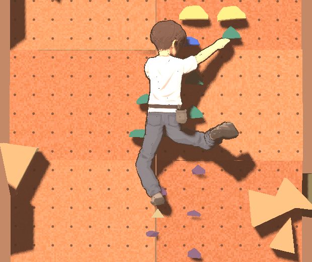 | 무릎각 76°. 무릎은 엉덩이보다 **아래**(−0.11m)·벽 쪽, 발목은 골반보다 **0.24m 카메라 쪽**(벽에서 0.44m) |
| 같은 자세를 옆에서 | 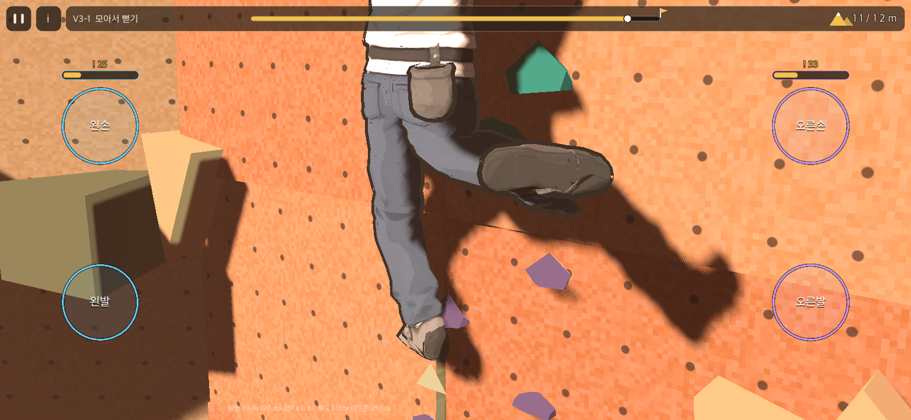 | 발이 몸 뒤로 나와 발바닥이 카메라를 본다 |
| 오른발을 엉덩이 높이, 옆 0.75m(끝까지) | 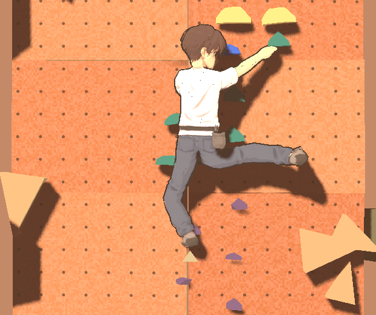 | 무릎각 150°, 다리가 수평 막대. 골반·허리는 그대로 |
| 네 손발이 붙은 평소 자세 | 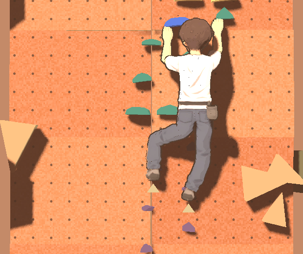 | 허벅지 앞면과 실제 굽는 방향이 51~54° 어긋남 |

## 2. 원인

판정(2D)은 문제없고, 모두 표현(3D 자세를 만드는 부분) 쪽이다. 캡슐 인형일 때는 안 보이던 것이 옷·신발이 있는 Tripo 모델에서 드러났다.

1. **뗀 발이 몸 뒤로 나온다(가장 큼).** 무릎 자리를 만들려고 뗀 발 끝을 벽에서 최대 0.25m 더 띄우는 규칙(`ClimberPose.FREE_END_DEPTHS`)이 있다. 골반이 벽에 붙어 있으면(0.20m) 발이 골반보다 뒤(0.44m)로 가서 "뒤차기"가 된다. 카메라가 정확히 뒤에서 보므로 정강이는 짧게 눌려 보이고 발바닥이 크게 보인다. 기기 화면 3·4번이 이것이다.
2. **무릎이 위·바깥으로 못 간다.** 발이 엉덩이 높이 근처면 실제로는 무릎을 옆·위로 드는 하이스텝 모양이 된다. 그런데 고관절 굴곡각을 옆에서 본 각으로만 재서(`Anatomy.hip_flexion_deg`), 허벅지가 옆·위를 향하면 180°로 계산되어 금지된다. 벽 쪽은 공간이 없어(필요 0.33m, 있는 것 0.15m) 막힌다. 남는 선택이 무릎을 아래로 내리고 발을 뒤로 빼는 1번 자세다. 붙은 발(기기 화면 1번 왼다리)도 같은 이유로 무릎이 발 아래로 처진다.
3. **골반이 통짜다.** 골반·허리 뼈는 몸통 기울기만 따른다. 다리를 옆으로 90° 들어도 골반이 따라 기울지 않아 다리만 막대처럼 튀어나온다(기기 화면 2번).
4. **뼈 비틀림을 정하지 않는다.** 허벅지·정강이·발 뼈는 "가장 짧은 회전"으로만 돌려서(`RigPose`), 무릎 앞면이 실제 굽는 방향과 25~63° 어긋나고 발바닥 방향이 자세마다 제멋대로다(최대 90° 돌아감). 허벅지만 맞추는 시험을 해 보니 무릎 주름은 맞지만 발이 바깥으로 벌어져, 발 방향과 같이 고쳐야 한다.
5. **곧은 다리를 수평으로 끌 수 있다.** 판정의 발 도달 범위가 엉덩이 중심 원이라 다리를 편 채 옆으로 90° 드는 것도 된다. 이건 판정 규칙이라 표현만으로는 못 막는다.

## 3. 계획

판정은 건드리지 않고 표현만 고친다(1~4단계). 단계마다 맥 화면으로 확인하고 APK를 낸다.

**1단계 — 뗀 발 깊이·무릎 방향 (효과 가장 큼)**
- 뗀 발 끝은 골반보다 뒤로 가지 않는다(발목 깊이 ≤ 골반 깊이 − 0.05m). 추가 띄움 후보를 0.25 → 0.12 이하로 줄인다.
- 발이 엉덩이 높이 근처(엉덩이 아래 0.25m보다 높음)면 무릎 선호 방향을 "바깥·위"로 바꾼다. 붙은 발에도 적용한다.
- 고관절 굴곡각을 허벅지가 옆으로 벌어진 정도에 맞춰 재도록 고쳐, 옆·위로 든 무릎(하이스텝)을 허용한다.
- 뗀 다리에 자리가 없으면 발을 뒤로 빼기 전에 골반을 벽에서 떼는 쪽을 먼저 고른다(판정이 허용하는 깊이 안에서).
- 시험: 발 위치 격자(엉덩이 기준 가로 0~0.75, 세로 −0.75~+0.3)를 훑어 "발목이 골반 뒤", "뗀 발의 무릎이 발보다 아래"가 0건인지 본다. 기존 떨림 방지 시험은 그대로 통과해야 한다.

**2단계 — 골반 기울기**
- 허벅지가 옆으로 45° 넘게 들리면 골반 뼈를 그 다리 쪽으로 최대 15° 기울이고 허리 뼈가 반대로 받아 가슴은 그대로 둔다. 관절 위치는 판정 그대로(모양만).

**3단계 — 뼈 비틀림**
- 허벅지: 무릎 앞면이 굽는 방향을 보게 돌린다. 정강이는 따라간다.
- 발: 발끝 방향에 더해 발바닥 방향을 정한다. 붙은 발은 발끝이 벽, 발바닥이 아래. 뗀 발은 정강이 기준으로 자연스럽게 늘어뜨린다.
- 시험: 앞면-굽힘 방향 차 ≤ 15°, 발바닥 기울기 ≤ 30°.

**4단계 — 가중치 확인**
- 1~3단계 뒤에도 사타구니·엉덩이 옷이 늘어나 보이면 `build_tripo_rig.py`의 골반·허벅지 가중치를 고쳐 glb를 다시 만든다. 필요할 때만.

**결정이 필요한 것(판정 변경)**
- 곧은 다리 수평 들기(원인 5)를 막을지. 막으면 발 도달 범위가 줄어 문제 배치 검증을 다시 해야 한다. 권장: 1~3단계를 먼저 보고, 그래도 어색하면 그때 정한다.

## 4. 1단계 결과 (0.9.24-preview)

| 상황 | 화면 | 잰 값 |
|---|---|---|
| 오른발을 엉덩이 높이, 옆 0.42m |  | 무릎이 엉덩이보다 0.32m 위·바깥. 발목은 골반보다 0.05m 벽 쪽(벽에서 0.15m) |
| 같은 자세를 옆에서 | 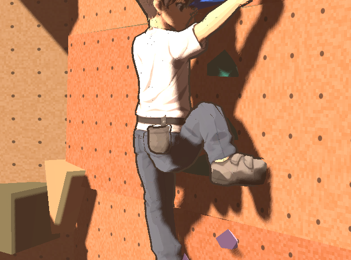 | 발이 몸 앞(벽 쪽)에 있다 |
| 엉덩이 아래 0.15m, 옆 0.40m | 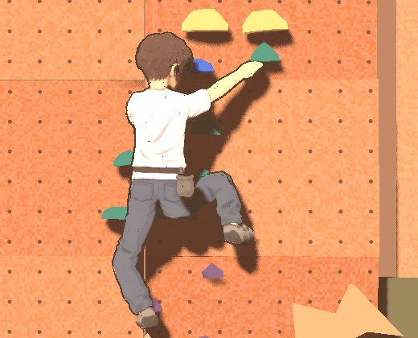 | 무릎이 발 위에 있다 |
| 엉덩이 높이, 옆 0.75m(끝까지) | 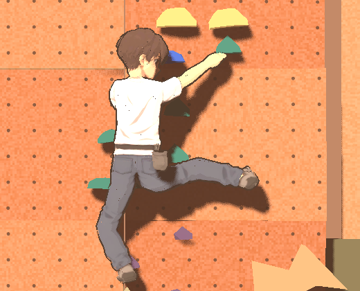 | 다리는 여전히 수평 막대(원인 3·5, 2단계와 판정 결정 대상) |

바꾼 것(모두 표현, 판정은 그대로):
- `ClimberPose`: 뗀 발 끝 깊이는 골반 깊이 − 0.05m를 넘지 않는다(`FREE_FOOT_FRONT`). 추가 띄움 후보 0.12·0.25 → 0.06·0.12.
- `Anatomy.hip_lift_excess`: 고관절 굴곡 한계를 "허벅지를 든 높이"로 다시 정했다. 앞으로 70°, 옆으로 60°, 뒤로 −60°까지이고 사이는 보간한다. 옆·위로 든 무릎(하이스텝)이 허용된다. IK(`LimbIK._violation`)와 점검(`Anatomy.check`)이 같이 쓴다.
- `Anatomy.hip_twist_deg`: 허벅지가 수평 위로 들리면 회전 기준을 "앞으로 든 자세에서 정강이가 아래"로 바꿔 잰다. 이전 기준은 옆·위 허벅지에서 값이 뒤집혀 하이스텝을 회전 위반으로 봤다.
- `LimbIK.leg_pole`: 발이 엉덩이 아래 0.40m보다 높으면 무릎 선호 방향을 바깥·위로 섞고, 0.10m부터는 바깥·위만 쓴다. 붙은 발에도 적용한다.

시험(`test_free_foot_grid`): 두 판의 시작 자세에서 양발을 격자 48칸씩, 그리고 G_V3_02 12번째 동작 뒤(골반이 벽에 붙은 자세) 오른발 5곳.
- 고치기 전: 12번째 동작 뒤 격자 96칸 중 83칸에서 발목이 골반 뒤, 13칸에서 무릎이 발 아래(거의 편 자세 포함).
- 고친 뒤: 둘 다 0칸. 전체 시험 262개 통과.

남은 것:
- 발을 엉덩이 바로 옆·위로 바짝 당긴 자세(엉덩이에서 0.25m 안, 엉덩이보다 높음)는 무릎이 가슴 앞으로 곧게 올라가고 회전 한계를 넘는다(격자 96칸 중 2~12칸). 판정이 허용하는 극단 자세라 표현으로는 가능한 굽힘이 없다.
- 발바닥이 카메라를 보는 자세가 있다(발을 엉덩이 위로 든 경우). 3단계(발 방향)에서 고친다.

## 5. 2·3단계 결과 (0.9.25-preview)

| 상황 | 화면 |
|---|---|
| 네 손발이 붙은 평소 자세 | 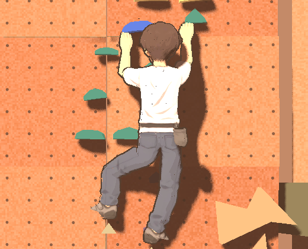 |
| 오른발을 엉덩이 높이, 옆 0.42m | 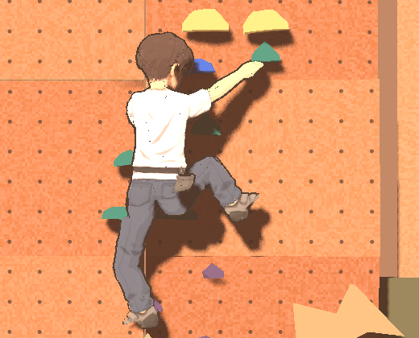 |
| 엉덩이 위 0.15m, 옆 0.30m | 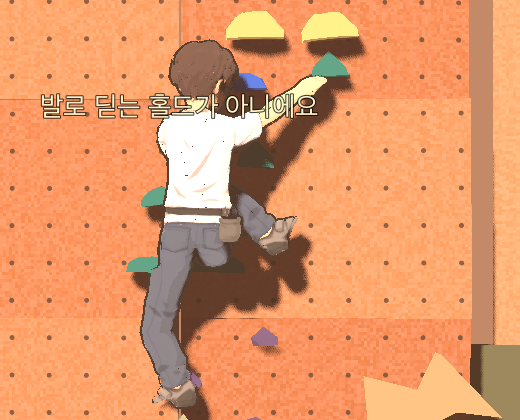 |
| 엉덩이 높이, 옆 0.75m(끝까지) | 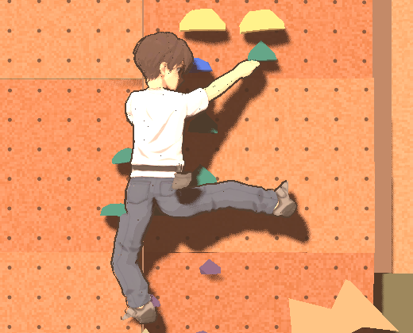 |

바꾼 것(모두 `RigPose`, 뼈 방향만. 관절 위치와 판정은 그대로):
- **골반 기울기**(`pelvis_tilt_deg`): 허벅지가 옆으로 45° 넘게 벌어지면 골반 뼈의 그 다리 쪽이 올라간다. 90°에서 최대 15°. 앞으로 든 무릎은 해당 없음. 허리·가슴 뼈는 건드리지 않으므로 가슴은 그대로다.
- **허벅지 비틀림**: 무릎 앞면이 실제 굽는 방향(무릎이 엉덩이–발목 선에서 벗어난 쪽)을 본다. 거의 편 다리(벗어남 0.02m 미만)는 돌리지 않고 0.08m까지 서서히 켠다. 정강이는 허벅지를 따라간다.
- **발 방향**: 발등이 "몸 위쪽 − 정강이 방향"을 본다. 붙은 발은 위쪽 비중이 커서(2.0) 발바닥이 아래로, 뗀 발은 작아서(0.5) 정강이를 따라 늘어진다. `play_3d`가 어느 발이 떠 있는지 넘긴다.

시험(`test_leg_bone_twist`, `test_pelvis_tilt`): 두 판의 시작 자세, 양발 격자 12칸씩, 12번째 동작 뒤 오른발 3곳.
- 허벅지 앞면-굽힘 방향 차 ≤ 15°: 모두 통과(고치기 전 25~63°).
- 붙은 발 발바닥 기울기 ≤ 30°, 발등이 정강이 아래쪽을 보지 않음: 모두 통과.
- 전체 시험 264개 통과.

남은 것:
- 골반 기울기는 맥 화면에서 차이가 작다(엉덩이 관절이 2~3cm 움직이는 정도). 끝까지 편 수평 다리는 여전히 막대처럼 보인다. 이건 원인 5(판정이 곧은 다리 수평 들기를 허용)라 표현으로는 더 못 줄인다 → §3의 판정 결정 대상.
- 4단계(가중치)는 하지 않았다. 맥 화면에서 사타구니 옷 늘어짐이 눈에 띄지 않았다. 기기에서 보이면 그때 한다.

## 6. 4단계 결과 — 가랑이 (0.9.26-preview)

사용자 보고(0.9.25-preview 기기 화면, 오른다리를 옆으로 끝까지 든 자세):
- 사타구니 분기점이 불명확하다. 양쪽 허벅지가 갈라지는 Y자 형태가 자연스럽지 않다.
- 골반 아래 형태가 어색하다. 바지 가랑이가 정상 인체처럼 이어지지 않는다.

원인(Blender에서 같은 자세로 재현, `build_tripo_rig.py` 가중치):
- 골반↔허벅지 가중치가 높이로만 정해져서, 가운데 선 바로 옆(x 0.5~2cm) 가랑이 정점도 허벅지 가중치를 0.7까지 받았다. 다리를 들면 가랑이 꼭짓점이 엉덩이 관절을 중심으로 15cm 넘게 옆으로 끌려간다. 그래서 갈라지는 점이 사라지고, 왼다리 안쪽에서 들린 다리 밑까지 둥근 U자로 이어졌다.
- 두 뼈만 선형으로 섞으면 회전 차이가 90°에 가까울 때 사이 정점이 안으로 접힌다. 엉덩이가 납작해지고 허벅지가 엉덩이 뒤에서 관처럼 나온다.
- 가중치만 바꾸면(가운데를 골반에 남김) 꼭짓점은 가운데에 남지만 허벅지 밑이 넓은 막처럼 처지고 늘어남이 커졌다(최대 2.2 → 3.0배). 그래서 아래 방식을 골랐다.

바꾼 것:
- **엉덩이 보조 뼈 `hiphelp_L/R`**(모델, 부모 골반, 엉덩이 관절 위치): 게임(`RigPose.HELPERS`)이 골반과 허벅지 회전의 딱 중간(구면 보간 0.5)으로 돌린다. 골반↔허벅지 사이 정점은 pelvis → hiphelp → thigh로 이어져 각 구간의 회전 차이가 절반이 된다. 보조 뼈가 없는 모델이면 건너뛴다.
- **가랑이 가중치**: 골반→허벅지 섞는 구간을 z +0.04~−0.14로 넓히고, 가운데 선 가까운 가랑이(|x| < 0.07, z > −0.20)는 섞는 양을 최대 절반까지 줄여 골반 쪽에 남긴다.
- 판정·관절 위치는 그대로(모델과 뼈 방향만).

| | 전(0.9.25) | 후(0.9.26) |
|---|---|---|
| 게임, 옆으로 끝까지 | 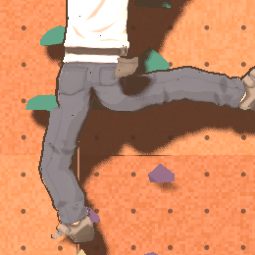 | 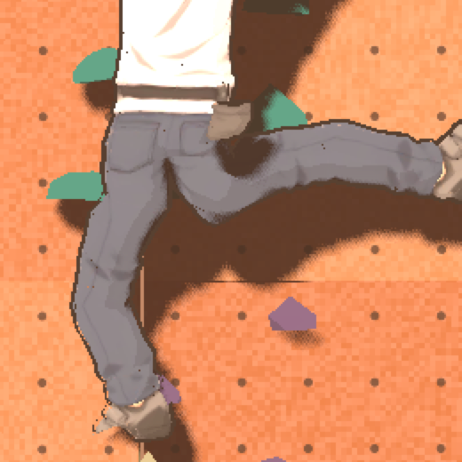 |
| 게임, 하이스텝 | 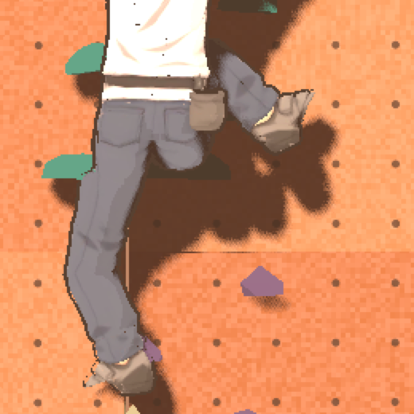 | 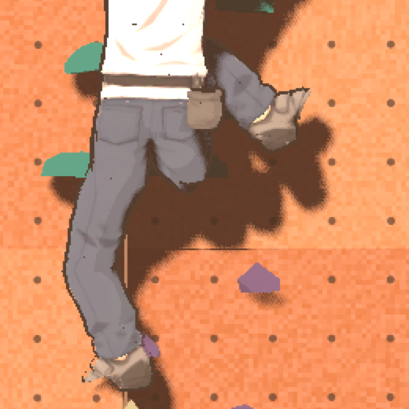 |
| Blender, 옆 85° | 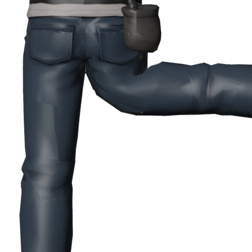 | 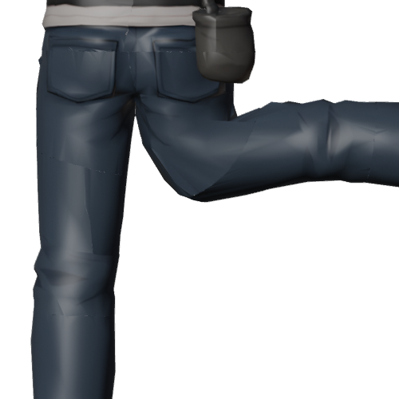 |

모서리 늘어남(Blender, 가랑이·엉덩이 영역 최대, 전 → 후): 옆 90° 2.1 → 2.3배, 옆 60° 1.7 → 1.8배, 앞 90° 1.8 → 2.0배, 하이스텝 2.2 → 2.4배. 늘어남은 비슷하게 두고 모양(꼭짓점 위치, 엉덩이 부피)을 바꾼 것이다.

시험: `test_hip_helper_halfway`(보조 뼈가 중간 회전·엉덩이 관절 위치, 없는 모델은 건너뜀), `test_catalog_matches_model`(모델에 보조 뼈, 부모 골반, 위치 = 엉덩이 관절). 전체 시험 265개 통과. 기기 확인은 아직.

남은 것: 다리를 수평 위로 많이 든 하이스텝은 여전히 엉덩이 아래 주름이 크다. 옷 메시가 T자 기준이라 가랑이 천이 부족한 것이 한계다. 더 고치려면 메시를 다리를 벌린 자세로 다시 만들어야 한다(Tripo 재생성 또는 수작업).

## 7. 엉덩이 높이·캐릭터 교체 (0.9.27-preview)

사용자 요청(2026-11-12~13):
- "엉덩이가 갈라지는 부분이 아직 너무 낮아", 참고 그림 2장(다리가 엉덩이 아래 끝에서 갈라짐). "허리를 낮추지 말고 다리가 시작하는 지점을 높일 수 없어?"
- "엉덩이가 너무 울긋불긋 이상하다, 깔끔한 텍스처로" → 원인은 Tripo 참고 그림 자체(청바지에 진한 주름·그림자를 그려 둠).
- 여성 캐릭터 추가, 남성은 그림자를 지운 그림으로 새로 만든 모델로. 엉덩이골 사이 검은 선 없애기.

### 7.1 화면 다리 관절 올리기
판정 고관절(골반 높이)은 그대로 두고, **화면 다리만** 판정 고관절에서 몸 위쪽으로 `hip_raise` 올린 점(엉덩이 가운데)에서 시작한다. 허벅지는 그만큼 길게 그린다(허벅지+정강이 = 판정 다리 0.785 + hip_raise). 발목(판정 접점)은 그대로라 홀드 위치·닿는 범위·판정은 바뀌지 않는다. 판정 고관절에서 닿는 발은 올린 점에서도 항상 닿는다(삼각부등식).
- `LimbIK.hip_raise / leg_upper_shown / leg_lower_shown`(정적 값, 기본 남성). 화면(`play_3d`)이 모델을 불러올 때 뼈대에서 읽어 `set_leg_shape`로 바꾼다(`CharacterAssembler.leg_shape`).
- `ClimberPose._root`가 다리 뿌리를 올린다. `CharacterAssembler.compatible`은 다리 길이 합·발목 높이로 본다.
- 엉덩이 보조 뼈(§6)는 골반 회전 + 허벅지 방향 변화의 절반만 따르고, 허벅지 길이축 비틀림은 따르지 않는다(크게 들 때 엉덩이 아래가 처지던 것).

### 7.2 모델(`build_tripo_rig.py`, `TRIPO_CHAR=male|female`)
| | 남성 v2 | 여성 |
|---|---|---|
| 원본 | `art_source/character/male`(그림자 지운 그림으로 재생성) | `art_source/character/female`(사용자 그림) |
| 크기 | ×1.9877(키 1.99m) | ×2.0845(키 약 2.08m, 올림머리 포함) |
| 화면 다리 관절 | 판정 고관절 위 0.10 | 0.11 |
| 허벅지 / 정강이 | 0.458 / 0.427 | 0.437 / 0.460 |
| 팔 | 손끝 ×0.981 | 손끝 ×0.866(그림 팔이 길다) |
| 가랑이 | 0.07 올림 | 그대로 |

- 크기는 판정 몸의 어깨(0.67)~발목(−0.785) 1.455m에 맞춘다. 여성은 그림이 다리가 상대적으로 길어 남성보다 약 9cm 크다.
- 원본 메시를 줄이기 전에 같은 위치 정점을 붙인다(UV 경계 틈 → 게임에서 검은 점).
- 엉덩이골 검은 선: 뒤집은 껍데기 윤곽선이 움푹한 골 사이로 비친 것(윤곽선을 끄면 사라짐을 확인). 모델 정점 색 R에 윤곽선 굵기를 넣고(가랑이·엉덩이골 가운데 0), 외곽선 셰이더 `use_vertex_width`가 곱한다.
- 홈 [캐릭터]의 성별 줄에서 남성·여성을 고른다(`characters.json` 몸마다 `model`). 미리보기 모델도 바뀐다.

| | 화면 |
|---|---|
| 남성 v2 게임 | 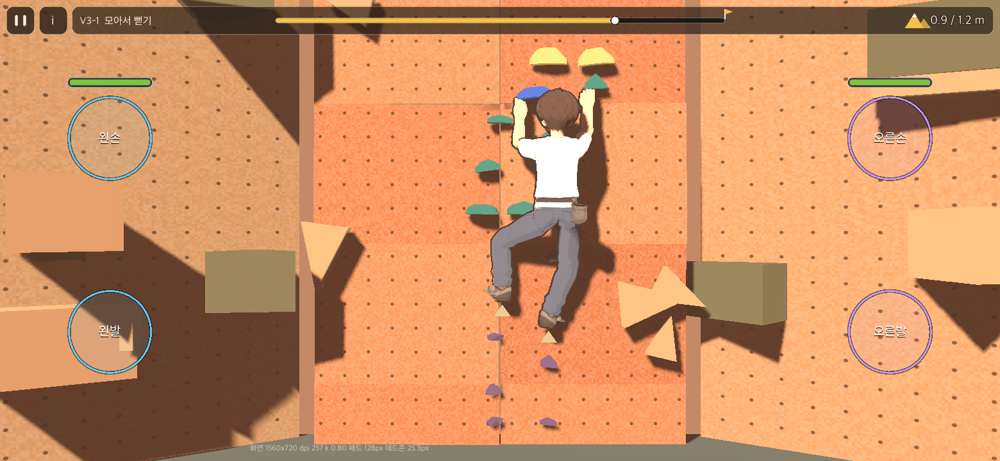 |
| 남성 v2 다리 옆으로 | 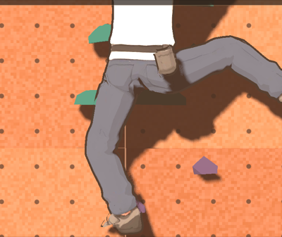 |
| 여성 게임 | 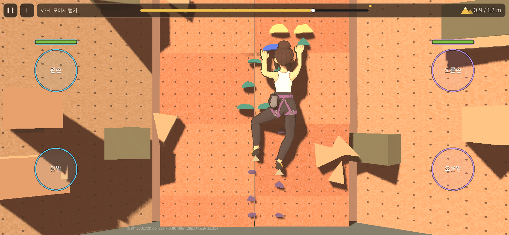 |
| 여성 다리 옆으로 | 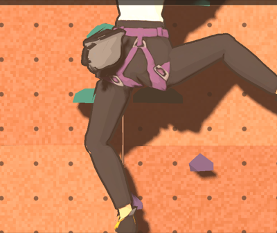 |
| 엉덩이골 선 전 / 후 | 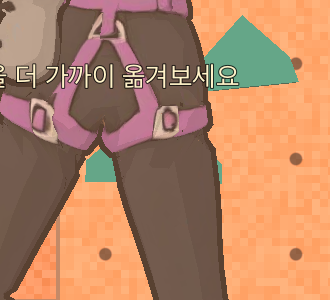 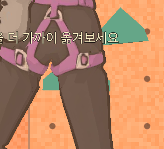 |
| 참고 그림 뒤(전 / 그림자 지움) | 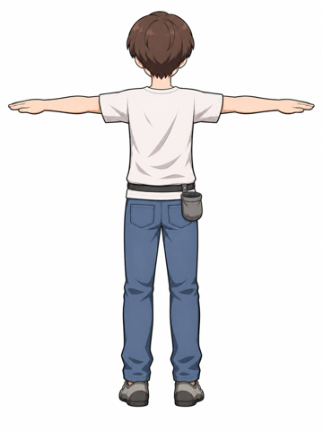 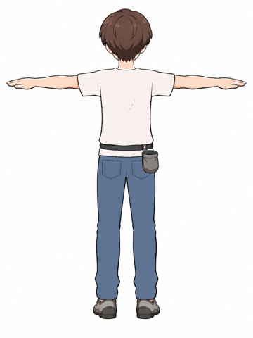 |

시험: `test_catalog_matches_model`(두 모델: 뼈, 위치, 다리 길이 합·발목 높이, 윤곽선 굵기), `test_apply_tripo_shows_body`(성별 바꾸기·몸마다 모델), `test_leg_shape_per_model`(여성 다리로 바꾸면 화면 무릎이 그 길이를 따르고 되돌리면 기본), `test_style_passes_texture`(윤곽선 정점 색). 전체 266개 통과. 기기·홈 캐릭터 화면은 맥에서 띄워 보지 않았다.

남은 것:
- 여성은 남성보다 크게 보인다(판정 몸에 맞춘 결과).
- 남성 v1에 했던 바지 음영 펴기(delight)는 v2에 필요 없어 끈다.
