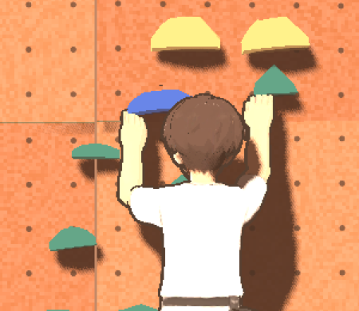
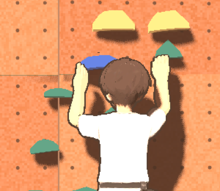

# 38. D패드 조작, 발은 모든 홀드, 손은 홀드 겉면

v0.1 (2026-11-13) — 사용자 요청 4가지를 반영한 기록. 0.9.28-preview.

> 사용자 요청: "실제 게임에 사용하는 디자인 외에는 헷갈리지 않게 다 삭제해. 홀드를 손으로 잡으면 홀드 안으로 들어가서 묻혀. 어차피 게임할 때는 캐릭터 등 뒤에서 보니까 홀드 겉을 잡아도 돼. 발은 모든 홀드를 밟을 수 있어야 하는데 지금 보라색 말고는 못 밟는 것 같아. 합손이 가능한 경우 합발도 가능해야 해. 손 발 버튼은 D패드처럼 만들어서 사용자가 조작하는 방향에 맞춰 움직이게 해줘."

## 1. 손발 패드 = D패드(방향 스틱)

- 패드 가운데(반지름의 22%, 원으로 표시)를 누르면 멈춤. 붙은 손발은 준비(arm) 상태다(전과 같음).
- 가운데 밖을 누르거나 밀면 그 손발을 떼고, **누르고 있는 동안 손가락이 있는 방향으로 계속 움직인다.** 세기는 가운데에서 멀수록 크고(곡선 1.5), 테두리에서 1.1 m/s(감도 1).
- 손가락을 떼면 놓기(잡기 시도). 전과 같다.
- 패드에는 네 방향 화살표와 가운데 원을 그리고, 누르고 있으면 손잡이가 손가락 쪽으로 간다.
- 코드: `InputRouter.stick_mode`(게임에서 켬), `tick(dt)`가 매 틱 move 명령을 만든다. 몸통 끌기는 예전 끌기 방식 그대로.
- 시험: `test_stick_mode_moves_toward_pressed_direction`.

## 2. 발은 모든 홀드, 합발

판정 규칙 변경(사용자 결정).
- 손홀드 슬롯에도 LF·RF를 더한다(`RouteDef._read_slot`). 발 영역 반폭 = 손 영역 반폭(최소 0.04).
- 합손 되는 파란 홀드(`hand_area.matchable`)는 두 발이 같이 딛는다. 두 번째 발은 옆으로 0.05m(왼발 왼쪽, 오른발 오른쪽). 다른 홀드는 한 발만.
- 발이 딛은 홀드는 손으로 잡지 않고, 손이 잡은 홀드는 발로 딛지 않는다.
- 문제 배치(의도 경로)는 그대로 통과한다(전체 시험). 발 선택이 늘어 쉬워질 수 있다. 등급 재검토는 아직 안 했다.
- 시험: `test_feet_on_any_hold_and_match_feet`, 바뀐 기존 시험 4개(손홀드 발 영역, 손이 잡은 손홀드 탭은 OCCUPIED, 비허용 예시를 "손이 발판"으로).

## 3. 손은 홀드 겉면

표현만(판정 그대로). 붙은 손발은 그 홀드 메시의 겉면(벽에서 가장 먼 면) 위에 둔다. 손 접점(손가락 뿌리)은 겉면 + 0.065m(말아 쥔 손가락 끝이 겉면에 닿음), 발목은 겉면 + 0.03m. `ClimberPose.surface_depth`(화면이 홀드를 만들 때 채움).

| 전 | 후 |
|---|---|
|  |  |

## 4. 안 쓰는 디자인 삭제

- 지운 것: 옛 CH02 캐릭터(`game/art/characters/climber.glb`, `art_source/character/build_climber.py`·미리보기), 모듈 시제품(`modular/climber_modular.glb`), 남성 v1 Tripo 원본·참고 그림(`art_source/character/tripo`), 치수 그림 스크립트, 작업용 렌더·화면, 파일 전달용 릴리스(`asset-tripo-rig-wip-20261112`).
- 남긴 것: `art_source/character/build_tripo_rig.py`, `art_source/character/male`(남성 v2 원본·그림), `art_source/character/female`(여성 원본·그림), 게임 모델 2개, 홀드 `holds.glb`.
- 코드: 캐릭터 모델이 없으면 CH02 대신 캡슐 인형. CH02 색 표·모델 시험 삭제(표정 규칙 시험은 남김).
- 옛 문서(docs/34~36 등)의 그림·경로는 기록으로 남긴다.
