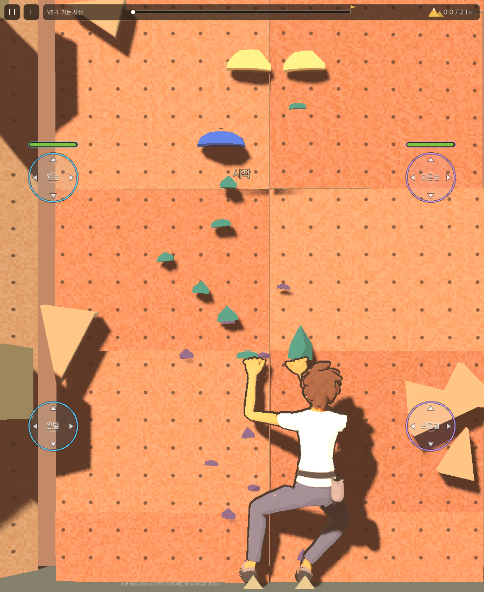

# 40. G_V5_01 "가는 사선" (V5)

v0.1 (2026-11-14) — 사용자 요청: "너가 생각했을 때 굉장히 어려운 난이도라고 생각하는 문제를 내어 줘." 더미 몸(docs/39) 기준. Draft(기기 검증 전).

## 구성

왼쪽 위로 작은 홀드 사선을 타고 오르다가, 높은 발로 일어서 파란 홀드에 두 손을 모은 뒤 오른쪽 위 정상으로 넘어간다. 키 1.71m 몸으로 3.6m 높이.

| 구간 | 이동 | 어려운 점 |
|---|---|---|
| 1 | 왼발 → 왼손 → 오른발 → 왼발 | 반폭 0.05 손홀드, 발을 왼쪽으로 몰아 몸을 옮긴다 |
| 2 크로스(#4) | 오른손이 왼손 너머 H04(반폭 0.04)로 | 크로스 없이는 못 잡는다 |
| 3 | 오른발 → 왼손 H05(왼쪽 끝, 반폭 0.04) → 오른손 H06 | 팔을 거의 다 뻗는 사선 |
| 4 하이스텝(#8) | 왼발을 1.55m(고관절 높이) F07에 올리고 일어서 오른손 H07(반폭 0.04) | 하이스텝 없이는 발이 안 올라간다. 일어설 때 손 사용률 최대 0.77 |
| 5 매치(#12) | 왼손·오른손을 파란 H08에 모은다 | 매치 없이는 두 번째 손이 못 들어온다 |
| 6 | 왼발 → 오른손 H09(오른쪽 위, 반폭 0.04) → 오른발 → 정상 | 왼쪽에서 오른쪽으로 몸을 넘긴다 |

- 손홀드 반폭: 시작 0.06, 파란 0.13, 나머지 0.04~0.05. 발판 반폭 0.04(작게).
- 봇 완등(의도 경로): 33.4초, 이동 18, 도달 여유 최소 0.025m, 최대 손 사용률 0.77, 최저 손 피로 84.
- 필요 기술 검사(docs/28 §7.4): 크로스·하이스텝·매치를 각각 금지하면 그 단계에서 막힌다(국소 검사). 발은 모든 홀드를 딛을 수 있어(docs/38 §2) 다른 길이 있는지는 기기 플레이로 확인한다.
- 열기: V5는 V3(문제 1개) 완등 뒤 열린다(V4 문제 없음, docs/28 §7.2).
- 만든 방법: 홀드 배치 → `tools/route_check.gd`로 봇 재생 → 막히는 이동을 옮기며 반복.

## 체감 결과(2026-11-14)

사용자 플레이: "쉬웠어. 난이도는 V2로 보면 될 것 같아. 홀드도 많아서 기술을 쓰지 않고도 편하게 갔다." 봇으로 다시 확인하니 크로스·매치는 손 순서를 바꾸면 필요 없었다(크로스 금지 완등, 최저 손 피로 82). 원인 분석과 새 설계 방법은 [41](41_route_design_plan.md). 등급 표시는 아직 V5 그대로다(처리 방법 결정 전).
