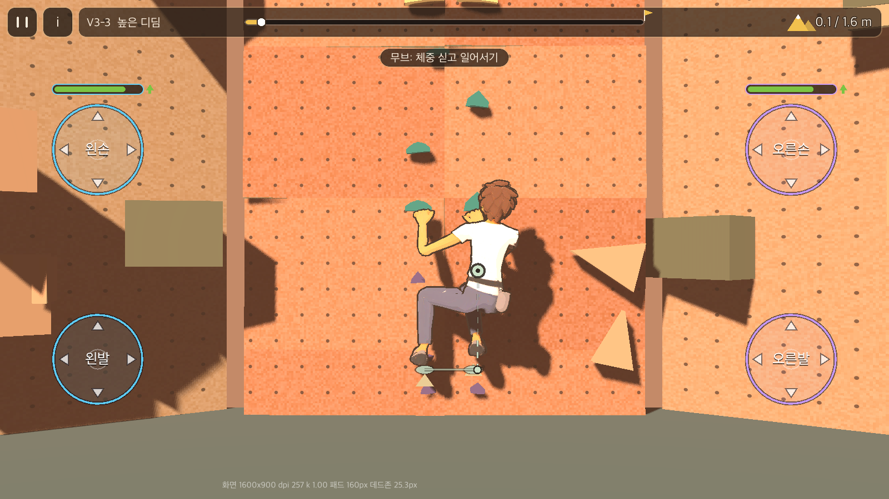
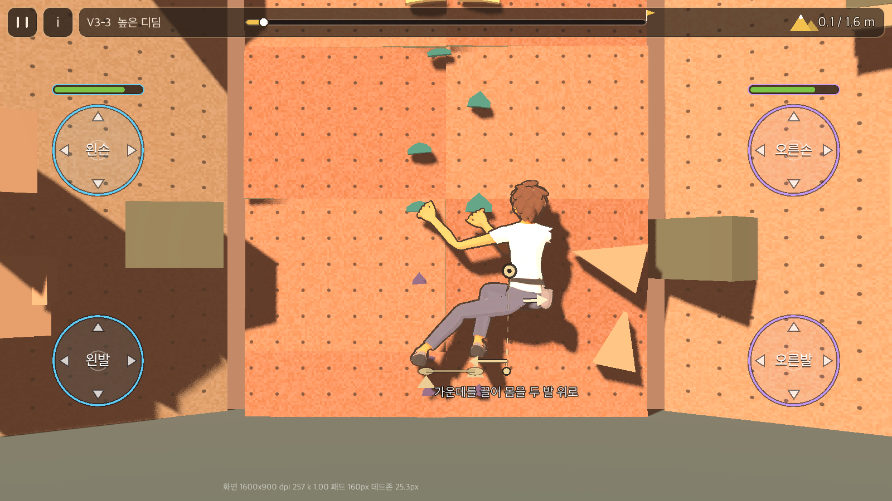
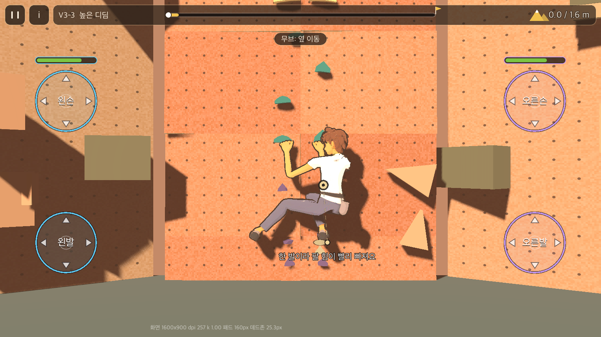
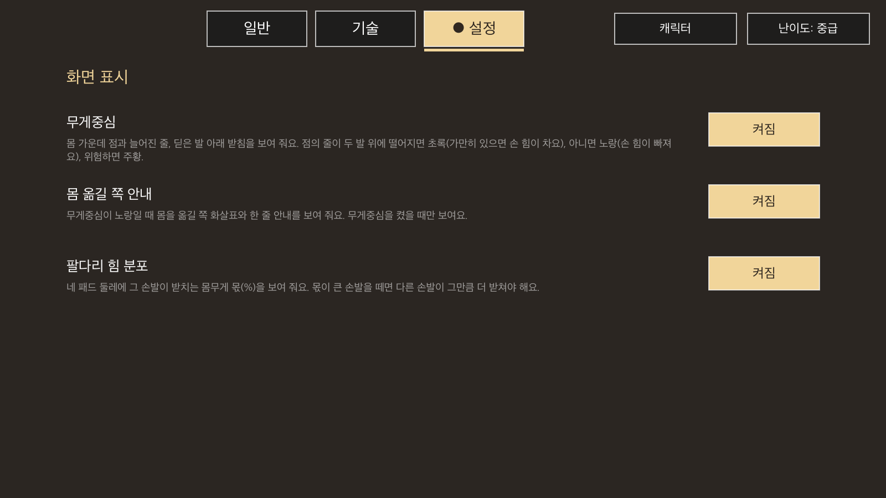
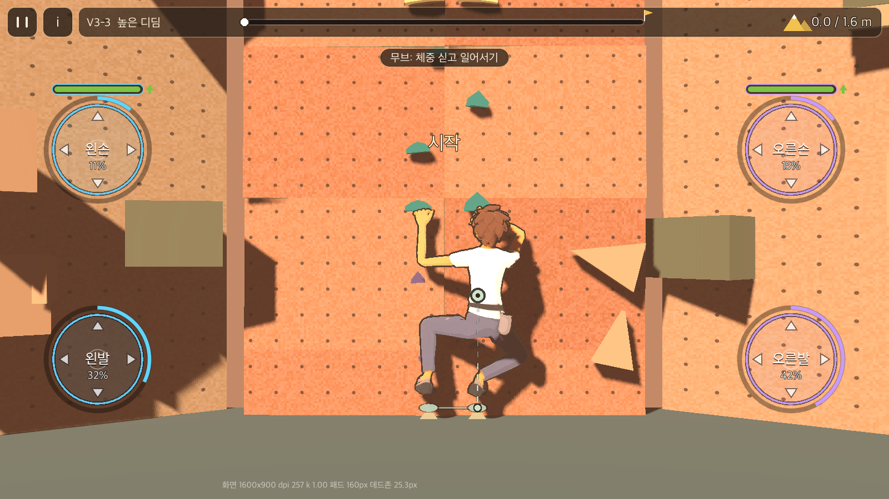

# 49. 무게중심 보이기 기획

v0.1 (2026-11-19). 사용자: "클라이밍을 안 해 본 사용자들이 무게중심이 어디 있는지 가시적으로 보이지 않아 어려워해. 이 부분에 있어 게임 요소들을 해치지 않고 보여 줄 수 있는 방법을 고려해서 기획해 봐."

시안 그림은 실제 게임(G_V3_04, 맥 렌더)에 판정의 실제 무게중심·발 몫으로 그린 것이다(임시 도구, 게임 코드는 바꾸지 않음).

---

## 1. 무엇이 안 보여서 어려운가

클라이밍을 아는 사람은 "엉덩이를 발 위에"를 몸으로 안다. 처음인 사람에게 이 게임은 이렇게 보인다.

- 손 힘이 왜 줄어드는지 모른다. 판정은 이제 발이 몸 아래에 있는지(발 몫, docs/48 R1)로 손 힘이 빠지는 빠르기를 정하는데, 화면에는 줄어드는 막대만 보인다.
- "균형!" 경고가 떠도 몸을 어느 쪽으로 옮겨야 하는지 모른다. 몸통 끌기(가운데 끌기)라는 해결책이 경고와 이어지지 않는다.
- 상세 정보(i)는 손 하중을 숫자로만 준다. 숫자는 처음인 사람에게 뜻이 없다.

**보여 줄 것은 한 가지 관계다: "몸무게(점)가 두 발 위에 있으면 팔이 편하다."** 이 관계가 보이면 하이스텝·몸통 옮기기·발 바꾸기가 왜 필요한지가 같이 보인다.

## 2. 방향 고르기

| 안 | 모습 | 판단 |
|---|---|---|
| A. 숫자·막대(손 하중 %) | 위쪽 패널 | 이미 있음(상세 정보). 처음인 사람에게 뜻이 없다 |
| B. 몸 색 바꾸기(무리하면 붉게) | 캐릭터 | 옷 갈아입기(46)와 툰 색을 해친다. 어디로 옮길지는 여전히 모른다 |
| C. 손발마다 힘 화살표 | 네 손발 | 정확하지만 벽 위가 복잡해진다. 홀드를 가린다 |
| **D. 다림추 + 발 받침** | 몸 가운데 점 하나, 그 아래로 늘어진 점선과 추, 실린 발 아래 받침 점 | **고른다.** 클라이머가 실제로 쓰는 생각(무게를 발 위에)을 그대로 그림으로. 요소 셋, 색 셋 |

클라이밍 코치가 쓰는 말 "다림줄이 발 사이로 떨어지게"를 그대로 옮긴다. 다림추는 늘어진 줄이라 몸이 움직이면 살짝 흔들려, 글을 읽지 않아도 "무게가 매달려 있다"는 느낌을 준다.

## 3. 생김새

| 요소 | 모양 | 뜻 |
|---|---|---|
| 무게중심 점 | 진한 잉크(#302820) 테두리 + 상태 색 + 가운데 잉크 점, 지름 28px | 몸무게가 모인 곳. 판정의 `com`(몸통·팔다리 가중 평균) 그대로 |
| 다림줄 | 점선(10px 간격). 몸 위는 옅게(35%), 몸 아래는 진하게 | 무게가 떨어지는 곳. 몸이 옆으로 움직이면 진자처럼 살짝 흔들렸다 선다 |
| 추 | 작은 잉크 원 + 상태 색, 발판 높이보다 6cm 아래 | 무게가 떨어진 자리 |
| 발 받침 | 실린 발 아래 납작한 타원. **크기 = 그 발의 몫**(발이 몸 아래·덜 펴질수록 큼). 두 발이면 사이를 잇는 띠 | 몸을 받치는 바닥. 추가 이 위에 떨어지면 편하다 |
| 화살표(초급, 팔이 버틸 때) | 추에서 두 발 가운데 쪽으로, 최대 25cm | 몸을 옮길 쪽 = 가운데를 끌 쪽 |
| 짧은 문구(초급만) | 추 아래 한 줄 | "가운데를 끌어 몸을 두 발 위로" / "한 발이라 팔 힘이 빨리 빠져요" / "발이 없어 팔로만 버텨요" |

### 색 세 가지 — 판정과 같은 기준

색은 거리로 정하지 않고 **실제 손 힘 규칙**으로 정한다(시안 1차에서 거리로 정했더니 손 힘이 덜 빠지는 자세에서도 "옮기세요"가 떠서 고쳤다).

| 상태 | 조건 | 색 | 지금 화면의 같은 색 |
|---|---|---|---|
| 편함 | 발 몫 합 ≥ 1.6이고 안정 = 가만히 있으면 손 힘이 차오름 | 연초록 #cfe3c8 | 상태 "안정" |
| 팔이 버팀 | 그 밖(발 몫 부족·부담 큼) = 손 힘이 빠짐 | 노랑 #f1d59a | 상태 "부담 큼" |
| 위험 | 균형 회복 중·지지 없음 | 주황 #ff8a6a | 상태 "균형 회복 중" |

새 색을 만들지 않고 위쪽 상태 표시의 색을 그대로 쓴다. 그래서 위쪽 글자와 몸 가운데 점이 같은 말을 한다.

## 4. 게임을 해치지 않는 규칙

1. **홀드를 가리지 않는다.** 받침·추는 발판 높이보다 6cm 아래에 그리고, 홀드 그림과 겹치는 구간은 띠를 끊는다(시안에서 출발 발판 표시와 겹친 것 확인 → 끊기 필요). 홀드 빛(잡을 수 있음·목표)이 언제나 위에 그려진다.
2. **움직일 때만 진하게.** 손발이나 몸통을 끄는 동안과 놓은 뒤 1.5초는 100%, 가만히 있고 편하면 1.5초 뒤 30%로 흐려진다. 노랑·주황일 때는 흐려지지 않는다.
3. **난이도마다 다르게.**

| 난이도 | 보임 |
|---|---|
| 초급 | 늘 보임 + 화살표 + 짧은 문구 |
| 중급 | 끄는 동안·놓은 뒤 1.5초·노랑/주황일 때만. 화살표·문구 없음 |
| 고급 | 상세 정보(i)를 켰을 때만 |
| 상세 정보(i) | 모든 난이도에서 늘 보임 + 발 몫 숫자(받침 옆 "0.8") |

4. 일시정지 메뉴에 "무게중심 보기: 자동 / 늘 / 끄기"(기본 자동 = 위 표).
5. 위험 경고(붉은 고리·"균형!")가 뜨면 받침·추는 그대로 두고 문구만 숨긴다(경고 문구와 겹치지 않게).
6. 3D 캐릭터 위에 2D로 겹쳐 그린다. 몸 위 구간의 줄은 옅게 해 옷·얼굴을 덮지 않는다. 무게중심 점은 진한 테두리라 흰 옷 위에서도 보인다(시안 1차의 흰 고리는 흰 티 위에서 안 보였다).

## 5. 처음 알려 주기

- 수업 2 "몸통 옮기기"(C_BODY) 첫 단계를 바꾼다: "몸 가운데 점이 몸무게예요. 점에서 늘어진 줄이 두 발 위에 떨어지면 팔이 편해요. 가운데를 끌어 점을 옮겨 보세요." → 목표: 노랑에서 연초록으로 바꾸기(새 단계 목표 `balance_ok`).
- 수업 3 "팔 힘과 쉬기"의 한 발 떼기 단계에서 받침이 줄어드는 것을 가리킨다: "발을 떼면 받침이 작아지고 점이 노랗게 바뀌어요."
- 일반 문제에서 처음 노랑이 2초 넘게 이어지면 한 번만: "몸이 발 위에 없으면 팔 힘이 빨리 빠져요. 가운데를 끌어 보세요."(42 §4.4 한 번 안내)

## 6. 만들 것

| 할 일 | 곳 |
|---|---|
| 그리기 함수 `_draw_balance()`(시안 코드 정리) | `scenes/play_test.gd` |
| 상태 판정 `balance_state()` → ok/strain/danger, 발 몫 목록, 무게중심 | `ClimbSession`(시험 가능하게) |
| 진자 흔들림(무게중심 x 변화 → 감쇠 진동, 화면만) | 그리기 쪽 |
| 홀드와 겹치는 구간 끊기 | 그리기 쪽(홀드 화면 위치·크기 사용) |
| 난이도별 보임·흐려짐·설정 | `play_test.gd`, 설정 저장 |
| 수업 문구·`balance_ok` 목표 | `tools/lessons/gen_basic_lessons.py`, `TutorialRunner` |
| 시험 | 상태가 손 힘 규칙과 같은지(편함이면 손 힘 증가), 난이도별 보임 |

## 7. 고르지 않은 것

- 손 하중 숫자를 늘 보이기: 처음인 사람에게 뜻이 없고 위쪽 패널이 붐빈다(상세 정보에 그대로 둔다).
- 바닥 그림자처럼 3D로 그리기: 벽이 수직이라 그림자가 벽에 생기지 않고, 오버행(48 R2)에서 다시 바뀐다. 2D 겹쳐 그리기가 오버행에서도 같은 뜻으로 남는다.
- 손발 힘 화살표: 정확하지만 벽 위가 복잡하고 홀드를 가린다.

---

## 8. v0.2 적용 (2026-11-19, 0.9.50)

사용자: "난이도에 따른 구분을 하지 말고 설정 탭에서 on/off로 할 수 있도록 해 줘. 무게중심, 분산된 하중에 따라 팔다리에 힘의 분포 두 가지를 나누어 on/off 기능으로 하고, 필요한 경우 추가해. 추가하면 이 또한 별도 설정값으로 켜고 끌 수 있게 만들어."

- **난이도별 보임(4장 3번 표)은 없앴다.** 홈에 **설정** 탭을 더하고 표시마다 켜짐/꺼짐 하나씩. 저장된다(`Progress.display`).

| 설정 | 기본 | 내용 |
|---|---|---|
| 무게중심 | 켜짐 | 다림추 + 발 받침(3장). 색은 손 힘 규칙과 같음 |
| 몸 옮길 쪽 안내 | 켜짐 | **추가.** 노랑일 때 화살표와 한 줄 문구. 난이도로 나누던 것을 따로 켜고 끄게 뺐다. 무게중심이 꺼져 있으면 안 보인다 |
| 팔다리 힘 분포 | 꺼짐 | 네 패드 둘레의 호와 %: 그 손발이 받치는 몸무게 몫(합 100%). 벽 위에는 그리지 않아 홀드를 가리지 않는다. 패드 색 = 손발 색 |

- 힘 분포의 몫: 힘 계산의 접점 힘 크기를 합으로 나눈 비율. 크기 그대로면 옆으로 서로 상쇄되는 성분 때문에 합이 112%처럼 1을 넘어서, 처음 보는 사람이 알기 쉽게 비율로 했다.
- 흐려짐(가만히 있으면 30%)은 이번에 넣지 않았다. 켜고 끄기가 생겨서 우선 늘 보이게 두고, 써 보고 정한다.
- 수업 문구·`balance_ok` 목표(5장)는 아직이다.
- 시험: 설정 기본값·저장·모르는 키 버림, 균형 상태가 손 힘 규칙과 같음, 한 발이면 편하지 않음, 몫의 합 100%.

## 9. 팔다리 힘 분포 → 뼈대 막대 (2026-11-19, 0.9.51)

사용자: "네 개의 팔다리에 각각 적용되는 하중이 팔다리에 스켈레톤 형식으로 작대기가 표시되어 색깔로 보여 줬으면 좋겠어." 시안([1](images/skeleton_loads_1.png), [2](images/skeleton_loads_2.png))을 보고 "1번(패드 호를 뼈대로 바꾸기) 너무 좋아. 색도 좋고 숫자도 좋아. 적용하자."

- 패드 둘레 호는 지우고, 설정 "팔다리 힘 분포"가 뼈대 막대를 그린다.
- 막대: 3D 캐릭터의 실제 뼈(팔 upperarm·forearm·hand, 다리 thigh·shin·foot 뼈의 시작점)를 화면으로 옮긴 점(`play_3d.limb_chain_screen`). 3D가 없으면 판정 관절로.
- 색: 그 손발 몫(합 100%) 0% #dcd6cc → 15% #8fd18a → 35% #f3c94f → 55% 이상 #f0663f(사이는 섞음). 진한 테두리. 뗀 손발은 가는 흰 막대 + "–".
- 숫자: 팔은 팔꿈치 바깥 위, 다리는 무릎 바깥 아래(시안 1차에서 오른팔 13%·오른다리 30%가 겹쳐 "130%"로 보였다).
